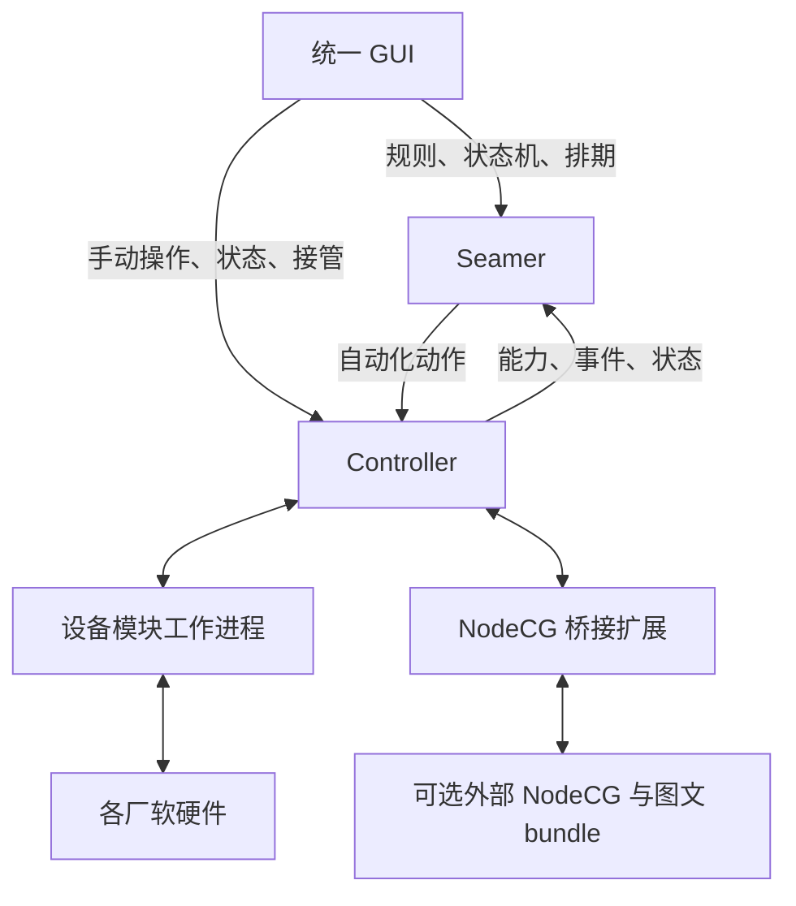

# LeafSeamer Rebirth 完整设计稿

- 日期：2026-10-17（Asia/Tokyo）。
- 状态：供整体审阅的设计稿；产品决策已逐轮确认，接口及实现细节尚未冻结。
- 当前工作分支：`rebirth`。本文在 Suite 维护；引用的旧源码固定到 Legacy 最终提交，新版尚未实现。
- 当前范围：继续设计定稿，不修改业务代码；用户已另行授权旧仓改名停维护、最终推送及推送核验后的本地目录重整。[LeafSeamer 组织](https://github.com/LeafSeamer) 与五个公开仓库已创建并标记施工中；旧版最终推送及本地五仓目录已完成，详见 [交接记录](LEGACY_HANDOVER.md)。
- 配套文件：[整体审阅与待落实事项](rebirth-review.md)。

## 1. 目标、依据与适用范围

LeafSeamer 是总项目品牌。新版由 GUI、Seamer 自动化核心、Controller 设备控制平台、SDK 四个独立组件组成，以套件仓库组织部署与整套验收。Controller 可独立使用；Seamer 通过公共能力 API 编排它，GUI 为两者提供统一操作台。

本稿以本次会话 Q1—Q44 及用户后续修正为需求依据。下文“已确认”表示用户已决定的产品约束；“设计细化建议”表示为使方案可评审而提出的接口或实现方向，仍须完成专项技术审阅；“待落实”不等于已经执行外部操作。

### 1.1 旧仓参考事实（固定于 Legacy 最终提交）

- 根 [package.json](https://github.com/ikenainanodesu/leafseamer-legacy/blob/5d60491d7158f87fc27b564f510d321074aedac9/package.json) 当前为 1.1.3，启动入口仍为 NodeCG，声明 MIT 许可；18 个工作区 bundle 已按其 package.json 核实。
- [现有触发器](https://github.com/ikenainanodesu/leafseamer-legacy/blob/5d60491d7158f87fc27b564f510d321074aedac9/bundles/seamer/extension/trigger-manager.ts) 监听状态变化并延迟派发动作；新版的持久执行记录、显式状态机和接管机制不能视为现有能力。
- [现有注册表](https://github.com/ikenainanodesu/leafseamer-legacy/blob/5d60491d7158f87fc27b564f510d321074aedac9/bundles/seamer/extension/integration-registry.ts) 已提供能力注册、状态发布和动作分派；[共享类型](https://github.com/ikenainanodesu/leafseamer-legacy/blob/5d60491d7158f87fc27b564f510d321074aedac9/shared/integration/types.ts) 是新契约的参考材料，不是无需修改即可公开的新版协议。
- [当前数据库适配器](https://github.com/ikenainanodesu/leafseamer-legacy/blob/5d60491d7158f87fc27b564f510d321074aedac9/bundles/database-postgresql/src/database-adapter.ts) 仍要求 PostgreSQL；[现有 LICENSE](https://github.com/ikenainanodesu/leafseamer-legacy/blob/5d60491d7158f87fc27b564f510d321074aedac9/LICENSE) 仍为 MIT。本稿不会改变这两个运行及许可事实。
- 本轮开始前已有指令、开发日志、忽略规则和索引资产改动；本次文档变更不得覆盖这些既有工作。

### 1.2 明确不包含的工作

首期不设计断网自治、离线队列及断网任务补发；不做集群、主备或多个 Seamer 同时调度同一组设备；不承诺帧级多设备同步；不做多租户、企业 SSO、社交登录或通用脚本编程画布。基本连接状态、失败反馈和服务重启处理仍是必要能力。

旧数据不迁移。新版空库启动，仅提供迁移建议文档；旧库、配置和秘密保持原状，废弃数据的决定不授权删除。功能保留与代码历史追溯继续有效。

## 2. 已确认决策登记

| 决策 | 最终约束 |
| --- | --- |
| Q1 | 本期不考虑断网自治；不能以此推导无需报告连接失败。 |
| Q2 | 简单触发规则与显式状态机共存。 |
| Q3 | GUI 是统一操作台，SDK 支持后续界面及模块扩展。 |
| Q4 | 保留业务功能；GUI 脱离 NodeCG 重新制作。 |
| Q5 | SDK 优先规范 Seamer API，模块声明 Trigger 和 Action 能力。 |
| Q6 | Controller 是可独立操作各厂软硬件的控制产品，SDK 指导设备接入；Seamer 自动化调用 Controller。 |
| Q7 | 能力声明、实际事件、用户自动化规则分开；模块提供事实，Seamer 处理规则。 |
| Q8 | 动作声明参数、结果、执行生命周期、完成依据、超时、重试及可选取消能力。 |
| Q9 | GUI 使用声明式通用界面及可选专用面板；无界面模块也能参加自动化。 |
| Q10 | 区分模块类型、运行实例、设备身份及能力版本；失效引用不静默改绑。 |
| Q11 | 同一 GUI 支持仅 Controller 及完整套件模式。 |
| Q12 | Controller 按资源协调冲突；手动接管优先。 |
| Q13 | 动作默认顺序执行，显式并行组；失败默认停止，其他策略显式配置。 |
| Q14 | Organization 下四个独立组件仓库及一个套件仓库，初期不强制 Submodule。 |
| Q15 | 组件独立版本；套件锁定通过整套验证的组合。 |
| Q16 | 尽可能保留相关历史；新版 Apache-2.0 主许可，保留必要旧代码及第三方声明。 |
| Q17 | 状态、事件转换、条件及动作；支持进入、退出及转换动作，首期不做嵌套状态或并行状态区域。 |
| Q18 | 接管持续到明确释放；阻止相关自动化写入；释放不补发错过动作。 |
| Q19 | 重启恢复定义和记录，执行中动作标为中断或结果未知；默认不自动续跑或补排期。 |
| Q20 | 设备适配模块按类型运行于独立工作进程，一进程可管理多台同类设备；不等于安全沙箱。 |
| Q21 | 单组织、多用户角色与受限服务身份，Controller 独立认证授权。 |
| Q22 | 一个 Seamer 接入多个 Controller；一个设备实例由一个 Controller 管理；多 GUI 用户可并发。 |
| Q23 | HTTP 管理和命令 API＋WebSocket 状态和事件；补充指定 NTP 时间源同步。 |
| Q24 | 服务数据所有权隔离；后续明确改选 SQLite，先前保留 PostgreSQL 的建议已失效。 |
| Q25 | 官方面板随 GUI 构建；第三方面板采用声明式描述或受限 iframe 扩展接口。 |
| Q26 | 排期归 Seamer；日志归各服务；备份由 Suite 编排；图文改为外部 NodeCG 兼容入口。 |
| Q27 | NTP 用于统一时间戳、审计和普通排期，不承诺帧级同步。 |
| Q28 | 可选独立 NodeCG 实例＋桥接扩展＋Controller 适配模块。 |
| Q29 | 后续明确免除旧数据迁移：空库启动，只保留建议文档，不开发迁移工具。 |
| Q30 | 首期支持 Windows／Linux、容器及原生路径；模块声明平台与外部依赖。 |
| Q31 | 完整套件统一登录，独立 Controller 支持本地账户；明确配对建立信任。 |
| Q32 | 时间质量不合格时阻止绝对时间排期；手动、普通事件和相对延迟允许；恢复不补发。 |
| Q33 | 设备工作台＋自动化工作台，结构化状态机编辑及辅助关系图，首期无自由编程画布。 |
| Q34 | 最小闭环、全部功能覆盖、整套发布验收三阶段；模拟结果与真机结果分开记录。 |
| Q35 | 首期整台设备接管；Controller 确认门控生效，版本变化使旧自动化失效；细粒度接管列入路线图。 |
| Q36 | 未派发取消，已派发按模块能力处理；未知结果不伪报取消，迟到结果不恢复流程。 |
| Q37 | 区分业务、转换及设备状态；退出／转换／进入必需动作成功后提交目标状态，失败暂停实例。 |
| Q38 | SDK 声明完成证据，规则指定标准；发送／应答／效果核实不混同，降低标准必须显式。 |
| Q39 | 部分失败保留真实副作用，默认停止、不回滚、不重放；补偿须显式配置并受接管约束。 |
| Q40 | 写命令默认不自动重试；仅声明安全条件、错误分类、次数及截止期限后允许；未知结果先查询，同一请求身份返回既有执行记录。 |
| Q41 | 恢复前核对现状、逐步结果和执行预览；只明确恢复仍必要的失败／未执行步骤，不重放成功步骤；释放接管不等于恢复。 |
| Q42 | 每台设备同一时刻一名手动控制者；转交经对方接受后原子切换控制版本；紧急接管需相应权限，退出或超时不自动释放。 |
| Q43 | 并行组失败后停止尚未派发与后续步骤，收集在途结果；仅按声明安全取消，未知结果阻止相关恢复，不默认补偿。 |
| Q44 | 仅独立动作可并行，冲突、依赖或未知资源范围不开放并行；预检和派发复核不是多设备事务，播出动作优先准备、核实再切出。 |

## 3. 仓库与产品边界

### 3.1 目标仓库

以下五仓已在 [LeafSeamer 组织](https://github.com/LeafSeamer) 创建，均公开并标记施工中；创建仓库不代表组件实现或验收完成。

| 仓库 | 权威职责 | 独立交付 |
| --- | --- | --- |
| `leafseamer` | Seamer 规则、状态机、排期、能力引用、运行记录 | 自动化服务 |
| `leafseamer-controller` | 设备、适配模块、连接、命令、接管、凭据 | 控制服务及官方模块 |
| `leafseamer-gui` | 统一操作台、声明式字段、官方专用面板、扩展容器 | Web 应用 |
| `leafseamer-sdk` | 公共契约、客户端、模块开发接口、界面扩展接口及契约测试 | 版本化软件包和协议说明 |
| `leafseamer-suite` | 总入口、兼容清单、Nginx／部署配置、整套验收、备份恢复编排 | 套件发行 |

组件不能跨仓库导入其他组件的内部源码。SDK 以软件包及协议版本引用；Suite 记录源码提交、发布版本、产物摘要和兼容范围。相同版本号不是跨组件兼容证明。Submodule 可在未来作为整套源码检出方式，不是首期依赖或部署前提。

当前本地 `LeafSeamer` 大小写与目标核心仓库名重合；旧仓归属、历史提取及本地路径要先制定映射，不能靠大小写改名区分。五个新仓库已各自建立 `rebirth` 分支；旧仓 `rebirth` 随完整旧工作区保留。

### 3.2 运行关系

图中为逻辑调用关系，不指定 WebSocket 发起方向或实际代理路径。服务网络必须可达；Nginx 提供入口代理，不解决现场设备网络可达性。一个 Seamer 可连接多个 Controller；GUI 关闭不影响服务执行。Controller 不依赖 Seamer 才能连接设备或手动控制。

非设备数据源可通过 Seamer 扩展接口提供事件与状态。设备协议仅由 Controller 模块实现，不能同时在 Seamer 中维护另一套驱动。SDK 是库和契约，不是必须部署的中心服务。

## 4. SDK 与公共 API

### 4.1 已确认的契约职责

- 通用契约：身份、能力、参数及结果结构、版本、错误、事件、状态与时间质量。
- Seamer 接口：能力提供者注册、目录更新、状态及事件接收、规则和状态机管理、运行查询。
- Controller 接口：设备模块生命周期、设备能力、控制、资源协调及状态采集。
- GUI 扩展接口：通用表单、动态目录、专用面板、选中设备上下文、主题和生命周期。
- SDK 优先面向 Seamer 能力模型；线上协议与语言无关，TypeScript SDK 为首选实现方向，具体分包及工具链待技术设计。

模块注册描述“可以发生什么、可以执行什么”；事件报告“发生了什么”；用户规则决定“对此如何处理”。三者不得混为一次注册请求。Controller 发布能力后，Seamer 获取并校验目录，用户无需重复录入定义。

### 4.2 设计细化建议：身份与版本

| 对象 | 建议身份与语义 |
| --- | --- |
| 模块类型 | 稳定模块 ID，与显示名称分开 |
| 运行节点 | Controller ID、模块实例 ID及进程启动身份 |
| 设备 | 稳定设备 ID，连接地址和别名不充当唯一业务身份 |
| 能力 | 提供者、能力 ID、兼容版本及参数／结果 Schema |
| 动作与流程 | 分别拥有执行 ID；关联 ID用于追踪，不自动等同去重键 |
| 事件与状态 | 事件 ID、来源内序号、状态版本及时间质量 |

以上字段名与编码尚未冻结。重启、模块升级及设备改名不能默默改变规则绑定；能力消失或不兼容时保留可解释的失效引用并阻止有关执行。能力发布和更新必须受提供者身份及权限约束。

### 4.3 API 传输与状态同步

HTTP 用于管理、查询和命令提交；命令受理返回执行身份，最终结果可查询并通过 WebSocket 发布。WebSocket 传输状态、事件和执行进度；GUI 不读数据库或直接调用设备协议。

首次订阅需要快照及后续增量。设计细化建议：快照带版本水位，增量带来源序号；检测间隙后明确重新取快照，而不是假装状态完整。这是运行中同步完整性，不是离线事件补发或离线自治。

正式 API 路径、Schema 格式、分页、事件保留、订阅范围、大小限制、错误码、超时及兼容窗口待冻结。第一版不承诺跨来源全局事件顺序，也不承诺设备副作用“恰好一次”。

## 5. Seamer 规则、状态机与执行

简单规则支持事件／状态条件、阈值及组合、相对延迟和动作；具体操作符集合需从旧能力清单提取并测试。状态机拥有显式状态、转换事件、守卫条件和进入／退出／转换动作。首期不做嵌套状态、并行状态区域或任意脚本节点。

动作默认顺序执行，明确的并行组才并行。每步指定所需完成依据；失败默认停止，重试、跳过、继续及补偿必须显式配置。动作“已受理”“协议已发送”“设备已应答”“状态已核实”不等价。没有确认能力的模块可以声明发送级完成，但 UI 和记录必须准确标明。

动作应覆盖受理、执行中、成功、失败、结果未知等语义；取消只在模块支持时开放。配置了超时并不代表设备未执行；是否可重试由动作语义、去重策略和设备反馈共同决定。

设计细化建议：每次运行绑定一份定义版本，编辑后的定义仅作用于新运行；因果链、运行 ID及有限执行预算用于检测自动化反馈循环。规则重复触发、多事件仲裁、循环保护及运行配置激活仍须专项定稿；失败恢复与并行组失败方向已由 Q40—Q44 确认，具体接口与竞态验证仍待落实。

Q37—Q39 已确认：业务状态、转换执行状态及设备实际状态分别记录。执行顺序固定为校验条件、退出动作、转换动作、进入动作、提交目标状态、发布转换完成事件；进入动作属于提交目标状态前的准备阶段。必需动作全部达到声明的完成标准后才提交目标状态。同一状态机实例转换期间不启动第二条转换；失败后暂停该实例，显示最后完成状态、未完成转换及真实设备状态，不能按旧状态继续正常执行。

SDK 声明“已发送”“设备应答”“效果已确认”等证据，设备应答是否等于完成由模块明确说明。关键动作默认要求足以证明目标效果的反馈；无反馈模块可接入，但接受发送级标准须显式配置，界面显示效果未验证。不得用发送前的缓存状态证明本次完成。

部分成功后失败时保留已发生副作用，停止后续动作，不提交目标状态、不默认回滚或从头重放。结果未知与明确失败分开。补偿属于新设备操作，必须显式配置且遵守接管限制，不保证恢复原状。

Q40—Q41 已确认：写命令默认不自动重试。例外须由能力和策略明确约束安全错误类别、最大次数及截止期限，并在每次派发前重新校验权限、接管版本和动作条件；结果未知时先查询，不能以超时作为设备未执行的证据。同一请求身份的重复提交关联既有记录，不产生新设备动作；重试尝试与逻辑动作身份需要区分。恢复入口展示设备现状、每步完成证据和拟执行预览，仅执行仍必要且获明确确认的失败／未执行步骤，保留成功步骤。释放接管与恢复流程是两个操作；人工校正业务状态不自动触发进入动作。

Q43—Q44 已确认：并行组出现失败时，停止尚未派发的组内动作及后续流程；已派发动作继续收集结果，只对声明支持安全取消的动作发起取消。保留部分成功与未知结果，未知结果未处理前不恢复相关执行，不默认回滚或补偿。只有无冲突、无先后依赖且资源范围明确的动作可组成并行组；未知范围按保守冲突处理。预检后仍需派发复核，不承诺跨设备原子提交。影响播出的流程优先采用准备、核实、切出阶段，具体设备是否支持必须由能力声明和验证证明。

服务重启恢复定义、状态和记录，执行中任务标为中断或结果未知。先获取设备现状，再由用户明确决定恢复、跳过或重启；不默认自动续跑。错过排期不补执行。数据库提交与设备副作用不是一个事务，不能用本地事务声称设备执行可回滚。

## 6. Controller、接管与模块隔离

Controller 主服务负责认证、设备注册、能力汇总、命令调度、接管状态、审计与持久化。模块按类型运行于独立工作进程，一进程可管理多台同类设备，负责厂商协议、采集及反馈。进程隔离主要减少故障影响，不是运行不可信代码的安全沙箱。

设备模块通过 SDK 声明连接参数、能力、参数单位及范围、完成依据、可取消性、重试属性、冲突资源、平台支持和外部依赖。生命周期需涵盖启动、就绪、停止及异常报告；重启模块不得自动重放未决动作。协议差异和型号限制必须保留，不能只保留通用最低能力。

普通瞬时命令按冲突资源排序，不同资源可并行。持续动作声明资源占用及可抢占性。手动接管优先，并持续到明确释放；接管范围内的新自动化写入被拒绝，Seamer 显示阻止原因且不无限重试。释放后不补发旧动作。

Q35—Q36 已确认：首期默认整台设备实例接管；Controller 更新控制版本、使旧版本未派发自动化失效，并保证实际派发前检查接管及版本后，才返回接管已生效。释放也更新版本，旧动作不能复活。接管生效不等于在途动作清零；版本判断不依赖 NTP 时间戳。

未派发自动化作废；已派发动作仅在模块支持时请求取消，确认前仍算在途。不可取消动作继续观察，后续自动化不再派发。超时无法确认结果时标为未知；迟到回执可补充记录与设备状态，不能恢复已被接管中断的流程。同一冲突资源上的手动操作默认等待在途完成或取消确认；超时进入显式人工处理，不能无限静默排队。立即停止或覆盖须由模块声明对应设备能力，不能以终止工作进程声称设备已停止。

Q42 已确认：每台设备同一时刻仅一名手动控制者。正常转交由现持有人发起、接收者接受后，Controller 原子切换持有人与控制版本；接受前仍由原持有人控制，旧持有人的待派发命令随后失效。在途动作继续遵循 Q36，转交不等于取消已发送命令。有紧急接管权限的用户可强制接管并留下审计，普通用户不得抢占；退出、页面关闭或超时不自动释放设备，也不恢复自动化。

设计细化建议：持久化已确认接管并在重启后恢复限制；具体存储及故障语义仍待冻结。细粒度冲突资源接管属于第 13 节路线图，不能宣传为首期已有能力。

## 7. SQLite 与数据管理

已确定采用 SQLite，替代新版运行数据库的 PostgreSQL 方案。Seamer 和每个 Controller 各自拥有本地库；GUI 仅保存界面偏好，SDK 不拥有运行数据。主服务统一写库，模块通过内部接口提交数据，不直接竞争写数据库文件。

- Seamer：规则、状态机、排期、能力引用、运行与审计记录。
- Controller：设备、模块配置、加密秘密或秘密引用、接管状态、命令与审计记录。
- 高速电平、频繁矩阵刷新等默认保留内存状态或聚合结果，不逐条落库。
- 使用短事务和有界队列；数据库放本地持久卷，不把 WAL 数据库通过网络共享给多台主机。
- 运行备份使用 SQLite 备份接口或完整停机流程；不能只复制正在写入的主数据库文件。
- Suite 编排各服务备份及版本清单；多库备份不自动构成同一时刻的全局事务快照。
- 秘密主密钥与数据库分开管理；普通导出脱敏；加密备份及密钥恢复路径须单独验证。

SQLite 写并发及 WAL 边界见官方资料 [S1]、[S2]；备份接口见 [S3]。选型基于配置、小事务和执行记录用途，不是本项目已经完成的性能结论。DuckDB 暂不引入，可在以后有明确分析需求时评估 [S4]。

新版空库启动，不自动连接旧库或导入旧秘密。不实现旧数据迁移工具，仅写人工迁移建议和不可直接复用项；此决定不授权删除旧数据，也不免除新版自身的 Schema 升级、备份和恢复能力。

## 8. 时间模型与 NTP

各服务通过统一时钟接口对接指定 NTP 时间源，API 和 GUI 可查询同步状态、来源、最近同步、偏移及误差估计。支持配置能力不代表同步成功；NTP 原理及测量依据见 [S5]。

API 时间采用统一 UTC 表示，区分设备发生时间、采集时间和服务接收时间；设备无可信时钟时不得伪造发生时间。来源内序号和启动身份用于顺序判断，跨机器单调时钟不能直接互相比大小。超时和相对持续时间使用本地单调时钟。

| 时间状态下的操作 | 已确认行为 |
| --- | --- |
| 手动即时操作 | 允许，附带时间质量 |
| 普通事件及相对延迟 | 允许，不能把不可信 UTC 当作可信比较依据 |
| 依赖绝对时间的排期 | 同步质量不合格时阻止派发 |
| 恢复同步后的错过排期 | 标记错过，不补发 |
| 审计 | 保留时间质量、来源身份与顺序信息 |

应用默认不修改宿主机系统时间，浏览器不直接访问 NTP。实际采用系统时间服务对接还是应用层校时提供器、时间单位、阈值、有效期、平滑策略和可配置服务器集合待技术验证；不得静默改用未配置的外部时间源。

排期需保存计划时间、派发时间及反馈时间，以观察调度与设备延迟。校时不能造成同一排期重复派发；时区、夏令时、时间跳变和重复触发的处理必须进入测试。首期不承诺帧级动作同步。

## 9. GUI 与身份

GUI 包含设备工作台和自动化工作台。设备侧显示连接、状态、专用面板、接管及动作结果；自动化侧显示规则、状态机、排期、运行步骤和失败原因。状态机以状态列表、转换表、动作序列为主，关系图辅助理解。

声明式参数支持类型、单位、范围、动态选项目录、级联依赖和条件显示；显示 label 与持久化 ID分离。无效引用不能静默选第一项。第三方不提供面板时，仍可以完整注册能力并使用通用表单。

官方面板随 GUI 构建并使用公共 SDK；第三方自定义面板使用受限 iframe 和消息契约。面板只获得授权能力，不拿设备凭据或任意访问 GUI 内部接口。独立来源、sandbox 权限、消息来源校验、权限撤销和凭据隔离方案待安全设计，不以 iframe 存在作为安全证明。

完整套件统一登录、明确一个身份签发方，各服务独立授权。独立 Controller 支持本地账户；接入通过管理员配对建立信任。身份签发方的具体宿主和协议尚未选定，不能暗中增加第六个必需服务或把独立 Controller 绑到 Seamer。

角色包含查看者、操作员、管理员；自动化和外部程序使用受限、可撤销服务身份。操作记录应关联发起用户、规则、运行实例及实际服务身份；客户端不能自行声明角色获得权限。

旧 [UI 规范](https://github.com/ikenainanodesu/leafseamer-legacy/blob/5d60491d7158f87fc27b564f510d321074aedac9/docs/UI_DESIGN_GUIDELINES.md) 仍约束现有 Dashboard。其可读性、键盘操作、数值中间态和协议哨兵要求可继承；NodeCG 快照导入规则不直接移植为新版跨仓库约束。新版语言和视觉规范需单独定稿，未批准前不擅自把现有英文界面改为其他语言。

## 10. NodeCG 兼容边界

NodeCG 作为可选外部服务保留图文渲染和原有图文编辑。LeafSeamer 不重写字幕、比分或播出页面；通过 Controller 适配模块连接 NodeCG 桥接扩展，将明确映射的消息和 Replicant 字段转换为能力与状态。官方通信机制见 [S6]。

桥接配置应列明 bundle、允许的消息／字段、读写方向、参数结构、完成依据和资源映射。GUI 提供通用控制、输出 URL及原操作台入口；不用图文时不要求安装 NodeCG。不能声明任意 bundle 零配置兼容。

通过 Controller 的桥接写入遵循接管与权限；直接从原 NodeCG 操作台或其他客户端操作属于外部变化，不受 Controller 完整仲裁。设计细化建议：桥接写入携带关联身份，回流状态不得生成无限反馈循环；完成确认依赖具体 bundle 合同。

NodeCG 版本兼容范围、桥接扩展打包及旧图文代码保留位置待落实。桥接扩展可随 Controller 仓库发布为独立安装产物，不必新增顶层仓库；这是建议，不是已完成拆分。

## 11. 现有 18 个 bundle 的功能去向

下表是功能归属清单，不表示旧源码必须原样移动。细粒度能力与型号覆盖矩阵将在实施前从当前源码、测试和文档补齐。

| 现有 bundle | 新版归属与处理 |
| --- | --- |
| `atem-control` | Controller ATEM 模块；GUI 专用面板 |
| `obs-control` | Controller OBS 模块；GUI 专用面板 |
| `mixer-control` | Controller Mixer 模块及型号驱动；保留范围、单位和协议能力差异 |
| `vb-matrix-control` | Controller VB Matrix 模块；GUI 矩阵及路由操作 |
| `seamer` | Seamer 核心及 GUI 自动化工作台，新增显式执行语义 |
| `seamer-adapter-atem` | 能力声明及映射并入 Controller ATEM 接入，不保留 NodeCG 内部耦合 |
| `seamer-adapter-obs` | 能力声明及映射并入 Controller OBS 接入 |
| `seamer-adapter-mixer` | 能力声明及映射并入 Controller Mixer 接入 |
| `seamer-adapter-vb` | 能力声明及映射并入 Controller VB Matrix 接入 |
| `seamer-adapter-schedule` | 并入 Seamer 排期事件能力 |
| `schedule-manager` | 排期编辑及导入归 Seamer；播出展示交给外部 NodeCG 兼容入口 |
| `data-sync-service` | Seamer 数据源扩展；外部图文需要的数据通过明确桥接提供 |
| `schedule-adapter-google-sheets` | Seamer Google Sheets 数据源，保留授权与来源语义 |
| `schedule-adapter-postgresql` | Seamer 外部 PostgreSQL 只读数据源；不因本地运行库改 SQLite 而删除 |
| `database-postgresql` | NodeCG 运行持久化适配退出新版核心；新版业务持久化由 SQLite 承担 |
| `graphics-package` | 功能通过外部 NodeCG 保留，不在新版 GUI 自研渲染 |
| `logger-system` | 各服务日志及审计、GUI 统一查询 |
| `backup-system` | 服务备份／恢复接口及 Suite 编排，重新定义完整备份范围 |

## 12. 部署、历史与许可

Windows、Linux 是首期平台，具体 CPU 架构和版本矩阵待定。网络模块及核心服务提供容器路径；Controller 同时提供原生路径，模块声明限制。Suite 提供仅 Controller 和完整套件组合，数据库使用本地持久卷。

Nginx 是推荐入口，GUI 静态资源及 HTTP／WebSocket 代理规则归 Suite，其他代理可接入。WebSocket 升级及空闲连接配置应据 [S7] 验证；容器服务、配置及卷模型参考 [S8]。容器支持不意味着可访问任意宿主机设备。

用户已授权旧仓以 `leafseamer-legacy` 为 GitHub slug 停止维护，README 指向新的 LeafSeamer 组织；旧版最终推送已核验，本地父目录已整理为五个独立仓库文件夹。组织与五个公开施工中仓库已核验创建，包作用域、镜像命名、签发方地址和默认端口尚未冻结。旧工作区及未提交／被忽略内容须先完整保留，不能以远端只包含 Git 跟踪文件为由丢弃本地材料；不得将秘密和运行数据随最终推送发布。

代码历史尽可能按相关目录保留，并保留旧仓基线。跨仓过滤可能改变提交 ID，需记录来源与新历史映射；共同来源的代码保留作者与声明，正式拆分前检查秘密和许可材料。

新版以 Apache-2.0 为项目主许可，有权授权的新代码据此发布；历史提交保留当时许可。复用 MIT 代码及第三方组件保留必要版权、许可和归属声明。根 LICENSE 替换不能证明全部历史贡献均已改授 Apache-2.0；具体权利、依赖、字体、图标及图文素材尚未完成审查。[S9]—[S11] 说明许可依据，本稿不宣布已完成全仓许可审计。

## 13. 实施阶段与完成标准

| 阶段 | 交付与退出条件 |
| --- | --- |
| 0：设计及准备 | 完成整体审阅，冻结关键接口和执行语义；确定仓库／历史方案、能力矩阵及许可边界；获得进入业务实现的明确指令 |
| 1：最小完整链路 | SDK、一个模块、GUI 手动操作、Seamer 规则／状态机、SQLite、时间状态贯通；接管、失败及重启测试通过 |
| 2：全部功能覆盖 | 逐项完成本稿第 11 节及细粒度能力矩阵，含各型号、排期、数据源、NodeCG 桥接、身份和备份 |
| 3：套件验收 | Windows／Linux 和两种部署模式、兼容组合、备份恢复、许可及发布产物验收，记录设备覆盖和限制 |

各阶段分别记录源码／契约测试、浏览器行为、部署、设备实测证据。模拟器通过不等于真机通过；没有硬件时明确未验证范围，不把缺少证据解释为功能已验收。第一阶段不代表重构完成。

本轮只进行文档检查和设计一致性审阅；不执行业务构建、设备控制、数据库迁移或部署。待落实事项与阻断等级以配套审阅文件为准。

### 13.1 接管粒度路线图（Q35）

- 首期：按设备实例接管；SDK 保留冲突资源声明位置，未知冲突按整台设备处理。
- 后续：模块声明通道、总线、输出等资源及其重叠关系；完成交叉冲突、宏的多资源占用、转交与在途竞态验证后，逐模块开放细粒度接管。
- 开放门槛：资源模型可版本化，旧规则保持保守语义；GUI 明确接管范围，不因能力升级自动缩小原有接管范围。

## 14. 官方资料

- [S1：SQLite 适用场景](https://www.sqlite.org/whentouse.html)
- [S2：SQLite WAL](https://www.sqlite.org/wal.html)
- [S3：SQLite Backup API](https://www.sqlite.org/backup.html)
- [S4：DuckDB 工作负载与并发](https://duckdb.org/docs/lts/connect/concurrency)
- [S5：RFC 5905 NTPv4](https://www.rfc-editor.org/rfc/rfc5905)
- [S6：NodeCG 概念与通信](https://www.nodecg.dev/docs/concepts-and-terminology/)
- [S7：Nginx WebSocket 代理](https://nginx.org/en/docs/http/websocket.html)
- [S8：Docker Compose 应用模型](https://docs.docker.com/compose/intro/compose-application-model/)
- [S9：MIT 许可正文](https://opensource.org/license/mit)
- [S10：Apache-2.0 许可正文](https://www.apache.org/licenses/LICENSE-2.0)
- [S11：ASF 第三方许可政策](https://www.apache.org/legal/resolved.html)
- [S12：GitHub Organization](https://docs.github.com/en/organizations/collaborating-with-groups-in-organizations/about-organizations)
- [S13：Git Submodule](https://git-scm.com/docs/gitsubmodules)

这些资料在本次设计会话中查阅；ASF 政策是其项目政策，仅作为兼容性参考，不自动成为 LeafSeamer 的额外许可条款。组织与源码组合机制的事实依据为 [S12]、[S13]。
