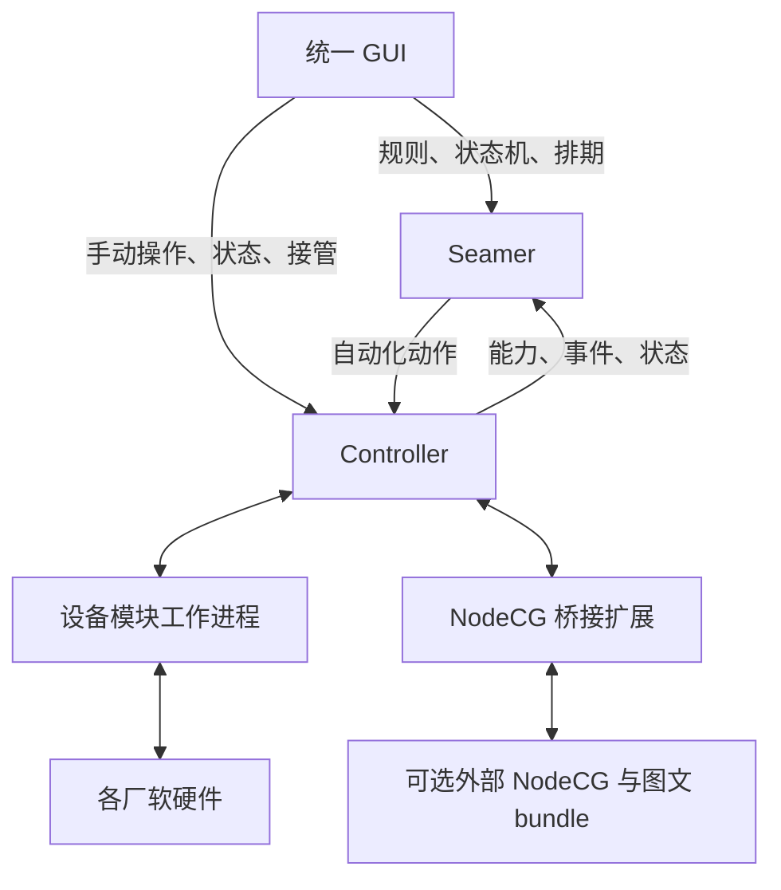

# LeafSeamer Rebirth 完整设计稿

- 日期：2026-10-17（Asia/Tokyo）。
- 状态：供整体审阅的设计稿；产品决策已逐轮确认，接口及实现细节尚未冻结。
- 当前工作分支：`rebirth`。本文在 Suite 维护；引用的旧源码固定到 Legacy 最终提交，新版尚未实现。
- 当前范围：继续设计定稿，不修改业务代码；用户已另行授权旧仓改名停维护、最终推送及推送核验后的本地目录重整。[LeafSeamer 组织](https://github.com/LeafSeamer) 与五个公开仓库已创建并标记施工中；旧版最终推送及本地五仓目录已完成，详见 [交接记录](LEGACY_HANDOVER.md)。
- 配套文件：[整体审阅与待落实事项](rebirth-review.md)、[实施前契约与验收交付清单](rebirth-readiness.md)、[首闭环 SDK/API 与执行契约草案](rebirth-first-loop-contract.md)。
- 工程进展：用户已同意 F04／F05 推荐方案；[F06／F07 候选设计](rebirth-f06-f07-design.md)补齐 OBS UUID／目录代际、完成证据、有限失败依赖证明、恢复单次消费与状态提交。候选字段需下一版显式归并，协议／设备／故障运行验收仍未完成。
- 最新工程基线：用户已同意 F06／F07；[F01—F07 整体审阅及归并](rebirth-draft3-review.md)已将确认的候选落实为公共 `1.0.0-draft.3`、IPC `ipc/0.2.0-draft.1`，修正身份域、未知结果清资源、证据／证明／恢复引用链及单次票据响应。先前“待归并”记录由本进展更新；实现选型和运行冻结门槛仍保留，暂不修改业务代码。
- 最新确认与选型：用户已同意 draft.3／IPC 0.2 及[TS01—TS05](rebirth-technology-selection.md)：TypeScript／Node 24 LTS、Schema-first 生成、F04 不透明认证、better-sqlite3 专用存储线程及平台时钟适配。精确产物和TV01—TV14运行证据仍待落实。
- 最新平台与协议进展：用户已同意NF01—NF03及[draft.4／IPC 0.3归并基线](rebirth-draft4-review.md)，旧机器文件保留。[DF01细化](rebirth-df01-sdk-freeze.md)新增D1—D6推荐与SV01—SV20，明确源迁移等价、工具链候选及数字词法缺口；新推荐尚待确认。DF01—DF06、TV／PF运行门槛仍待落实，未开始业务实现。

## 1. 目标、依据与适用范围

基础方案细化入口已扩展至[DF02运行域](rebirth-df02-runtime-design.md)、[DF03授时](rebirth-df03-time-profile-design.md)、[DF04存储](rebirth-df04-storage-design.md)、[DF05发行](rebirth-df05-release-design.md)和[DF06内部信任](rebirth-df06-internal-trust-design.md)。这些新推荐待审阅，完整系统及所有首期模块设计门槛仍按[实施前清单6.1](rebirth-readiness.md#61-全系统设计完成门槛)执行；候选和参考检查不代表已实现或已获生产批准。

LeafSeamer 是总项目品牌。新版由 GUI、Seamer 自动化核心、Controller 设备控制平台、SDK 四个独立组件组成，以套件仓库组织部署与整套验收。Controller 可独立使用；Seamer 通过公共能力 API 编排它，GUI 为两者提供统一操作台。

本稿以本次会话 Q1—Q72 及用户后续修正为需求依据。下文“已确认”表示用户已决定的产品约束；“设计细化建议”表示为使方案可评审而提出的接口或实现方向，仍须完成专项技术审阅；“待落实”不等于已经执行外部操作。Q72 已解决 Q13 与 Q37／Q43 的失败继续范围歧义；首闭环字段、状态及接管时序已形成工程草案，尚未冻结或实现。

### 1.1 旧仓参考事实（固定于 Legacy 最终提交）

- 根 [package.json](https://github.com/ikenainanodesu/leafseamer-legacy/blob/5d60491d7158f87fc27b564f510d321074aedac9/package.json) 当前为 1.1.3，启动入口仍为 NodeCG，声明 MIT 许可；18 个工作区 bundle 已按其 package.json 核实。
- [现有触发器](https://github.com/ikenainanodesu/leafseamer-legacy/blob/5d60491d7158f87fc27b564f510d321074aedac9/bundles/seamer/extension/trigger-manager.ts) 监听状态变化并延迟派发动作；新版的持久执行记录、显式状态机和接管机制不能视为现有能力。
- [现有注册表](https://github.com/ikenainanodesu/leafseamer-legacy/blob/5d60491d7158f87fc27b564f510d321074aedac9/bundles/seamer/extension/integration-registry.ts) 已提供能力注册、状态发布和动作分派；[共享类型](https://github.com/ikenainanodesu/leafseamer-legacy/blob/5d60491d7158f87fc27b564f510d321074aedac9/shared/integration/types.ts) 是新契约的参考材料，不是无需修改即可公开的新版协议。
- [当前数据库适配器](https://github.com/ikenainanodesu/leafseamer-legacy/blob/5d60491d7158f87fc27b564f510d321074aedac9/bundles/database-postgresql/src/database-adapter.ts) 仍要求 PostgreSQL；[现有 LICENSE](https://github.com/ikenainanodesu/leafseamer-legacy/blob/5d60491d7158f87fc27b564f510d321074aedac9/LICENSE) 仍为 MIT。本稿不会改变这两个运行及许可事实。
- 旧版收尾时的指令、开发日志、忽略规则和索引资产已随完整 Legacy 工作区保全；Suite 中已有的未提交文档变更继续保留。

### 1.2 明确不包含的工作

首期不设计断网自治、离线队列及断网任务补发；不做集群、主备或多个 Seamer 同时调度同一组设备；不承诺帧级多设备同步；不做多租户、企业 SSO、社交登录或通用脚本编程画布。基本连接状态、失败反馈和服务重启处理仍是必要能力。

旧数据不迁移。新版空库启动，仅提供迁移建议文档；旧库、配置和秘密保持原状，废弃数据的决定不授权删除。功能保留与代码历史追溯继续有效。

## 2. 已确认决策登记

| 决策 | 最终约束 |
| --- | --- |
| Q1 | 本期不考虑断网自治；不能以此推导无需报告连接失败。 |
| Q2 | 简单触发规则与显式状态机共存。 |
| Q3 | GUI 是统一操作台，SDK 支持后续界面及模块扩展。 |
| Q4 | 保留业务功能；GUI 脱离 NodeCG 重新制作。 |
| Q5 | SDK 优先规范 Seamer API，模块声明 Trigger 和 Action 能力。 |
| Q6 | Controller 是可独立操作各厂软硬件的控制产品，SDK 指导设备接入；Seamer 自动化调用 Controller。 |
| Q7 | 能力声明、实际事件、用户自动化规则分开；模块提供事实，Seamer 处理规则。 |
| Q8 | 动作声明参数、结果、执行生命周期、完成依据、超时、重试及可选取消能力。 |
| Q9 | GUI 使用声明式通用界面及可选专用面板；无界面模块也能参加自动化。 |
| Q10 | 区分模块类型、运行实例、设备身份及能力版本；失效引用不静默改绑。 |
| Q11 | 同一 GUI 支持仅 Controller 及完整套件模式。 |
| Q12 | Controller 按资源协调冲突；手动接管优先。 |
| Q13 | 动作默认顺序执行，显式并行组；失败默认停止，其他策略显式配置。 |
| Q14 | Organization 下四个独立组件仓库及一个套件仓库，初期不强制 Submodule。 |
| Q15 | 组件独立版本；套件锁定通过整套验证的组合。 |
| Q16 | 尽可能保留相关历史；新版 Apache-2.0 主许可，保留必要旧代码及第三方声明。 |
| Q17 | 状态、事件转换、条件及动作；支持进入、退出及转换动作，首期不做嵌套状态或并行状态区域。 |
| Q18 | 接管持续到明确释放；阻止相关自动化写入；释放不补发错过动作。 |
| Q19 | 重启恢复定义和记录，执行中动作标为中断或结果未知；默认不自动续跑或补排期。 |
| Q20 | 设备适配模块按类型运行于独立工作进程，一进程可管理多台同类设备；不等于安全沙箱。 |
| Q21 | 单组织、多用户角色与受限服务身份，Controller 独立认证授权。 |
| Q22 | 一个 Seamer 接入多个 Controller；一个设备实例由一个 Controller 管理；多 GUI 用户可并发。 |
| Q23 | HTTP 管理和命令 API＋WebSocket 状态和事件；补充指定 NTP 时间源同步。 |
| Q24 | 服务数据所有权隔离；后续明确改选 SQLite，先前保留 PostgreSQL 的建议已失效。 |
| Q25 | 官方面板随 GUI 构建；第三方面板采用声明式描述或受限 iframe 扩展接口。 |
| Q26 | 排期归 Seamer；日志归各服务；备份由 Suite 编排；图文改为外部 NodeCG 兼容入口。 |
| Q27 | NTP 用于统一时间戳、审计和普通排期，不承诺帧级同步。 |
| Q28 | 可选独立 NodeCG 实例＋桥接扩展＋Controller 适配模块。 |
| Q29 | 后续明确免除旧数据迁移：空库启动，只保留建议文档，不开发迁移工具。 |
| Q30 | 首期支持 Windows／Linux、容器及原生路径；模块声明平台与外部依赖。 |
| Q31 | 完整套件统一登录，独立 Controller 支持本地账户；明确配对建立信任。 |
| Q32 | 时间质量不合格时阻止绝对时间排期；手动、普通事件和相对延迟允许；恢复不补发。 |
| Q33 | 设备工作台＋自动化工作台，结构化状态机编辑及辅助关系图，首期无自由编程画布。 |
| Q34 | 最小闭环、全部功能覆盖、整套发布验收三阶段；模拟结果与真机结果分开记录。 |
| Q35 | 首期整台设备接管；Controller 确认门控生效，版本变化使旧自动化失效；细粒度接管列入路线图。 |
| Q36 | 未派发取消，已派发按模块能力处理；未知结果不伪报取消，迟到结果不恢复流程。 |
| Q37 | 区分业务、转换及设备状态；退出／转换／进入必需动作成功后提交目标状态，失败暂停实例。 |
| Q38 | SDK 声明完成证据，规则指定标准；发送／应答／效果核实不混同，降低标准必须显式。 |
| Q39 | 部分失败保留真实副作用，默认停止、不回滚、不重放；补偿须显式配置并受接管约束。 |
| Q40 | 写命令默认不自动重试；仅声明安全条件、错误分类、次数及截止期限后允许；未知结果先查询，同一请求身份返回既有执行记录。 |
| Q41 | 恢复前核对现状、逐步结果和执行预览；只明确恢复仍必要的失败／未执行步骤，不重放成功步骤；释放接管不等于恢复。 |
| Q42 | 每台设备同一时刻一名手动控制者；转交经对方接受后原子切换控制版本；紧急接管需相应权限，退出或超时不自动释放。 |
| Q43 | 并行组失败后停止尚未派发与后续步骤，收集在途结果；仅按声明安全取消，未知结果阻止相关恢复，不默认补偿。 |
| Q44 | 仅独立动作可并行，冲突、依赖或未知资源范围不开放并行；预检和派发复核不是多设备事务，播出动作优先准备、核实再切出。 |
| Q45 | 自动化默认未布防；只读预检后明确布防，派发仍复核；异常阻止相关自动化，不主动打断播出或禁用独立手动控制。 |
| Q46 | 草稿、发布版本与运行实例分离；实例固定版本，运行配置须显式切换，不在转换中途热替换。 |
| Q47 | 接管、转交及控制版本持久化成功后才确认；重启先恢复控制限制，记录不可靠时禁止受影响设备自动化，离线不自动释放。 |
| Q48 | 稳定事件身份去重，来源顺序与有限时效分开判断；暂停期间不积压动作，恢复快照不伪造新触发边沿，普通事件不统一依赖可信 NTP。 |
| Q49 | 因果关联、阈值滞回和稳定窗口配合规则、因果链及设备执行预算；超限暂停相关自动化并告警，不主动改变播出输出。 |
| Q50 | 同一规则默认单活动运行，忙碌触发不积压；同一事件命中多转换选唯一最高优先级，并列暂停；来源间按接收顺序处理。 |
| Q51 | 必要设备前提变化或无法核实时停止相关后续派发，不自动纠正设备；正常外部 Trigger 不因此禁用。 |
| Q52 | 关键控制／执行记录不可可靠保存时，阻止受影响服务新写入，包括 Controller 手动写命令；普通日志失败只降级告警，恢复须核对。 |
| Q53 | 模块只允许有限、无写副作用的自动重启；重新核对就绪，相关自动化明确重新布防；计划升级不静默热换。 |
| Q54 | 备份恢复、数据库升级及回退须明确维护；隔离恢复演练，正式替换前停止原实例控制，恢复后默认未布防且旧请求不复活。 |
| Q55 | 显式指定一个 Controller 承担套件身份签发；独立模式本地账户，各服务独立授权；受控初始化和配对，不自动选主或切换登录来源。 |
| Q56 | 人员会话、权限及设备接管分开管理；受理及派发前复核授权，撤销逐服务确认，不自动释放接管或撤回在途动作。 |
| Q57 | 自动化绑定独立、受限、可撤销的组织授权及批准版本；人员退出或停用不隐式停播，服务授权失效则停止相关新派发。 |
| Q58 | 排期编辑／导入先形成草稿及差异，显式激活未来场次；已受理／派发固定原版本，重复导入不重播，删除行不等于设备取消。 |
| Q59 | 一次场次明确 UTC，重复规则保留命名时区与本地日历语义；时间歧义显式解决，已批准场次不静默重算，校时不补发或重播。 |
| Q60 | 场次有稳定身份和有限派发窗口；仅容纳持续正常状态下的调度延迟，门控失效即失去资格；Controller 发送前复核截止，不承诺按时完成。 |
| Q61 | 组件、公共协议及能力分别版本化，兼容涵盖行为；不兼容阻止相关写入，首期只维护当前稳定协议主版本，Suite 锁定实测组合。 |
| Q62 | 配置编辑带预期修订，冲突不覆盖；同身份不同命令拒绝，受理期限与记录保留分离，旧身份过期或记录清理不产生新执行。 |
| Q63 | 请求与队列容量有界，受理前超限明确拒绝；保护操作预留有界预算但不绕过鉴权、在途或关键持久化约束。 |
| Q64 | 展示遥测可按声明合并，关键结果及触发事件不静默丢失；慢 GUI 单独失步，Seamer 依赖缺口暂停相关自动化且不补播。 |
| Q65 | 面板固定产物及权限清单获批准，权限为安装范围、当前用户和目标服务授权交集；无设备秘密，更新和撤销不绕过运行保护。 |
| Q66 | 后端模块只运行管理员明确信任的代码；独立进程不是恶意代码沙箱，仅授予必要凭据，安装批准与运行授权分离。 |
| Q67 | 阶段 1 先用 SDK 模拟器验证事故语义，再以隔离 OBS 测试场景完成首个真实闭环及独立 Controller 验收；阶段 2 保留全部旧功能。 |
| Q68 | 首期验收 Windows 11 x64、Ubuntu 24.04 LTS amd64 和桌面 Edge／Chrome；按组件与模块公布精确实测组合，ARM64 后续。 |
| Q69 | GUI 首期简中及英文完整支持，保存语言偏好，未匹配时回退英文；默认暗色、可选浅色，日文后续；语言不改变协议及业务语义。 |
| Q70 | Linux Compose＋Nginx 套件及 Windows 原生 Controller＋GUI 为主教程；保留其他适用原生路径，固定版本包、只读初始化、独立持久数据，不自动布防或更新。 |
| Q71 | Controller 管理适配模块、独立 NodeCG bridge 及旧图文兼容产物，Suite 锁定一个实测 NodeCG 2.x 组合；可选安装不免除全部旧图文交付，原操作台是独立外部入口。 |
| Q72 | 首期转换及并行组设备动作全为必需，失败不跳过或提交成功；仅简单顺序规则中显式非必需、明确失败且证明不影响后继的步骤可继续，保留失败总结；未知及控制保护不可豁免。 |

## 3. 仓库与产品边界

### 3.1 目标仓库

以下五仓已在 [LeafSeamer 组织](https://github.com/LeafSeamer) 创建，均公开并标记施工中；创建仓库不代表组件实现或验收完成。

| 仓库 | 权威职责 | 独立交付 |
| --- | --- | --- |
| `leafseamer` | Seamer 规则、状态机、排期、能力引用、运行记录 | 自动化服务 |
| `leafseamer-controller` | 设备、适配模块、连接、命令、接管、凭据 | 控制服务及官方模块 |
| `leafseamer-gui` | 统一操作台、声明式字段、官方专用面板、扩展容器 | Web 应用 |
| `leafseamer-sdk` | 公共契约、客户端、模块开发接口、界面扩展接口及契约测试 | 版本化软件包和协议说明 |
| `leafseamer-suite` | 总入口、兼容清单、Nginx／部署配置、整套验收、备份恢复编排 | 套件发行 |

组件不能跨仓库导入其他组件的内部源码。SDK 以软件包及协议版本引用；Suite 记录源码提交、发布版本、产物摘要和兼容范围。相同版本号不是跨组件兼容证明。Submodule 可在未来作为整套源码检出方式，不是首期依赖或部署前提。

本地 `LeafSeamer` 已作为五仓父目录，核心仓库位于其 `leafseamer` 子目录，父目录没有 Git 仓库；完整旧工作区在同级 `leafseamer-legacy` 保全。五个新仓库已各自建立 `rebirth` 分支；旧仓 `rebirth` 随旧工作区保留。相关业务历史提取及来源映射仍待实施。

### 3.2 运行关系

图中为逻辑调用关系，不指定 WebSocket 发起方向或实际代理路径。服务网络必须可达；Nginx 提供入口代理，不解决现场设备网络可达性。一个 Seamer 可连接多个 Controller；GUI 关闭不影响服务执行。Controller 不依赖 Seamer 才能连接设备或手动控制。

非设备数据源可通过 Seamer 扩展接口提供事件与状态。设备协议仅由 Controller 模块实现，不能同时在 Seamer 中维护另一套驱动。SDK 是库和契约，不是必须部署的中心服务。

## 4. SDK 与公共 API

### 4.1 已确认的契约职责

- 通用契约：身份、能力、参数及结果结构、版本、错误、事件、状态与时间质量。
- Seamer 接口：能力提供者注册、目录更新、状态及事件接收、规则和状态机管理、运行查询。
- Controller 接口：设备模块生命周期、设备能力、控制、资源协调及状态采集。
- GUI 扩展接口：通用表单、动态目录、专用面板、选中设备上下文、主题和生命周期。
- SDK 优先面向 Seamer 能力模型；线上协议与语言无关，TypeScript SDK 为首选实现方向，具体分包及工具链待技术设计。

模块注册描述“可以发生什么、可以执行什么”；事件报告“发生了什么”；用户规则决定“对此如何处理”。三者不得混为一次注册请求。Controller 发布能力后，Seamer 获取并校验目录，用户无需重复录入定义。

### 4.2 设计细化建议：身份与版本

| 对象 | 建议身份与语义 |
| --- | --- |
| 模块类型 | 稳定模块 ID，与显示名称分开 |
| 运行节点 | Controller ID、模块实例 ID及进程启动身份 |
| 设备 | 稳定设备 ID，连接地址和别名不充当唯一业务身份 |
| 能力 | 提供者、能力 ID、兼容版本及参数／结果 Schema |
| 动作与流程 | 分别拥有执行 ID；关联 ID用于追踪，不自动等同去重键 |
| 事件与状态 | 事件 ID、来源内序号、状态版本及时间质量 |

以上字段名与编码尚未冻结。重启、模块升级及设备改名不能默默改变规则绑定；能力消失或不兼容时保留可解释的失效引用并阻止有关执行。能力发布和更新必须受提供者身份及权限约束。

### 4.3 API 传输与状态同步

HTTP 用于管理、查询和命令提交；命令受理返回执行身份，最终结果可查询并通过 WebSocket 发布。WebSocket 传输状态、事件和执行进度；GUI 不读数据库或直接调用设备协议。

首次订阅需要快照及后续增量。设计细化建议：快照带版本水位，增量带来源序号；检测间隙后明确重新取快照，而不是假装状态完整。这是运行中同步完整性，不是离线事件补发或离线自治。

正式 API 路径、Schema 格式、分页、事件保留、订阅范围、大小限制、错误码、超时及兼容窗口待冻结。第一版不承诺跨来源全局事件顺序，也不承诺设备副作用“恰好一次”。

首闭环工程草案见 [SDK/API、命令生命周期与接管契约](rebirth-first-loop-contract.md)：提出请求世代／幂等域、能力及命令字段、结果与证据分离、运行授权、最终出口接管屏障及 FC01—FC24 验收用例。字段名和实验参数不自动视为稳定协议，冻结缺口 F01—F07 单列；相关业务运行验收尚未执行。

用户已同意首闭环推荐方案。现已落实 [draft.2 Schema／OpenAPI 与正反例](contracts/README.md)，并通过离线元校验、结构／静态语义检查及固定向量验证；FC01—FC24 的业务运行验收仍未执行。命令完成、资源释放和控制权生效分开表示；字段细化及 F01—F07 余项见 [边界审阅](rebirth-contract-review.md)。没有开始业务实现。

用户已同意 draft.2 契约基线。后续 [F02／F03 实施设计](rebirth-f02-f03-design.md)使用独立内部 IPC 草案，公共协议保持不变：接管 effective 与出口 ready 分开，屏障 ACK 必须完整覆盖未核销 intent，故障接替先证明旧 writer／通道终止；SQLite 使用每服务本地关键库、WAL＋FULL 和短事务，事件可重传而设备意图不重投。上述为工程推荐与可校验资料，真实 IPC、数据库故障和设备验收仍未执行。

用户已同意上述 F02／F03 推荐方案；其运行验收仍未执行。新增 [F04／F05 候选设计](rebirth-f04-f05-design.md)梳理人员／会话／服务／扩展的精确撤销及逐目标出口确认、有限身份快照、独立认证时钟、业务 UTC 误差区间和时间代际、有界容量及保护预算，列出 FA01—FA24、TB01—TB24。公共 draft.2 和既有 IPC 不暗改，新增守卫、AUTH_FENCE／TIME_FENCE 及浏览器票据须在下一版显式合并；实验参数不是生产承诺，本轮没有业务实现。

### 4.4 已确认的兼容、并发与容量边界

Q61 已确认：组件发行、公共协议和设备能力契约分别版本化，协商协议及必需特性；稳定契约同主版本向后兼容，参数单位、默认行为、完成证据及取消／重试语义改变均须审查破坏性。新增枚举或可选字段也须契约测试，未知写参数明确拒绝，不静默忽略或替换动作。不兼容阻止相关写入，只有双方明确支持的只读能力可继续。首期只提供当前稳定协议主版本，弃用先公告、移除进入新主版本，紧急停止支持单独说明；预发布不冒充稳定，同版本产物不可替换。SDK 与服务端均校验，Suite 仅承诺实测组合且不自动升级直播环境；版本含义参考 [S16]，具体支持窗口及测试仍待冻结。

Q62 已确认：规则、排期、设备配置及权限编辑携带预期修订，冲突返回差异，不最后写入覆盖或自动合并播出字段。命令按授权身份、目标和操作范围绑定幂等身份及规范化内容；同身份同内容关联既有执行，同身份不同内容拒绝，查询受当前权限约束，不改变 Q40 默认不重试。受理有效期、执行详情及防重放记录保留分离；详情清理不能解释为从未执行。协议须以有界受理期限或服务请求世代保证防重放资料覆盖所有仍有效身份，无法确认旧请求时拒绝，备份恢复不重用旧世代。清理不得删除在途、未知或必要审计证据，具体算法和周期待验证，不要求无限保存全部日志。

Q63 已确认：服务、身份、设备和扩展的大小、速率、并发、队列及操作时限有界，批量另限额并给逐项结果，不承诺设备原子批量。超限在受理前明确拒绝，不能先成功再丢弃或合并离散命令；已受理保留执行身份、期限及可查询状态。限流提示不授权自动重试，超时仍可能结果未知。接管、撤销、取消和查询预留有界处理预算，仍鉴权、限速、遵守在途及 Q52，不承诺机器完全故障时仍可接管。调低额度不丢既有记录，具体默认值及范围以参考环境压测冻结。

Q64 已确认：展示最新状态可按声明合并或降频；关键执行结果、控制权变化和自动化触发事件不能静默丢弃。触发数据须声明采样／聚合／丢失语义，不能依赖 GUI 降采样结果。每订阅范围、频率、大小及缓冲有界，单个慢消费者不能拖住关键处理。慢 GUI 明示失步并重取带水位快照及增量，只影响该客户端；Seamer 所依赖事件或证据出现缺口则暂停相关自动化并核对，快照不证明缺失期间无事件，不补放动作。有限传输重传不等于离线任务补发，权限撤销由服务执行；存储与重同步也有界，无法恢复完整性时告警。

细化入口：[C05事件与同步](rebirth-c05-event-sync-design.md)给出ES01—ES06待审阅候选及EV01—EV36，保留现有快照水位／前驱游标，补齐世代身份、应用确认／ACK、规范顺序与侧通道证据、完整快照范围、容量及失步恢复。新同步状态不自动恢复触发资格，公共draft.4仍不变。

## 5. Seamer 规则、状态机与执行

细化入口：[C04自动化执行设计](rebirth-c04-automation-design.md)补齐候选表达式、完整依赖图、发布产物、活动槽、三值仲裁、延迟／反馈及EX01—EX32。AR01—AR06为待审阅建议；投影误删、proof路径及容量问题须下一版显式修订，不改变本节已确认产品约束或当前draft.4基线。

简单规则支持事件／状态条件、阈值及组合、相对延迟和动作；具体操作符集合需从旧能力清单提取并测试。状态机拥有显式状态、转换事件、守卫条件和进入／退出／转换动作。首期不做嵌套状态、并行状态区域或任意脚本节点。

动作默认顺序执行，明确的并行组才并行。每步指定所需完成依据；失败默认停止，重试、跳过、继续及补偿必须显式配置。动作“已受理”“协议已发送”“设备已应答”“状态已核实”不等价。没有确认能力的模块可以声明发送级完成，但 UI 和记录必须准确标明。

Q72 已确认：首期状态转换的退出／转换／进入设备动作及并行组设备动作均为必需，不允许通过跳过或继续达成成功／提交目标状态。只有简单顺序规则的显式非必需步骤，在结果明确失败且可证明不会破坏后继前提时才允许继续；无法证明则拒绝该配置，实际失败保留并显示“完成但有失败”。未知结果及权限、接管、关键存储、维护、截止门控始终不能由失败策略豁免。依赖证明与状态字段见首闭环契约草案。

动作应覆盖受理、执行中、成功、失败、结果未知等语义；取消只在模块支持时开放。配置了超时并不代表设备未执行；是否可重试由动作语义、去重策略和设备反馈共同决定。

Q45 已确认：自动化默认未布防，用户明确启用后才允许写设备。预检只读，检查能力、引用、权限、设备状态新鲜度、完成证据、接管、未决命令及相关时间质量；不能通过切换播出画面、调整音量或开停推流测试设备。预检通过后仍需派发复核，不构成永久通行证。异常只阻止受影响自动化，不主动打断当前播出；Controller 独立手动操作继续遵循接管规则。首期预检范围按启用的规则／状态机定义，不依赖尚未定义的项目分组。

Q46 已确认：草稿、已发布版本和运行实例分离。运行实例固定绑定不可变定义版本，保存草稿或发布新版本均不自动改变当前实例，持续运行的状态机也不在下一次转换自动换版。影响设备、动作、参数或能力绑定的变更必须显式切换：停止相关触发、处理在途命令并核对现状后，再启用新版本，不在转换中途热替换。纯布局及说明可即时更新；能力失效暂停相关执行，不静默降级或改绑。

Q48 已确认：事件使用稳定身份去重，提供来源启动身份、来源内序号及必要时效信息；关联 ID 或 NTP 时间戳不能单独作为去重身份。触发事件有有限有效期，接收及派发前均检查，过期只记录不执行。暂停、接管或未布防期间可更新状态与审计，不积压待执行动作；重新启用时的状态快照不伪造新触发边沿。已批准的延迟动作按自身计划和截止期限判断，不能简单套用原触发事件有效期。NTP 不可信时，本地单调时钟只证明本机排队年龄；无法证明来源事件时效安全时，阻止相关时间敏感触发，不一刀切禁止普通事件。

Q49 已确认：命令、结果及事件保留因果关联；证据不足时不能猜测变化由自身造成并屏蔽真实外部变化。阈值触发提供滞回、稳定窗口及明确的再次触发条件；规则、因果链、设备分别具有次数、速率和持续时间上限，缺少因果关联不能绕过设备级限制。超限暂停相关自动化并保留明确告警，手动控制仍遵循接管规则；不自动黑场、静音或恢复旧场景。有意循环也须显式有界，数值按设备延迟和测试确定。接口字段、限额及竞态验证未完成。

Q50 已确认：同一规则默认最多一个活动运行，忙碌期间新触发记录为抑制，不排队、不重启、不覆盖当前运行。状态机转换期间持续更新观测，但不启动第二条转换或事后重放期间事件。同一事件命中多条可用转换时，选显式优先级唯一最高者；最高优先级并列则暂停实例并告警，预检尽可能提前发现歧义。不同来源按 Seamer 接收序列稳定处理，不以跨来源时间戳排序。不同规则可独立运行，设备冲突由 Controller 仲裁；等待有界且派发前复核时效和前提。连续数值跟随应使用专门的有界控制能力，不借通用动作无限重入实现。

Q51 已确认：动作声明必要执行前提，关键播出动作在派发前核对新鲜观测；按当前步骤要求判断，不能把本流程预期变化误判为异常。外部操作导致前提失效或关键状态无法核实时，停止相关后续派发并展示差异，不自动恢复旧画面、音量或业务状态。正常外部 Trigger 仍有效；已派发按在途规则处理。无可靠反馈的设备遵循 Q38 的显式降级，不能伪造已核实。检查与动作间仍存在竞态，不承诺阻止设备原生面板或其他外部客户端的控制。

Q37—Q39 已确认：业务状态、转换执行状态及设备实际状态分别记录。执行顺序固定为校验条件、退出动作、转换动作、进入动作、提交目标状态、发布转换完成事件；进入动作属于提交目标状态前的准备阶段。必需动作全部达到声明的完成标准后才提交目标状态。同一状态机实例转换期间不启动第二条转换；失败后暂停该实例，显示最后完成状态、未完成转换及真实设备状态，不能按旧状态继续正常执行。

SDK 声明“已发送”“设备应答”“效果已确认”等证据，设备应答是否等于完成由模块明确说明。关键动作默认要求足以证明目标效果的反馈；无反馈模块可接入，但接受发送级标准须显式配置，界面显示效果未验证。不得用发送前的缓存状态证明本次完成。

状态转换及并行组部分成功后失败时保留已发生副作用，停止后续动作，不提交目标状态、不默认回滚或从头重放；简单顺序规则仅适用 Q72 已确认的有限继续例外。结果未知与明确失败分开。补偿属于新设备操作，必须显式配置且遵守接管限制，不保证恢复原状。

Q40—Q41 已确认：写命令默认不自动重试。例外须由能力和策略明确约束安全错误类别、最大次数及截止期限，并在每次派发前重新校验权限、接管版本和动作条件；结果未知时先查询，不能以超时作为设备未执行的证据。同一请求身份的重复提交关联既有记录，不产生新设备动作；重试尝试与逻辑动作身份需要区分。恢复入口展示设备现状、每步完成证据和拟执行预览，仅执行仍必要且获明确确认的失败／未执行步骤，保留成功步骤。释放接管与恢复流程是两个操作；人工校正业务状态不自动触发进入动作。

Q43—Q44 已确认：并行组出现失败时，停止尚未派发的组内动作及后续流程；已派发动作继续收集结果，只对声明支持安全取消的动作发起取消。保留部分成功与未知结果，未知结果未处理前不恢复相关执行，不默认回滚或补偿。只有无冲突、无先后依赖且资源范围明确的动作可组成并行组；未知范围按保守冲突处理。预检后仍需派发复核，不承诺跨设备原子提交。影响播出的流程优先采用准备、核实、切出阶段，具体设备是否支持必须由能力声明和验证证明。

服务重启恢复定义、状态和记录，执行中任务标为中断或结果未知。先获取设备现状，再由用户明确决定恢复、跳过或重启；不默认自动续跑。错过排期不补执行。数据库提交与设备副作用不是一个事务，不能用本地事务声称设备执行可回滚。

恢复中的“跳过”不能把未完成必需动作改记为成功。人工校正业务状态是独立授权且审计的操作；已成功步骤的效果若因外部操作失效，先处理前提差异，不能借恢复自动重放原成功步骤。

## 6. Controller、接管与模块隔离

Controller 主服务负责认证、设备注册、能力汇总、命令调度、接管状态、审计与持久化。模块按类型运行于独立工作进程，一进程可管理多台同类设备，负责厂商协议、采集及反馈。进程隔离主要减少故障影响，不是运行不可信代码的安全沙箱。

设备模块通过 SDK 声明连接参数、能力、参数单位及范围、完成依据、可取消性、重试属性、冲突资源、平台支持和外部依赖。生命周期需涵盖启动、就绪、停止及异常报告；重启模块不得自动重放未决动作。协议差异和型号限制必须保留，不能只保留通用最低能力。

普通瞬时命令按冲突资源排序，不同资源可并行。持续动作声明资源占用及可抢占性。手动接管优先，并持续到明确释放；接管范围内的新自动化写入被拒绝，Seamer 显示阻止原因且不无限重试。释放后不补发旧动作。

Q35—Q36 已确认：首期默认整台设备实例接管；Controller 更新控制版本、使旧版本未派发自动化失效，并保证实际派发前检查接管及版本后，才返回接管已生效。释放也更新版本，旧动作不能复活。接管生效不等于在途动作清零；版本判断不依赖 NTP 时间戳。

实现义务：接管门控必须覆盖工作进程的最终设备发送出口，IPC 投递不能算实际派发。控制版本可靠持久化后，须确认旧版本尚未发送队列已经失效，并登记此前在途，才报告接管生效；同设备发送与版本切换串行仲裁，只能落入“先发送、登记在途”或“先接管、拒绝旧发送”。屏障未确认、工作进程失联或启动身份改变时不得伪报生效。出口同时复核授权、维护、关键存储和截止；具体 IPC、屏障与故障恢复由 T05／T06／T10 冻结及竞态测试证明，不声称数据库与设备发送原子提交。

未派发自动化作废；已派发动作仅在模块支持时请求取消，确认前仍算在途。不可取消动作继续观察，后续自动化不再派发。超时无法确认结果时标为未知；迟到回执可补充记录与设备状态，不能恢复已被接管中断的流程。同一冲突资源上的手动操作默认等待在途完成或取消确认；超时进入显式人工处理，不能无限静默排队。立即停止或覆盖须由模块声明对应设备能力，不能以终止工作进程声称设备已停止。

Q42 已确认：每台设备同一时刻仅一名手动控制者。正常转交由现持有人发起、接收者接受后，Controller 原子切换持有人与控制版本；接受前仍由原持有人控制，旧持有人的待派发命令随后失效。在途动作继续遵循 Q36，转交不等于取消已发送命令。有紧急接管权限的用户可强制接管并留下审计，普通用户不得抢占；退出、页面关闭或超时不自动释放设备，也不恢复自动化。

Q47 已确认：持有人、接管状态及控制版本原子持久化成功后，才确认接管或转交；持久化失败不得伪报成功。Controller 重启先恢复控制限制，再开放自动化入口；记录缺失、损坏或不确定时，受影响设备保持自动化禁用，由有权限人员明确处理。持有人离线不自动释放接管，现场保留明确、有权限的接管途径，但不能绕过持久化失败而假称接管已成功。数据库事务不代表设备副作用与接管记录原子提交。具体存储接口和故障测试仍待落实；细粒度冲突资源接管属于第 13 节路线图，不能宣传为首期已有能力。

Q53 已确认：故障模块可按有限次数、退避和时间预算自动重启，超限停止并告警。自动初始化仅恢复无副作用的连接、采集及诊断，不重放命令、同步旧目标或恢复预设；不能保证初始化无写副作用的模块禁止自动重启。设备身份、能力版本和现状核对后才算就绪；受影响自动化解除布防，人工核对后明确重新布防，健康模块继续工作。手动入口须在就绪且核对接管及未知动作后开放。计划升级、重载或替换驱动须进入受影响模块维护流程并处理在途命令，不直播静默热换。

Q66 已确认：Controller 设备模块、Seamer 数据源等后端扩展仅运行管理员明确信任的代码，记录来源、版本、摘要、依赖、设备、外连及秘密范围。签名或摘要仅核验来源／一致性，不证明安全；独立进程减少故障影响，不保证恶意代码隔离。SDK 只授予自身所需设备凭据或引用，不直接开放主库、其他设备秘密或签发密钥；声明权限不等于操作系统强隔离，无理由不提升进程权限，必要厂商提权须说明并批准。安装审批不等于运行控制授权，自主写入边界须契约限制与审计。升级、来源及权限扩大明确批准并按 Q53/Q54 维护；卸载显示依赖、停止相关新派发并处理在途／未知，撤销宿主访问，已读秘密不伪称可收回，必要轮换另行安排。不可信模块安全运行留作专项设计。

模块细化入口：[C09 ME01—ME07](rebirth-c09-extension-design.md)给出安装／运行／用户权限分离、固定目录与证据批准、无旁路发送、复合操作、卸载撤销及面板委托候选。原设备能力范围见[8模块映射](rebirth-legacy-device-map.md)，原图文／日志／备份等见[系统映射](rebirth-legacy-system-map.md)。MX01—MX40未运行，新候选未并入draft.4／IPC 0.3，签名、进程隔离或iframe均不单独证明安全。

## 7. SQLite 与数据管理

已确定采用 SQLite，替代新版运行数据库的 PostgreSQL 方案。Seamer 和每个 Controller 各自拥有本地库；GUI 仅保存界面偏好，SDK 不拥有运行数据。主服务统一写库，模块通过内部接口提交数据，不直接竞争写数据库文件。

- Seamer：规则、状态机、排期、能力引用、运行与审计记录。
- Controller：设备、模块配置、加密秘密或秘密引用、接管状态、命令与审计记录。
- 高速电平、频繁矩阵刷新等默认保留内存状态或聚合结果，不逐条落库。
- 使用短事务和有界队列；数据库放本地持久卷，不把 WAL 数据库通过网络共享给多台主机。
- 运行备份使用 SQLite 备份接口或完整停机流程；不能只复制正在写入的主数据库文件。
- Suite 编排各服务备份及版本清单；多库备份不自动构成同一时刻的全局事务快照。
- 秘密主密钥与数据库分开管理；普通导出脱敏；加密备份及密钥恢复路径须单独验证。

SQLite 写并发及 WAL 边界见官方资料 [S1]、[S2]；备份接口见 [S3]。选型基于配置、小事务和执行记录用途，不是本项目已经完成的性能结论。DuckDB 暂不引入，可在以后有明确分析需求时评估 [S4]。

新版空库启动，不自动连接旧库或导入旧秘密。不实现旧数据迁移工具，仅写人工迁移建议和不可直接复用项；此决定不授权删除旧数据，也不免除新版自身的 Schema 升级、备份和恢复能力。

Q52 已确认：命令受理及派发所需关键记录可靠写入后才继续对应阶段。关键记录不可写、数据库损坏或关键队列耗尽时，受影响服务拒绝新设备写入，包含通过该 Controller 发起的手动命令；健康 Controller 不因此停用。已派发动作继续尽力观察，完成证据落库失败不能报成可靠完成，也不能重发原命令。状态读取和故障提示尽量保留；普通调试日志或非关键高频遥测可限流、丢弃并告警，不单独阻断控制。现场备用操作依赖设备原生控制台及规程，不提供伪称可靠的无记录旁路。恢复后先验证持久化、控制限制及未决命令，才开放手动入口；相关自动化须明确重新布防。关键记录分类及耐久性边界待故障测试确认。

Q54 已确认：备份恢复、数据库升级及回退进入明确维护状态，Suite 展示状态、各服务执行门控；暂停受影响范围新触发和写命令，收集在途结果并明确未决事项后再变更。涉及整库时不能只维护一台设备；维护不主动黑场或静音。恢复后默认未布防，重新核对配对、设备绑定、能力、秘密、接管及未决命令；不执行备份中的旧排期或命令。历史接管记录不等于当前控制权，重新建立有效控制版本，旧客户端及待发请求不得复活。恢复演练默认隔离真实设备，正式替换前确认原实例停止控制。回退核验程序、Schema、模块和数据兼容，不只替换旧程序；升级前备份及恢复演练属于发布门槛。普通只读备份可使用一致性接口，不要求打断直播，也不代表在线多库原子快照；版本、配置、数据及按分离边界管理的秘密恢复材料均须验证。

## 8. 时间模型与 NTP

各服务通过统一时钟接口对接指定 NTP 时间源，API 和 GUI 可查询同步状态、来源、最近同步、偏移及误差估计。支持配置能力不代表同步成功；NTP 原理及测量依据见 [S5]。

API 时间采用统一 UTC 表示，区分设备发生时间、采集时间和服务接收时间；设备无可信时钟时不得伪造发生时间。来源内序号和启动身份用于顺序判断，跨机器单调时钟不能直接互相比大小。超时和相对持续时间使用本地单调时钟。

| 时间状态下的操作 | 已确认行为 |
| --- | --- |
| 手动即时操作 | 允许，附带时间质量 |
| 普通事件及相对延迟 | 允许，不能把不可信 UTC 当作可信比较依据 |
| 依赖绝对时间的排期 | 同步质量不合格时阻止派发 |
| 恢复同步后的错过排期 | 标记错过，不补发 |
| 审计 | 保留时间质量、来源身份与顺序信息 |

此表的“允许”仅指不因业务 NTP 质量这一项阻断；权限及认证有效期、接管、关键记录、维护、设备前提与在途约束仍适用。Q45／Q49 的手动可用同样不绕过 Q52 的故障停写。

应用默认不修改宿主机系统时间，浏览器不直接访问 NTP。实际采用系统时间服务对接还是应用层校时提供器、时间单位、阈值、有效期、平滑策略和可配置服务器集合待技术验证；不得静默改用未配置的外部时间源。

排期需保存计划时间、派发时间及反馈时间，以观察调度与设备延迟。校时不能造成同一排期重复派发；时区、夏令时、时间跳变和重复触发的处理必须进入测试。首期不承诺帧级动作同步。

Q58 已确认：手工编辑及外部数据源导入先产生草稿和差异，展示来源稳定身份、版本、时区、绑定及删除项；不使用行号作为稳定身份，不凭同名合并，不将空响应或查询失败当作删除全部排期。发布并明确激活后才影响未来尚未受理的场次，激活时原子选择运行版本；已受理／派发场次保持原版本，不中途换动作。重复导入、改标题或改时间不重置已完成场次，重新播出须明确创建新场次。删除／取消未派发场次须明确操作，已派发仍按在途规则处理。数据采集可持续进行，但更新不绕过审批成为可执行计划；临近播出变更仍受布防、前提和截止约束。

Q59 已确认：一次场次保存 UTC 时刻和原本地时间、时区；重复排期保存命名时区及日历规则，生成稳定场次身份。浏览器或服务器时区改变只影响显示。人工输入不存在或歧义时间须纠正或选择明确偏移；重复规则默认跳过夏令时缺失时刻并预览，回拨重复时刻明确选择一次，策略随发布版本保存。外部无时区时间须明确来源时区。时区规则更新展示差异，已批准场次不静默重算，无法确定映射的场次不能布防。NTP 回拨不重置执行身份，异常前跳导致错过的不补发；普通手动及单调相对计时不因业务时间质量失效统一停用。时间表示参考 [S15]，本项目显式确认政策不等于完整 iCalendar 兼容。

Q60 已确认：每个场次有稳定执行身份、计划时刻及最晚派发时刻；计划前不派发、截止后不执行。有限窗口仅容纳持续正常布防、授权及时间质量合格状态下的调度延迟。到点时或等待窗口中出现暂停、重启、接管阻止、未布防或时间异常，即记为阻止／错过，恢复后即便仍在窗口也不补发；排队不能延长截止。Controller 在接近协议发送处复核期限和所需时间质量，不能把 Seamer 发出 HTTP 请求当作设备已派发，不能跨主机比较单调时钟。窗口约束开始发送，不承诺按时完成或帧同步；多步流程每步有自己的期限和完成标准，仅明确准备步骤可以提前。无有效上限的场次不能布防，默认上限按动作类别及实测确定；迟到结果只补充记录，不重复执行。

排期细化入口：[C06 SCH01—SCH07](rebirth-c06-schedule-design.md)及[旧五模块能力映射](rebirth-legacy-schedule-map.md)。推荐明确草稿／观察通道分离、版本无关逻辑场次、固定日历产物、激活与受理事务、逐步时间守卫，以及资格失效与设备结果独立记录。CT01—CT42尚未运行；日历工具包和完整模型仍待冻结，本轮不修改draft.4／IPC 0.3。

## 9. GUI 与身份

交互候选见[UI01—UI07](rebirth-c10-gui-design.md)：登录／撤销、完整快照投影、命令与接管／ready分离、转交、实时推子与编辑、恢复、全部设备及NodeCG编辑入口、双语键盘和告警；UIT01—UIT40尚未运行。推荐managed兼容编辑器显式按C09面板批准并通过宿主代理读写，原NodeCG dashboard仍是独立外部入口。此方案待审阅，GUI工具链、输出访问profile及公共关联字段仍需定稿，未修改业务或机器基线。

GUI 包含设备工作台和自动化工作台。设备侧显示连接、状态、专用面板、接管及动作结果；自动化侧显示规则、状态机、排期、运行步骤和失败原因。状态机以状态列表、转换表、动作序列为主，关系图辅助理解。

声明式参数支持类型、单位、范围、动态选项目录、级联依赖和条件显示；显示 label 与持久化 ID分离。无效引用不能静默选第一项。第三方不提供面板时，仍可以完整注册能力并使用通用表单。

官方面板随 GUI 构建并使用公共 SDK；第三方自定义面板使用受限 iframe 和消息契约。面板只获得授权能力，不拿设备凭据或任意访问 GUI 内部接口。独立来源、sandbox、消息来源与通道、撤销及凭据隔离已在[C09](rebirth-c09-extension-design.md)提出候选，具体交互见C10，均待实现和负向验收；不以iframe存在作为安全证明。

Q65 已确认：第三方面板按固定扩展身份、版本／产物摘要及权限清单批准，默认无设备写权限；有效权限为安装批准、当前用户和目标服务实时授权的交集，不继承安装者长期权限。宿主绑定用户与扩展审计身份，面板不能自填角色；命令走公共受控入口，不获得设备秘密、签发密钥或长期服务凭据，不后台替用户布防。执行来源与 GUI 隔离，校验消息来源、窗口／通道及结构，敏感消息不任意广播；网络访问另行批准并验证限制，安全依据参考 [S17]。代码与依赖锁定产物，不把可静默变化的远程脚本作为已审阅版本；更新明确启用，增权重新批准，不直播静默换版。撤销、卸载或会话结束失效该面板新请求、相关待发、订阅及临时授权；在途继续记录、接管不自动释放，独立组织自动化不因纯面板卸载隐式撤销。具体隔离实现仍须负向测试。

Q55 已确认：独立 Controller 使用本地账户，完整套件由管理员指定一个 Controller 承担统一登录和身份签发，其他服务显式配对信任它，各自独立授权。不新增第六个必需服务，不把独立 Controller 绑到 Seamer。首次管理员通过部署者专用的一次性初始化建立，禁止默认共享密码或公开抢注；配对核对服务身份、一次性凭证及授权范围，不按同名或邮箱自动合并账户。普通套件登录统一走指定签发方，保留受控本机管理员恢复途径，不自动回退另一套登录绕过撤销。签发方不可用不伪报授权，状态不可信时拒绝相关新写入；本机恢复仍受接管及持久化约束。更换签发方须维护并核对信任，不自动选主；具体协议和库仍待审阅，外部身份提供者适配留作后续扩展。

角色包含查看者、操作员、管理员；自动化和外部程序使用受限、可撤销服务身份。操作记录应关联发起用户、规则、运行实例及实际服务身份；客户端不能自行声明角色获得权限。

Q56 已确认：查看者只读，操作员仅在授权范围内控制、接管、布防及恢复；编辑／发布、权限管理、配对、维护及紧急接管单独授权，管理员身份不自动抢设备。会话失效阻止该会话新操作和未派发手动请求；停用或收权更新授权版本，受理及派发前复核，WebSocket 权限同样受约束。接管仍阻止自动化，由有权限的人明确处理，在途只跟踪结果。撤销区分签发方受理与各目标应用，未全部确认不能宣称全局生效；无法验证或超过授权状态有效期时拒绝相关新写入，不承诺跨服务原子撤销。传播窗口事实参考 [S14]，本项目的确认界限仍须测试。增权、配对及凭据管理要求近期重新认证，日常控制不反复确认；认证时间校验与可配置业务 NTP 偏移分离，不能以未同步为由禁用过期检查。

Q57 已确认：自动化使用独立组织授权，绑定专用服务身份、批准的运行版本和设备／动作／必要参数范围；编辑权限不等于执行权限，布防者不能授出自己没有的权限，扩大范围或改变批准版本须重新审核。记录创建／编辑、批准、布防及执行身份。人员退出、会话到期或账号停用不隐式撤销已批准自动化；停用时展示关联自动化并提供明确批量撤销入口，不阻塞人员停用。组织维护责任人缺失须告警交接，不静默转移权限。服务授权到期、撤销或目标收权则停止相关新派发、失效待发并解除布防；在途继续按既有规则。凭据轮换与权限变更分离，重叠窗口有界且可追踪，不复活旧授权；服务凭据不交 GUI 或面板，外部程序使用自己的受限身份，具体有效期及轮换窗口待验证。

旧 [UI 规范](https://github.com/ikenainanodesu/leafseamer-legacy/blob/5d60491d7158f87fc27b564f510d321074aedac9/docs/UI_DESIGN_GUIDELINES.md) 仍作为旧 Dashboard 参考。Q69 已确认新版完整简中／英文、默认暗色及可选浅色，语言偏好优先、无匹配回退英文，日文列后续路线图。继承可读性、键盘焦点、数值中间态及协议哨兵；告警不只依赖颜色，受理、核实、未知分别显示。设备和用户内容不翻译，语言不改变单位、身份或时区；官方完整流程及第三方缺译回退须浏览器验收。NodeCG 快照规则不直接移植为新版跨仓约束。完整确认内容见审阅稿 Q69。

## 10. NodeCG 兼容边界

详细候选见[NG01—NG07](rebirth-c11-nodecg-design.md)：固定映射、独立桥协议、远端在途／排空、原编辑器两种模式、三路旧图文及排期草稿、效果与持久化／画面证据分离，附NGT01—NGT32（未运行）。NodeCG 2.8.0固定源码的revision拒绝分支缺口已登记，最终组合须验证；本细化尚待审阅，不宣称原生Replicant提供可靠CAS或输出只读授权，不改变draft.4／IPC 0.3。

NodeCG 作为可选外部服务保留图文渲染和原有图文编辑。LeafSeamer 不重写字幕、比分或播出页面；通过 Controller 适配模块连接 NodeCG 桥接扩展，将明确映射的消息和 Replicant 字段转换为能力与状态。官方通信机制见 [S6]。

桥接配置应列明 bundle、允许的消息／字段、读写方向、参数结构、完成依据和资源映射。GUI 提供通用控制、输出 URL及原操作台入口；不用图文时不要求安装 NodeCG。不能声明任意 bundle 零配置兼容。

通过 Controller 的桥接写入遵循接管与权限；直接从原 NodeCG 操作台或其他客户端操作属于外部变化，不受 Controller 完整仲裁。设计细化建议：桥接写入携带关联身份，回流状态不得生成无限反馈循环；完成确认依赖具体 bundle 合同。

Q71 已确认：Controller 仓库分别交付适配模块、独立安装的桥接 bundle 及旧图文兼容适配／资产来源，Suite 提供可选模板和一个实测 NodeCG 2.x 固定组合，无需第六仓。2.8.0 仅为本次设计会话核查过的候选，最终版本与依赖待验，不承诺任意 2.x。一个真实 bundle 往返只是最小桥接验收，阶段 2 必须覆盖全部旧图文及排期展示。原 NodeCG 操作台是独立外部入口，不自动成为获授权的 iframe，不共享管理员会话；输出 URL 不携带管理令牌。桥接、原编辑器、输出页及目标浏览器源分别验收，消息应答不能证明观众端像素。完整确认内容见审阅稿 Q71。

## 11. 现有 18 个 bundle 的功能去向

音频逐能力细化见[AD01—AD07候选](rebirth-c11-audio-design.md)：保留Mixer五种配置、16动作／10触发、DM3全部184项来源、WING共享前级与两步patch、VB独立本地bank及逐点预置。AudioLevel／物理目标、秘密字段、协议反馈关联和AUDT01—AUDT40已列明；静态来源转录不证明设备能力，DM3 RCP与OSC不得混用目录。具体codec、设备反馈证据和下一版机器归并仍待冻结，未改业务代码。

OBS／ATEM逐能力细化见[AV01—AV06候选](rebirth-c11-obs-atem-design.md)：保留完整独立面板、目录与单位、复合操作、媒体和推流边界，附VAT01—VAT32（未运行）。固定库核查新增ATEM外层Promise吞内部拒绝、无后置查询、子线程自主重传及旧转场投影形状错误；候选OBS的VLC插件不读取旧按钮改写的selected。真实指定条目播放、ATEM反馈证据及逐次重传许可仍须完成冻结，不能把这份映射当已实现或已批准。

下表是功能归属清单，不表示旧源码必须原样移动。固定源码盘点已分为[设备8模块](rebirth-legacy-device-map.md)、[排期5模块](rebirth-legacy-schedule-map.md)与[自动化／图文／运维5模块](rebirth-legacy-system-map.md)；逐能力新版字段、型号／证据及验收矩阵仍需在实施前补齐，不能把来源盘点当运行完成。

| 现有 bundle | 新版归属与处理 |
| --- | --- |
| `atem-control` | Controller ATEM 模块；GUI 专用面板 |
| `obs-control` | Controller OBS 模块；GUI 专用面板 |
| `mixer-control` | Controller Mixer 模块及型号驱动；保留范围、单位和协议能力差异 |
| `vb-matrix-control` | Controller VB Matrix 模块；GUI 矩阵及路由操作 |
| `seamer` | Seamer 核心及 GUI 自动化工作台，新增显式执行语义 |
| `seamer-adapter-atem` | 能力声明及映射并入 Controller ATEM 接入，不保留 NodeCG 内部耦合 |
| `seamer-adapter-obs` | 能力声明及映射并入 Controller OBS 接入 |
| `seamer-adapter-mixer` | 能力声明及映射并入 Controller Mixer 接入 |
| `seamer-adapter-vb` | 能力声明及映射并入 Controller VB Matrix 接入 |
| `seamer-adapter-schedule` | 并入 Seamer 排期事件能力 |
| `schedule-manager` | 排期编辑及导入归 Seamer；播出展示交给外部 NodeCG 兼容入口 |
| `data-sync-service` | Seamer 数据源扩展；外部图文需要的数据通过明确桥接提供 |
| `schedule-adapter-google-sheets` | Seamer Google Sheets 数据源，保留授权与来源语义 |
| `schedule-adapter-postgresql` | Seamer 外部 PostgreSQL 只读数据源；不因本地运行库改 SQLite 而删除 |
| `database-postgresql` | NodeCG 运行持久化适配退出新版核心；新版业务持久化由 SQLite 承担 |
| `graphics-package` | 功能通过外部 NodeCG 保留，不在新版 GUI 自研渲染 |
| `logger-system` | 各服务日志及审计、GUI 统一查询 |
| `backup-system` | 服务备份／恢复接口及 Suite 编排，重新定义完整备份范围 |

## 12. 部署、历史与许可

[DEP01—DEP08候选](rebirth-c12-deployment-design.md)补齐部署拓扑、静态服务路由／Nginx无写重试、容器整域退役、本机TLS、日志诊断、NodeCG有限只读输出、分级加密备份及安装数据库选择完整程序／数据代。三路旧renderer经固定源码核查可只替换读取入口，原渲染保留；这不证明任意NodeCG页面可只读。DPT01—DPT48未运行，候选待审阅；精确工具链、profile和下一版机器归并仍待冻结，未交付可运行安装包。

Q68 已确认首期基准 Windows 11 x64（发行时仍获安全维护的具体版本）及 Ubuntu 24.04 LTS amd64，Linux 容器为 linux/amd64；Controller 在两平台保留原生路径，核心保留适用的原生／容器路径。发布逐组件、模块、OS、架构和运行时的精确实测矩阵，Windows 上 Linux 容器单列 Docker／WSL2。首批浏览器验收桌面 Edge／Chrome；ARM64 后续，macOS、Windows Server、其他发行版及移动控制不作首期完整验收承诺。

Q70 已确认两条主教程：Linux Compose＋Nginx 完整套件、Windows 原生 Controller＋GUI 独立现场模式，并保留其他适用原生路径。用户使用固定版本发布包／镜像，带运行时或检查明确版本，不要求自行编译、不静默更新。初始化涵盖模式、账户、签发、配对、设备、指定 NTP、本地数据、秘密及备份，仅执行只读检查，不试切、试音、推流或布防；默认本机初始化，远程须 TLS 及访问控制。程序与 SQLite 数据分开，卸载默认保留数据，导出脱敏，开机启动不续跑。分别显示进程存活、API 就绪、设备可达、允许自动化，分机网络可达须实测；Windows Nginx 不列正式推荐生产入口。完整确认内容与此前核查的官方依据见审阅稿 Q68／Q70。

Nginx 是推荐入口，GUI 静态资源及 HTTP／WebSocket 代理规则归 Suite，其他代理可接入。WebSocket 升级及空闲连接配置应据 [S7] 验证；容器服务、配置及卷模型参考 [S8]。容器支持不意味着可访问任意宿主机设备。

用户已授权旧仓以 `leafseamer-legacy` 为 GitHub slug 停止维护，README 指向新的 LeafSeamer 组织；旧版最终推送已核验，本地父目录已整理为五个独立仓库文件夹。组织与五个公开施工中仓库已核验创建，包作用域、镜像命名、签发方地址和默认端口尚未冻结。旧工作区及未提交／被忽略内容须先完整保留，不能以远端只包含 Git 跟踪文件为由丢弃本地材料；不得将秘密和运行数据随最终推送发布。

代码历史尽可能按相关目录保留，并保留旧仓基线。跨仓过滤可能改变提交 ID，需记录来源与新历史映射；共同来源的代码保留作者与声明，正式拆分前检查秘密和许可材料。

新版以 Apache-2.0 为项目主许可，有权授权的新代码据此发布；历史提交保留当时许可。复用 MIT 代码及第三方组件保留必要版权、许可和归属声明。根 LICENSE 替换不能证明全部历史贡献均已改授 Apache-2.0；具体权利、依赖、字体、图标及图文素材尚未完成审查。[S9]—[S11] 说明许可依据，本稿不宣布已完成全仓许可审计。

## 13. 实施阶段与完成标准

| 阶段 | 交付与退出条件 |
| --- | --- |
| 0：设计及准备 | Q72已定稿；按用户2026-10-17决定，先完成C01—C12全系统及全部首期模块方案审阅、DF01—DF06设计收敛、旧能力细项与历史许可边界；满足实施前清单6.1后进入业务实现 |
| 1：最小完整链路 | SDK 模拟器先验证事故语义，再以隔离 OBS 测试场景贯通 GUI、Controller、Seamer、SQLite、时间／排期门控；独立 Controller、基础身份／受限自动化授权、接管、撤销、失败和重启测试通过 |
| 2：全部功能覆盖 | 逐项完成本稿第 11 节及细粒度能力矩阵，含各型号、排期、数据源、NodeCG 桥接、身份和备份 |
| 3：套件验收 | Windows／Linux 和两种部署模式、兼容组合、备份恢复、许可及发布产物验收，记录设备覆盖和限制 |

各阶段分别记录源码／契约测试、浏览器行为、部署、设备实测证据。模拟器通过不等于真机通过；没有硬件时明确未验证范围，不把缺少证据解释为功能已验收。第一阶段不代表重构完成。

Q67 已确认阶段 1 不以开停推流冒烟、不连接正式播出目标；协议反馈与视觉输出分开验证，模拟器不成为生产必需服务。依最新阶段决定，全部首期模块参数、型号、UI及证据方案在阶段0完成设计审阅，阶段2退出仍要求全部旧能力逐项验收；不能用目录归属表代替详细矩阵。契约、待办与验收映射见 [实施前清单](rebirth-readiness.md)。

本轮只进行文档检查和设计一致性审阅；不执行业务构建、设备控制、数据库迁移或部署。待落实事项与阻断等级以配套审阅文件为准。

### 13.1 接管粒度路线图（Q35）

- 首期：按设备实例接管；SDK 保留冲突资源声明位置，未知冲突按整台设备处理。
- 后续：模块声明通道、总线、输出等资源及其重叠关系；完成交叉冲突、宏的多资源占用、转交与在途竞态验证后，逐模块开放细粒度接管。
- 开放门槛：资源模型可版本化，旧规则保持保守语义；GUI 明确接管范围，不因能力升级自动缩小原有接管范围。

## 14. 官方资料

- [S1：SQLite 适用场景](https://www.sqlite.org/whentouse.html)
- [S2：SQLite WAL](https://www.sqlite.org/wal.html)
- [S3：SQLite Backup API](https://www.sqlite.org/backup.html)
- [S4：DuckDB 工作负载与并发](https://duckdb.org/docs/lts/connect/concurrency)
- [S5：RFC 5905 NTPv4](https://www.rfc-editor.org/rfc/rfc5905)
- [S6：NodeCG 概念与通信](https://www.nodecg.dev/docs/concepts-and-terminology/)
- [S7：Nginx WebSocket 代理](https://nginx.org/en/docs/http/websocket.html)
- [S8：Docker Compose 应用模型](https://docs.docker.com/compose/intro/compose-application-model/)
- [S9：MIT 许可正文](https://opensource.org/license/mit)
- [S10：Apache-2.0 许可正文](https://www.apache.org/licenses/LICENSE-2.0)
- [S11：ASF 第三方许可政策](https://www.apache.org/legal/resolved.html)
- [S12：GitHub Organization](https://docs.github.com/en/organizations/collaborating-with-groups-in-organizations/about-organizations)
- [S13：Git Submodule](https://git-scm.com/docs/gitsubmodules)
- [S14：RFC 7009 令牌撤销及传播边界](https://www.rfc-editor.org/rfc/rfc7009#section-2.1)
- [S15：RFC 5545 时间表示与重复规则](https://www.rfc-editor.org/rfc/rfc5545)
- [S16：Semantic Versioning 2.0.0](https://semver.org/)
- [S17：WHATWG 跨文档消息安全](https://html.spec.whatwg.org/multipage/web-messaging.html#security-postmsg)

这些资料在本次设计会话中查阅；ASF 政策是其项目政策，仅作为兼容性参考，不自动成为 LeafSeamer 的额外许可条款。组织与源码组合机制的事实依据为 [S12]、[S13]。
