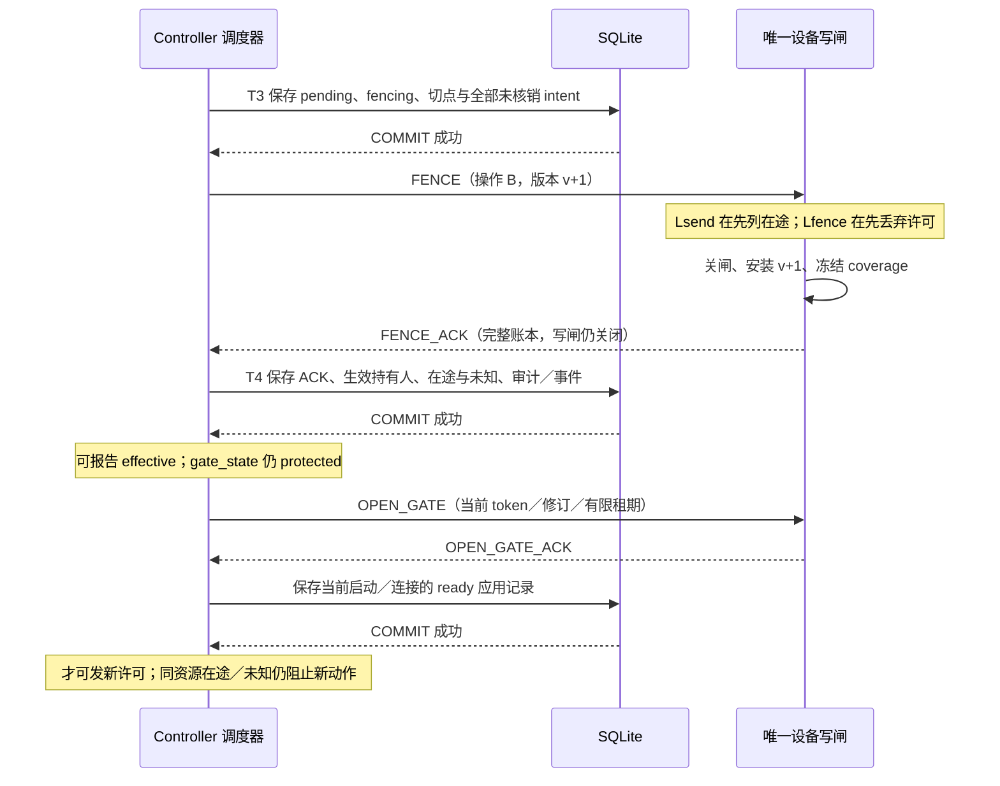
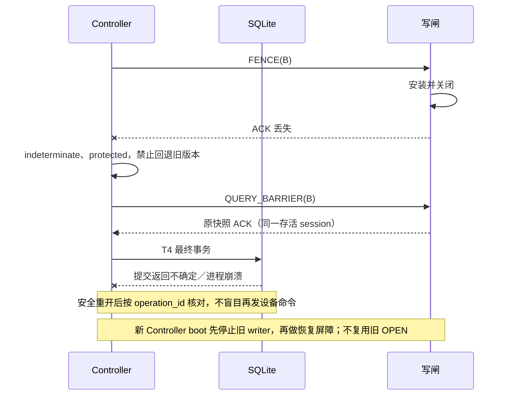

# F02／F03：最终写出口、IPC 与持久化设计

> 后续归并：本文保留原候选与故障说明；当前消息规范为 [IPC 0.2 与公共 draft.3](rebirth-draft3-review.md)，含执行守卫／精确授权及时间屏障。旧 IPC .1 仅为历史基线，真实运行验收仍未执行。

- 日期：2026-10-17。用户已同意公共协议 `1.0.0-draft.2`；本文是其内部实现设计建议 `ipc/0.1.0-draft.1`，不改公共 OpenAPI、命令终态或接管规则。
- 后续确认：用户已同意本轮 F02／F03 推荐方案；设计接受不等于运行验收完成。[F04／F05](rebirth-f04-f05-design.md)继续细化精确撤销、时间守卫与容量，新增消息须版本化归并，不暗改本页已有 IPC 基线。
- 已知项目事实：[已确认设计](rebirth-design.md)、[draft.2 契约](rebirth-first-loop-contract.md)要求手动优先、屏障后确认、未知结果暂停、重启不补发。本轮没有业务实现。
- 以下 IPC、表结构和事务划分均为基于这些约束的工程方案，尚未通过真实进程、SQLite 故障或设备验证。对应机器资料见 [F02／F03 校验入口](contracts/f02-f03/README.md)。

## 1. 不变量与唯一出口

| 编号 | 必须成立的不变量 |
| --- | --- |
| I01 | 每个设备只有一个存活的写入所有者；Controller 主服务、Seamer、GUI 不持有设备写 socket／厂商写句柄 |
| I02 | 每次尝试只有一个持久化 intent、一个单次 permit；数据库成功提交先于 IPC 投递，投递先于最终发送 |
| I03 | 同设备的屏障安装、许可消费及**进入传输层**在同一串行仲裁器排序；不存在仲裁器外的待发重试队列 |
| I04 | 控制权 effective 必须具备完整屏障证据和可靠最终事务；开放写闸还需独立的 OPEN_GATE 确认及资源检查 |
| I05 | 不知道是否进入传输层就按可能已发；unknown 不重投、不释放冲突资源，不因迟到结果自动恢复 |
| I06 | 关键存储失败关闭 Controller 全部设备新写入；尚未收到关闸的出口存在传播窗口，已发／未知如实保留 |
| I07 | 普通重启保留人工持有人及控制世代，但先关闸；备份恢复换世代且旧控制权仅历史；两者均不自动续跑 |
| I08 | 设备副作用与 SQLite 不是同一个事务；仅通知事件允许按固定 ID 重传，派发 intent 不作为自动重放队列 |

可信模块 worker 内每台设备一个 `DeviceWriteGate`，所有动作调用最终经其交给传输适配层。每种模块可服务多台设备，各设备独立排序；worker 整体失败影响它承载的全部设备。读轮询可独立，但“读方法”包含设备写副作用、初始化恢复、心跳控制、厂商自动重试或重连恢复预设时，必须归入写闸。首个 OBS 模块禁止自主写和自动重发；第三方模块不能绕过闸持有备用写连接。依赖无法关闭隐式重试或无法暴露传输队列时，不得声明支持首闭环强屏障。

**发送线性化点 Lsend**：在闸内复核控制／授权／gate 修订、启动与连接身份、资源、截止后，标记许可消费并开始一次不可分割的传输提交。这里的不可分割指与屏障的串行顺序，不是网络原子性。进入可能有副作用的底层调用即视为可能已发；同步明确拒绝且有可靠证据才可以归为未发。`send_started_at` 只作审计，不靠墙钟大小判定屏障先后。

**屏障线性化点 Lfence**：同一闸内关闭写入、安装新版本／gate 修订、永久失效旧许可，冻结覆盖账本。Lsend 先发生的列入在途／未知；Lfence 先发生的旧许可不能进入传输层。已交给内核、TLS／WebSocket 库或设备的字节仍可能在 ACK 后送达，属于屏障前在途，不能声称物理线路立刻静止。

多帧命令必须声明单次提交覆盖范围；尚在应用层的剩余写帧由屏障丢弃，已发部分记 possible／partial 与 unknown。不能将等待响应后产生的后续设备写藏在同一次许可中；需要新的受控尝试／动作定义。阻塞调用占住仲裁器时不得伪造 ACK；达到预算转 protected，按进程终止路径处理。单设备坏调用不能占用主服务数据库线程；模块共享 worker 的故障半径必须显示。

## 2. IPC 信封与消息

采用同机、本地鉴权、可靠有序字节流；Windows 本地命名管道、Linux 本地域 socket 为拟定承载，具体库、ACL／对端校验、进程句柄及关闭行为留实现验证。凭据由主服务通过受限启动通道提供，不在参数列表、日志或本文示例中存放。boot_id 只是身份绑定字段，不代替鉴权；不默认信任“来自本机”。

编码为四字节无符号大端长度加 UTF-8 JSON。先执行字节、深度、重复键和数值护栏，再 Schema 和状态校验；不支持任意外部引用。试验上限为每帧 256 KiB、每设备覆盖清单 256 项、每通道 64 个普通待处理帧并保留 4 个保护帧槽，属于测试配置，不是生产容量承诺。发送前按实际编码大小再检查；达到任何上限先停发，禁止截断屏障清单。保护槽满／IPC 故障进入 protected，不宣称紧急接管已生效。屏障不得被普通队列无界饿死；优先排队可丢弃尚未入流的派发，但不能颠倒已入流序列。

通用字段：`ipc_version, type, message_id, reply_to, ipc_session_id, controller_boot_id, worker_boot_id, seq, device_id, body`。`seq` 为每方向严格递增十进制字符串；握手也绑定主服务预分配的随机 session 与 worker boot 身份。`reply_to` 对响应必填非 null，非响应为 null。重连新 session，不恢复待发队列。重复帧只返回已缓存结果／拒绝，不再次执行；不同内容复用同一消息或业务 ID 是协议错误并关闸。消息缺口／乱序不能跳过恢复写入；重建连接并重新核对。所有消息实例是假数据。

| 消息／方向 | body 具体字段 | 应用规则 |
| --- | --- | --- |
| HELLO，W→C | module_id、module_digest、clock_domain_id、supported_ipc_versions | 启动写闸关闭；版本／模块与启动清单匹配 |
| HELLO_ACK，C→W | selected_ipc_version、clock_domain_id、gate_state=closed | 不因握手完成而开放写入 |
| OPEN_GATE，C→W | barrier_id、gate_token、device_session_id、control_epoch、control_version、gate_revision、authorization_revision、clock_domain_id、lease_until_tick_ns | 主服务已可靠提交当前控制和授权；仅打开最近已安装且未被保护关闭作废的屏障对应修订，不能回退或越过 close 锁存 |
| OPEN_GATE_ACK，W→C | gate_token、gate_revision、state=open | 主服务此后才投递许可；不等于资源已 clear |
| DISPATCH，C→W | permit（原 draft.2 DispatchPermit）、request（原 draft.2 CommandRequest 完整快照）、parameters_schema_digest、send_window（clock_domain_id、earliest_tick_ns、latest_tick_ns）、gate_token | 按原投影计算 request 摘要并匹配 permit／durable intent，核对设备、控制、origin、期限及自动化绑定；保留前提、证据要求和能力版本，参数再校验。许可不可跨 session／设备连接复用 |
| SEND_REPORT，W→C | report_id、permit_id、attempt_id、dispatch_intent_id、device_session_id、disposition、proof、protocol_request_id | disposition=not_sent／in_flight／unknown；proof 与分类一致。报告只表示发送事实，不自动等于命令成功 |
| EVIDENCE_CANDIDATE，W→C | report_id、command_id、attempt_id、device_session_id、evidence_kind、observation_id、payload | 候选证据需 Controller 核对来源、能力／会话及新鲜度；模块不能自填 durable=true |
| REPORT_STORED，C→W | report_id、record_revision | 相关关键事务成功后发送；worker 此后可释放缓存。可重发同 report_id 的报告，不能重发设备动作 |
| FENCE，C→W | barrier_id、operation_id、control_epoch、target_version、target_gate_revision、issued_cut_revision、ledger_digest、open_intents[] | open_intents 每项含 permit_id、command_id、attempt_id、dispatch_intent_id、worker_boot_id、device_session_id；持久化切点内未核销意图的完整集合 |
| FENCE_ACK，W→C | ack（原 draft.2 BarrierAck）、issued_cut_revision、ledger_digest、gate_revision、coverage[] | 每项 intent 恰好一种分类及 proof，ACK 时写闸仍 closed；绝不自动开启目标持有人 |
| QUERY_BARRIER，C→W | barrier_id、operation_id | 同 session 查询原快照；不重放动作、不制造新的“当前状态”替换原屏障证据 |
| CLOSE_GATE，C→W | close_id、reason、scope=device／controller | 当前已鉴权会话内无条件保护关闭，不依赖数据库写成功，不改变控制持有人／版本。controller 范围覆盖该 worker 所有设备，device_id 为 null |
| CLOSE_GATE_ACK，W→C | close_id、closed_device_ids[] | 仅表示列出的出口已关闭；Controller 全部 worker／设备对账后才能报告全部已应用，不把多设备 gate 修订合成一个数 |

### 2.1 时间、续约与保护

请求／响应型消息只有 HELLO_ACK、OPEN_GATE_ACK、FENCE_ACK、CLOSE_GATE_ACK 通过 reply_to 关联；SEND_REPORT、EVIDENCE_CANDIDATE、REPORT_STORED 是按 report_id 关联的独立通知，reply_to 为 null。CLOSE_GATE 即使数据库完全不可写也必须能发，close_id 是本次会话的保护去重身份，不是持久化版本；重复关闭不会开放出口。

内部 tick 是同机共享单调时钟域的纳秒十进制字符串，`clock_domain_id` 绑定宿主启动身份及经平台验证的时钟实现。不能直接比较两进程各自从零计时的值。首期共享时钟实现必须把挂起／恢复纳入安全边界，不能验证则禁止写入；不在本轮假定某个语言计时函数天然满足。

`latest_tick_ns` 从原受理时刻／排期窗口计算，IPC 延迟、重连、重试都不能重置计时。实际执行需 `earliest <= now < latest` 且 `now < lease_until`；到达边界即不发。排期另按原 `deadline_policy` 与当前可信 NTP 质量复核 UTC 窗口，单调窗口只是更保守的限制；质量过期不能只靠旧许可发送。F05 仍需冻结时钟映射和误差参数，禁止“没有适配便退回 worker 接收时间＋TTL”。

写闸短租期只是 IPC 失联的附加限制，不代替人工持有期。OPEN_GATE 可在相同修订／token 下续期，必须检查主服务关键存储健康；不可无限预发续约。已经过期、EOF、close 或重连的闸不能凭迟到续约重新开放，须可靠记录新的 gate_revision／token，再完成受控开放。租期到期不释放持有人、不证明进程死亡。检测故障到出口关闭有传播与调度延迟，不能承诺零窗口；运行验收须测量并给出支持的上界及超界保护行为。

### 2.2 完整账本与 ACK 核对

`ledger_digest` 固定为按 permit_id 升序的完整 open_intents 数组，经 RFC 8785 JCS 后 SHA-256，使用 sha256: 前缀；重复 ID 直接拒绝。账本项本身不含摘要字段，避免循环计算。DISPATCH 的 request 保留原规范化版本，不用新能力默认值重算。执行前提与冲突资源由固定能力目录及请求共同确定；worker 不能只看到 action 参数而丢掉前提／证据要求。

Controller 在同设备调度锁内暂停签发，事务保存 FENCE 的切点和完整 open_intents 清单。此处 open 包括所有尚无**可靠核销证据**的 intent，即使进程／连接身份已旧；历史已完成项可排除，但其持久化核销引用不得清理。未创建 intent 的 queued 命令也在控制事务中阻止，并保留 reason，不混入“已签发许可”清单。

coverage 恰好覆盖 open_intents：未收到且同当前 worker 身份、屏障已安装→`not_sent/never_received`；收到但确定未消费→`not_sent/discarded_unconsumed`；已进入传输→`in_flight/transport_entered`；无法确定→`unknown/send_uncertain`。新 worker 对旧 worker 的 intent 只能报 unknown，不能因为自己没收到就报未发。`ledger_digest` 是固定清单规范化摘要，不是 worker 可以修改的清单摘要。

Controller 检查身份、屏障／操作、世代、目标版本、gate 修订、切点摘要、集合完整性和分类与原记录一致。`discarded_permit_ids` 恰好对应 not_sent；在途／未知命令列表是 coverage 中对应 command_id 的去重并集；同一命令有多个尝试时可同时出现在两列表，不能靠去重删除某次未知。已有更强的持久化证据不得被快照降级；先保存原快照，再按证据顺序归并当前命令状态。ACK 冻结以后收到的完成报告单独提交，不能拿变化后的当前清单否定原 ACK。

只有当前 worker 能确认自己安装的屏障。旧 worker 的 ACK 即使真实，也仅补历史，不开放新进程。新 worker 必须获得显式导入的未知账本；旧进程及其写通道已终止的证明另由宿主监督器提供，不能让新 worker 自证。worker 不保存本地 durable 权威库；缓存丢失后从 Controller 导入并保守核对。

## 3. 接管、开放和故障时序

### 3.1 正常接管与发送竞争



`effective` 与 `ready` 分开：新持有人已生效但写闸未确认或资源未清仍可不能操作。OPEN_GATE_ACK 后的 ready 事务失败则保护关闭，尚无新许可；后续每次派发仍独立 T2。界面不能仅凭 mode/manual 或 holder_id 点亮可写操作。

### 3.2 ACK 丢失／最终提交不确定



如果原 ACK 缓存已丢，不能编造原屏障生效时间。原 pending 操作可在新 worker 安全接替后追加 recovery attempt（保留旧 boot／barrier／证据），用**新 barrier_id、同 operation_id、同一尚未被替代的目标版本**完成核对；公共操作记录绑定最终有效尝试，内部历史不覆盖。若已 effective 仅恢复当前写闸，不生成第二次控制转交。失败或后续授权变化则保持保护，按当前权限处理，不能回滚旧持有人继续发。

### 3.3 进程、IPC 与存储故障恢复

1. **worker 崩溃**：主服务立即冻结该 worker 的全部设备。所有已签发但无可靠未发／完成证据的 intent 标为 unknown；读缓存只作历史。监督器用进程启动身份和实际退出／句柄释放证据确认终止，PID 不足；包括派生进程和厂商辅助写通道。无法证明终止则不启动新 writer。
2. **Controller 崩溃但 worker 存活**：worker 检测 EOF／租期到期先关闸、丢弃未消费许可，尽力保留报告。不以 EOF 假定设备已停止。新 Controller 不收养旧写进程续发：先核验并终止旧所有者及写通道，再创建全新 boot/session，普通重启保留原控制世代与持有人限制。
3. **IPC 卡住但进程仍活**：主服务 protected；worker 的本地租期复核只限制新发送，不把失联当终止证明。屏障处理不了则不能 ACK。受控停止失败保持故障，禁止第二个 writer。租期值不能替代 OS 存活证明。
4. **设备连接断开／重建**：产生新的 device_session_id。旧会话 permit 失效；原意图保留 unknown 或已确证结果，重连只做允许的只读握手。若设备协议握手含写副作用，应声明并经写闸许可，否则该适配器不满足首闭环。
5. **关键 SQLite 故障**：独立于阻塞数据库调用的保护路径先关闭主服务调度，再尽力向所有 worker 发送 CLOSE_GATE。禁止新 permit 和租期续约；已发送的许可必须经关闭 ACK／屏障核对，不能宣称错误发生那一刻全部停止。丢失报告或缓存满时关闸保留 unknown，不能因无法记审计而继续写设备。
6. **主机重启**：所有 boot/session 换新；未发送 queued 旧请求终结为未发 blocked/expired，不续排；有 intent 无可靠结论则 unknown。恢复人工持有人限制、暂停锁存、资源占用，关闭旧 RequestContext。普通重启不能生成新命令来“完成旧工作”。

监督器拥有整个 Controller 实例的单所有者锁；同库 SQLite writer 锁不能替代设备所有者锁。不同数据库副本也不得各自启动同一设备 writer；部署层须唯一注册设备并在接替前确认旧实例停止。已有设备原生控制台仍可能改变现场，靠观测与执行前提核对，不能声称对外部控制拥有全局互斥。

### 3.4 写闸状态与启动安装补充

内部闸状态为 `closed → installed_closed → open`；屏障、EOF、租约到期、存储故障或协议错误使 open 回到 closed／installed_closed 并锁存保护。OPEN_GATE 不能隐式安装未知控制世代：新 worker 必须先用 FENCE 安装持久化控制版本及未核销账本。启动核对使用内部 recovery operation_id／barrier_id，普通重启不为此改变人工持有人；已经 effective 的公共操作不被重写。若原操作尚 pending，则按 3.2 的恢复尝试完成原目标。

同一个 token 的续约仅限仍处于 open、相同当前版本且未过期；一旦保护关闭必须可靠登记严格递增的 gate 修订／新 token，再以新 barrier_id 安装屏障并开放，旧 OPEN_GATE／续约一律不能越过锁存。接管版本可不变，gate 修订不能倒退；重复原 FENCE 只查询原 ACK，不清除其后发生的保护关闭。自动化准入仍独立校验当前 grant／arm 世代，OPEN_GATE 不是新的授权。外部 `ControlRecord.gate_state` 将内部非 open／未可靠确认 ready 的状态投影为 fencing 或 protected。

## 4. SQLite 持久化方案

### 4.1 官方事实与本项目选择

官方事实：WAL 不用于跨主机网络文件系统，写事务仍串行；SQLite 官方披露的 WAL-reset 问题已在 3.51.3 及后续版本修复，也有 3.44.6／3.50.7 回移植。（[SQLite WAL 文档，含第 11 节](https://www.sqlite.org/wal.html)）

官方事实：WAL＋FULL 在提交时增加同步；NORMAL 在掉电／系统崩溃后可能丢失已提交事务。持久化仍依赖 VFS、操作系统和存储正确兑现同步操作。（[SQLite synchronous](https://www.sqlite.org/pragma.html#pragma_synchronous)、[SQLite 原子提交的存储假设](https://www.sqlite.org/atomiccommit.html#hardware_assumptions)）

**项目推荐**：Controller、Seamer 各自一个本地关键库，各自一个专用 writer 执行线程／队列，受限只读连接；worker／GUI／SDK 不直连。数据库、WAL、SHM 位于同一本地持久化卷，不放 SMB/NFS 或临时容器层。Nginx 只反向代理，不承担状态保存。选定驱动时固定实际 SQLite 引擎构建，最低要求包含上述修复，首选 3.51.3 及之后经验收的固定版本；不将系统 Python 或任意系统 SQLite 版本当产品版本。不宣称本轮已选择驱动。

连接初始化建议（示意，不是迁移脚本）：

```sql
PRAGMA journal_mode=WAL;
PRAGMA synchronous=FULL;
PRAGMA foreign_keys=ON;
PRAGMA busy_timeout=0;
PRAGMA wal_autocheckpoint=0;
```

每个相关连接在事务外设置并读取验证实际值；`journal_mode` 必须实际返回 wal。写连接与 checkpoint 连接使用 FULL，读连接禁止写。busy_timeout=0 由应用显式处理有限重试，避免 SQLite 的长等待占住保护调度；等待发生在独立存储队列，不阻塞 IPC 关闸。驱动默认自动事务行为需关闭／明确适配，不能混用隐式提交与手写 BEGIN。主写连接不跨线程共享。关键表不放 TEMP，不降级 OFF／NORMAL 求吞吐。

### 4.2 最小逻辑表及一致性约束

以下是待实现的逻辑结构，不创建业务数据库；公共 revision 字符串与内部存储表示应统一转换和溢出拒绝，不能字典序比较 `"10"` 与 `"9"`。

| 表／记录 | 主键／唯一条件与关键内容 |
| --- | --- |
| service_generation | service_id；control_epoch／request_epoch、schema_version、启动与恢复记录；恢复世代只允许受控事务修改 |
| request_context、request_identity | context_id；UNIQUE(service_id,principal_id,context_epoch,context_id,operation,idempotency_key)，固定原协议／能力版本、内容摘要、对应资源 ID |
| command、attempt、dispatch_intent | command_id、attempt_id、intent_id；UNIQUE(permit_id)、UNIQUE(attempt_id) 绑定单次 intent，action/schema 快照、原截止、进程／连接身份、分类与核销引用 |
| device_control | device_id；epoch、version、holder、mode、gate_revision、gate_token、当前 pending operation；CAS 更新预期版本，单设备至多一个 pending |
| control_operation、barrier_attempt | operation_id、barrier_id；目标版本、每次尝试 boot/session、issued_cut_revision、完整清单及摘要、原始 ACK、应用状态、可靠提交修订 |
| resource_hold | (device_id,resource_key,command_id)；冲突仲裁在同 writer 事务内执行。不能靠 UNIQUE(resource_key,command_id) 假装已禁止不同命令冲突 |
| evidence、report_receipt | evidence_id、report_id；同 ID 同内容幂等，不同内容拒绝；来源、会话、原结果、追加 resolution、不覆盖终态 |
| audit、event_outbox | audit_id、event_id；与关键状态同事务落库，事件发布／确认另有状态；不将大日志附件写进关键事务 |
| Seamer run、step、state、trigger_inbox | run_id、(run_id,step_id)、state_revision、source/event_id 去重；固定定义、授权应用快照、结果引用、暂停锁存、恢复消费令牌 |

必需字段 NOT NULL、合法枚举／配对 CHECK、引用 FOREIGN KEY、幂等与单次尝试 UNIQUE。关键列是权威值，JSON 快照按固定 Schema 校验，不能任意更新 JSON 后留下索引列不一致。动态 read/write 资源重叠与跨行状态前提由事务内逻辑验证，不声称 CHECK 能验证所有不变量。禁止对关键表使用 `INSERT OR REPLACE` 覆盖旧记录；冲突必须读回核对摘要。请求上下文过期后仍拒绝新执行，保留身份墓碑／关闭上下文屏障；清理需遵守保留策略及外键，不删除未核销 intent、未解决资源或仍被引用证据。

### 4.3 事务编号、提交顺序及故障结果

关键写使用短 `BEGIN IMMEDIATE`，完成必要 CAS／约束后 COMMIT；不在事务里等待 IPC、socket、NTP、用户操作或 HTTP。每个事务有稳定业务 ID／tx_id，审计与 outbox 一起写。跨服务没有分布式 SQLite 事务。

| 事务 | 必须一起提交 | 提交后才允许 | 提交失败／不确定 |
| --- | --- | --- | --- |
| T1 受理 | 请求身份、摘要、command、初始资源占用／队列、审计、受理事件 | 返回已受理 command_id；queued 可查询 | 无可靠成功不投递；同身份查询，不换键补发 |
| T2 派发 | 再验当前控制／授权／资源／截止；attempt＋intent＋permit 全文、IPC session、gate token、send_window、issued revision、dispatching、审计 | 投递一次 DISPATCH | 持久化意图存在但无明确未发证据则 unknown；可靠证明未投递才可记 not_sent |
| T3 接管 pending | operation、目标版本、fencing、queued 阻止结果、完整未核销 intent 切点及摘要、barrier attempt、事件 | 发送 FENCE | 主服务保持保护；pending 未可靠提交不得发改变持有人的屏障；可无条件发只关不换持有人的 CLOSE_GATE |
| T4 接管 effective | 核验 ACK／coverage、已失效许可、原快照、生效版本和持有人、操作结果、审计／事件 | 报 effective；请求 OPEN_GATE | 不回滚 worker 版本、不报成功；按原 operation_id 核对 |
| T5 写闸 ready | 匹配 OPEN_GATE_ACK、boot/session／token／版本、当前存储健康与保护条件 | 主服务允许后续 T2 | 不投新许可，发送保护关闭；重启 ready 一律作废 |
| T6 发送／证据 | report 去重、可信证据、attempt／命令结果或追加 resolution、资源变化、暂停锁存、审计／outbox | REPORT_STORED、可靠完成事件 | 不宣称 durable；关闸，缓存候选事实，必要时 unknown；不能补发设备动作 |
| T7 Seamer 状态提交 | 同一固定定义及预期状态修订下全部必需步骤成功证据、守卫／授权／接管保护、状态与运行结果、事件／审计 | 发布新业务状态 | 状态保留旧值，运行暂停／待核对；控制设备不回滚，不重跑动作来补数据库 |
| T8 恢复 | 新启动／请求上下文关闭、旧 ready 作废、queued 终结、未核销意图 unknown、持有人限制和资源恢复、审计 | 只读核对及受控新握手 | 保持全写保护；不得以“库暂时打不开”创建空库继续直播 |

T2 的“未投递证明”限同一存活调度进程持有的确定记录，或完整屏障覆盖证明；重启后“没有 SEND_REPORT”不是证明。T4 可靠与否必须按数据库真实结果判断，不能由 worker 自报 durable。T7 首期转换／并行全部必需；Q72 独立可选顺序动作不放宽 unknown／接管／关键存储门控。保护事件与状态提交在 Seamer 本地串行；远端尚未送达的接管事实没有跨服务原子可见性，不能承诺绝对同时撤销，收到后锁存暂停而不倒改历史事实。

### 4.4 错误、checkpoint 与备份

官方事实：BEGIN IMMEDIATE 可能返回 BUSY；COMMIT 返回 BUSY 时事务可能仍活跃，可重试该提交。FULL／IOERR／NOMEM 等错误可能只撤销语句或撤销整个事务，应检查事务状态，不能一概假定已回滚。（[SQLite Transaction](https://www.sqlite.org/lang_transaction.html)、[sqlite3_get_autocommit](https://www.sqlite.org/c3ref/get_autocommit.html)）

| 现象 | 本项目处理建议 |
| --- | --- |
| BEGIN BUSY／排队耗时 | 未发生副作用；受原截止和有限存储预算约束，重试取得事务或拒绝，不能延长命令期限。异常持续争用关闭调度并检查第二写入者 |
| COMMIT BUSY | 检查连接事务状态；若仍活跃，仅重试同一 COMMIT，或明确 ROLLBACK 后核对；不可重跑 T2 及 DISPATCH。未知驱动映射按不确定处理 |
| FULL／IOERR／CORRUPT／NOTADB | 立即保护；连接归 writer 单独处置，捕获原始及扩展错误码。必要时回滚／关闭，安全重开后按业务 ID 和 tx_id 核对；库不可读则无法宣布未提交 |
| 已提交但响应丢失 | 读取原身份／命令／操作；返回已保存事实，不产生第二动作。可读且完整性可信的“无记录”仅证明该数据库事务未留下记录，不证明外部设备没动作 |
| 普通日志失败 | 与关键审计分开，可降级告警；关键审计是上述事务的一部分，写失败不能跳过后继续派发 |

checkpoint 由存储维护队列显式执行 PASSIVE，首期与写队列协调，正常直播不主动 TRUNCATE／RESTART／VACUUM 或跑重型迁移。监控 WAL 字节、未 checkpoint 页、最老读快照、磁盘余量及提交延迟，读接口短事务分页。关闭自动 checkpoint 后必须有可靠的维护调度与阈值保护；任务失效或空间逼近阈值时拒绝新写入，不靠无限 WAL 扛住。阈值、预算和线程隔离在 F05 实测冻结；PASSIVE 也不等于零 I/O 成本。关键 FULL 提交不以等候 checkpoint 为生效条件。

推荐使用驱动支持的 SQLite Online Backup API 分步生成一致快照；官方 API 支持增量复制，成功完成才可作为有效备份。（[SQLite Backup API](https://www.sqlite.org/backup.html)）备份先写临时目标，确认 API 完成、关闭与同步目标，离线完整性／外键检查，登记 schema／engine／世代／时间／校验和清单后发布；失败文件不可覆盖上一有效备份。复制一个正在使用的 .db 文件不算备份，不能手删 WAL/SHM；多服务分别备份不是全局同一时刻，需要 Suite 清单与维护协调。

普通崩溃恢复让 SQLite 恢复原库，保留人工限制；备份恢复是独立维护操作：旧实例停写并终止、隔离校验、换 control/request 世代、旧令牌及接管仅历史、未明设备效果仍保守保留、只读对照现场后人工恢复。数据库完整性检查通过不证明设备状态一致。密钥恢复／轮换单列，不把可携带库文件等同于恢复了所有授权。

## 5. 故障注入与验收清单

所有以下用例**待真实实现后运行**。观察点应包括：真实最终传输入口计数／顺序、带 boot/session 的 IPC 捕获、数据库重开后的原始关键记录及事件、资源占用和 GUI 可操作状态；不只检查一个返回码。每个成功 ACK 都需与完整 intent 清单对账。模拟器提供可暂停的传输入口、部分写、应答丢失与旧进程存活控制，正式直播设备不用于故障注入。

| 用例 | 注入切点／正反例 | 必须观察到的结果 |
| --- | --- | --- |
| FT01 | T1 提交前／后进程终止，随后同键请求 | 前者无发送；后者同 command_id，不重复受理；不能换键自动补 |
| FT02 | T2 提交前终止 | 无 DISPATCH／设备写；旧 queued 不在重启后续跑 |
| FT03 | T2 成功、IPC 前终止 | 无未发证明则 unknown；禁止按 outbox 自动投递 |
| FT04 | Lsend 前后各暂停并插入 FENCE | 前者旧许可未发失效；后者保留在途，ACK 后不发新旧版本动作 |
| FT05 | 部分帧／部分字节已提交，或库隐藏发送队列 | possible/unknown，未发剩余丢弃；无法覆盖的队列使模块不通过屏障验收 |
| FT06 | FENCE_ACK 丢失、重复、乱序、其他 boot/session ACK | 只同身份查询原快照；错身份拒绝；无第二次设备写或虚假 effective |
| FT07 | coverage 少项、重复项、改摘要、旧 worker intent 被新 worker 报 never_received | 全部拒绝，保持 protected；不能只比较 ACK 两个 command 列表 |
| FT08 | ACK 后 T4 COMMIT BUSY／IOERR／掉电 | 不开放新写；按原 operation核对；不存在数据库旧版本却恢复旧队列 |
| FT09 | T4 成功、OPEN_GATE_ACK 前后杀进程 | 持有人可 effective 但非 ready；启动后写闸重建，原 permit 不复用 |
| FT10 | IPC 断开但 worker／辅助进程仍存活 | 超时不算终止；无第二 writer；记录检测至关闸窗口 |
| FT11 | worker 死在设备写后、SEND_REPORT 前 | unknown、资源 unresolved；杀进程不证明设备取消 |
| FT12 | Controller 死、worker 尚有未消费 permit | worker EOF／租期关闭；边界前已发保留；新 Controller 不续用旧 writer |
| FT13 | SEND_REPORT 重复／冲突 report_id、证据先到或后到 | 同内容去重；冲突拒绝关闸；只事务成功后 REPORT_STORED |
| FT14 | unknown 之后收到成功证据 | 原终态保留，追加 resolution；不自动续跑，资源释放另验 |
| FT15 | 磁盘满、同步失败、只读库、checkpoint 失败 | 关键写停止含手动；传播窗口如实计数；普通日志故障单独对照 |
| FT16 | 长读快照、WAL 增长、维护队列停止 | 阈值保护拒新写；不删 WAL、不直播强制压缩；保护 IPC 不被 DB 等待拖死 |
| FT17 | 进程 kill 与宿主／存储故障分别注入 | 两类结果分开取证；前者通过不能充当掉电耐久证明 |
| FT18 | 事务中途错误造成语句回滚／整事务回滚 | 依据事务状态核对；无部分权威状态／孤立 outbox 对外发布 |
| FT19 | outbox 发送后确认前终止 | 重发同 event_id、消费者去重；设备发送次数不增加 |
| FT20 | Seamer 必需步骤未完成／unknown／接管先入队与 T7 竞争 | 不提交目标状态；T7 已提交后才收到远端保护则保留历史并暂停，禁止伪称跨服务同时 |
| FT21 | 备份期间写入、备份半成品、恢复旧备份 | 半成品不发布；恢复新世代，旧 token／context／permit 失效，无双控 |
| FT22 | 同持有人释放、转交接受、紧急接管 | 均走同屏障，未清资源不可绕过；转交邀请本身不换持有人 |
| FT23 | IPC 队列满、屏障覆盖超过上限、多设备 worker 卡死 | 不截断清单、不虚假 ACK；保护有界排队，故障半径可见 |
| FT24 | 截止等号、IPC 长延迟、租约过期后迟到续约、挂起恢复／时钟域变更 | 不重置 TTL，不自动重新开闸；旧域拒绝，UTC 质量另验 |
| FT25 | worker 自动重连／厂商库重试／模块绕过写出口 | 合约模块测试失败，不能宣称已通过；可信进程并不提供恶意代码沙箱 |
| FT26 | 引擎未含 WAL 修复、PRAGMA 实际值不符、网络卷 | 启动预检拒绝写入，不静默回退配置 |

FT04—FT12、FT22 对应 FC06—FC09／FC22；FT01—FT03、FT08—FT21 覆盖 F03 持久化与恢复；FT24 连接 F05。既有 FC01—FC24 保留，不因新增细项宣布其已执行。

## 6. 本轮结论与实施前余项

本轮消除了五处容易误实现的空白：effective 与 ready 分离；ACK 完整覆盖 intent 而非只列命令；重启后旧 worker 的“没见过”不能证明未发；存储故障不能瞬时撤回已送许可；事件重传与设备重投分离。它们遵循 draft.2，没有改成自动恢复或强行清除未知。

F02 设计稿和消息资料可供实现评审，但关闭 F02 仍需选定并验证 IPC／监督器、真正唯一写出口、可观测传输边界和 FT04—FT14 等竞态。F03 已给事务与耐久策略，仍需固定驱动／引擎构建、实际表／迁移评审、备份实现、故障注入和平台存储证据。F04 撤销传播、F05 时钟／容量／保护预算仍是开放前置，不能用实验编码限额冒充生产参数。本轮只进行离线协议检查，没有创建服务、数据库或设备连接。

## 7. 首期最终发送与控制屏障采用

2026-10-29。本节完成C02／C03在统一清单1.4所列的最终发送所有者、切点、持久提交和进程退役顺序核对。**当前事实：**固定panel4采用设备IPC0.14的52种消息；现有编码授权、Ownership、GateAccess、准备拒绝／释放、共享日志及T3—T5已有具名原件与时序，但分轮SQL保留部分领域未接入和最终准入阻断。它们属于局部参考接受集，不能作为产品禁止所有普通派发的功能规范，也不能删除阻断后宣称完整实现。（来源：[当前采用输入](rebirth-df01-sdk-freeze.md#15-首期采用输入与独立通道归属定稿)、[最终准入](contracts/c08-controller/FINAL_ADMISSION.md)、[共享日志](contracts/c08-controller/IPC_JOURNAL_STORAGE.md)。）

**采用结论：**本节统一后续产品实现顺序，复用已有原件，不新增同义发送协议。历史IPC0.3／0.8／0.9和各阶段表数只说明对应参考版本；当前机器接受集仍以DF01固定输入及明确生成差集为准。AdmissionSeal／完整物理外键、真实提供者和最终服务组合属于实施任务，不能把非空BODY、布尔passed或仅Schema通过当作资格证明。

### 7.1 四个所有者及不可混同的提交点

| 所有者 | 独占权威及顺序 | 不由该所有者证明的事实 |
| --- | --- | --- |
| Controller业务单writer | RequestKey裁决、完整主体／控制状态、prepare／Ownership、ci_issue、Guard／permit、屏障cut、ACK采用、ReadyCommit或ScopeCommit、预算及领域审计／outbox | SQLite提交不证明IPC已入流、设备已执行或旧进程已退出 |
| Controller每会话唯一发送器 | 共用设备注册集和每方向连续seq；只选择已提交逻辑候选，再预约完整FrameRecord、持久WriteAttempt并进入同一字节流 | 不从排队顺序自行创建授权；完整写入不等于对端处理 |
| worker每设备唯一I/O仲裁器 | 普通／取消／重传、Guard安装、DENY、各FENCE、OPEN／CLOSE及最终permit消费在同一设备序列中裁决；所有设备共享该会话的帧收发顺序 | OS已接收字节、库ACK或缓存清空均不等于业务效果／设备资源释放 |
| 本机监督器独立journal | 创建前意图、一次启动、bootstrap与准入、拒绝新启动和OS组退役证据 | 不直接访问业务库或持设备连接，不替核心签发Ready／Ownership，不把退役改成not_sent |

核心writer的状态变化与发送器候选登记通过同一进程内协调顺序交接；锁顺序固定为该协调器在前、业务写事务在后，不允许持写事务等待网络或worker ACK。保护先锁存拒绝新选择／废弃本地资格，再尝试持久记录；存储失败仍保持拒绝。持久提交成功仅发布对应新状态，不能解除先到的更强保护。发送器在选择及每次开始写前核同设备当前代次；worker在Lsend再次核当前本地安装状态。两端之间已有入流前缀仍存在传播窗口，不承诺本机COMMIT使远端瞬时关闭。

### 7.2 准备、最终准入、安装及发送

1. T1可靠保存请求裁决及命令后，编码准备事务固定实际RequestKey／取消Plan、参数和profile、目标出口、EncodingAuthorization及独立容量预留。编码不得做设备I/O、自动连接或厂商库重试；prepare登记不消耗ci_issue，不需要尚不存在的最终Guard。
2. 编码响应与其共享入站FrameRecord、原请求及EncodingEvidence同事务保存；原字节摘要按字节计算，参数／profile／出口不能在后续替换。准备失败、未知及过期不生成发送许可。普通proposed_attempt_id此时仍是预留身份。
3. 最终T2在同writer内取得当前控制／授权、普通ReadyCommit或限定取消ScopeCommit、完整前态资源、真实当前tick、编码及预算依据。普通首次派发创建实际attempt、hold及不可变Ownership；取消使用自己的Plan及独立hold；重传沿用原attempt／packet而新增permit、issue、Guard及预算扣费。再写完整后态资源快照和AdmissionSeal，一次COMMIT。既有hold绝不被重标为当前holder。
4. AdmissionSeal固定完整Binding、ExecutionIdentity、前／后态资源Ref、OwnershipRef、PermitAuthority及ci_issue、GateAccessRef、二选一ReadyCommit／ScopeCommit、保护Assessment或null、完整GuardRef、EncodingEvidence／packet、预算扣费原件、控制／授权／两安全代次、最终采样tick及封存摘要。每条新issue必须有且仅有同事务seal；seal中的许可类型与普通／取消唯一关联。正文及真实提供者原件逐项核对，不以存在某行代替当前性。Guard不反向引用Seal，seal不依赖尚未发生的Guard ACK，避免摘要及因果循环。
5. T2可靠确认且资格仍有效后，唯一发送器才预约GUARD_INSTALL或CANCEL_GUARD帧；精确ACK保存为入站领域事实。ACK必须绑定原Guard、运行域、会话、permit或execution及完整Scope，可靠采用后才允许选择对应DISPATCH。等待ACK期间不持写事务；迟到ACK仅保留历史，不能重开当前门控。
6. 设备I/O前核原字节、完整Guard、当前范围／控制／授权／资源安全代次、逐传输预算及实际单调期限；需要UTC的动作另核当前Reference Bundle及自身窗口。worker先消费唯一permit，再调用设备传输；消费后崩溃或结果丢失保留unknown，不自动重发。协议重传只能请求Controller新增许可；上游库内部重试必须接入同一出口，不能自行重用旧许可。

准备原件在T2采用时检查其期限；T2之后保留它作为原签发历史，不因编码TTL经过抹掉传输intent。后续仍受原Guard／发送窗口和当前撤回约束，不能借此延长任何期限。设备预算、编码活缓存和风险hold是三个不同账本：Guard失败或未知不自动退设备预算；DENY不退编码缓存；RELEASE不清设备风险。

### 7.3 保护切点、关闭与控制生效

所有屏障cut在与准备登记和ci_issue相同writer顺序中封存，逐目标保存完整匹配普通及取消传输、共享issued_cut_revision、规范摘要及原操作／attempt绑定；准备cut另保存完整prepare登记水位和匹配全集，不能从permit反推尚未派发的准备。范围按原来源选择：CONTROL覆盖同设备；AUTH按原完整身份／用途及修订；RUN按原run／arm／origin；TIME只覆盖匹配域及time-required成员；CANCEL区分ordinary与all。手动取消不得借父命令的run身份；非命中成员不凭“同设备”被误撤。

控制T3同时封存pending操作、预留目标版本、queued终结、cut及发送outbox；提交后才发送会改变控制版本的FENCE。数据库失败可走只关闸的紧急CLOSE，不得借它报告控制权变更。原ACK入库与T4采用分开；T4再核当前pending／最新attempt、完整目标集合、原主体／期限及所有原件未撤回，控制记录、操作结果、选择分类及通知同事务提交。历史in_flight不能被not_sent或退役覆盖，退休仅证明不能继续发新字节，原未知影响仍保留。

CONTROL／AUTH／RUN／TIME／CANCEL各领域保留自己的deny或失效原件；统一关闭调度只从这些原件、资源事故、Ownership撤回、会话／监督失效派生目标，不另建一套可独立解除的控制或拒绝权威。每个关闭目标保存完整cause Ref、设备／出口、目标安全代次及原关闭attempt关联，同cause同目标幂等；多个cause不得互相覆盖。当前范围内任何未解除硬保护都阻止普通OPEN；迟到更强事实或原ACK撤回须同事务追加风险失效、全部受影响目标及outbox，新发现出口也受当前保护。既有ro／cu／go记录映射到该共同派生关系，不能把“有目标行”当worker已关闸。

恢复消费只采用当前完整关闭证据，不自动OPEN。普通开放使用ReadyCommit；限定取消使用ScopeCommit，二者互斥，cancel_only不能显示为全局ready或豁免无关风险。父ordinary未知仅在原批准取消政策逐项允许时参与保护评估，不转移其Ownership或释放资源。切换范围／执行／主体／域先关闭，再完整安装新屏障／拒绝快照，用新gate revision和token开放；T4 effective不是T5 ready，OPEN_ACK也须当前原件复核并可靠采用。相同旧OPEN或close重投只查原ACK，不重开、续租或关闭后来合法开放。

### 7.4 共享日志的最终优先规则

采用IPC_JOURNAL及IPC_JOURNAL_STORAGE覆盖GATE_ORDER的早期仅内存seq描述：未分配序号的逻辑候选可因保护而丢弃；完整帧及seq一旦可靠预约，就不得退款、跳过或用占位帧补号。该帧在发送前失去资格时终止会话，不继续后续正常帧。每会话多设备共用方向水位，设备调度器不能另开写队列；先前帧完整写入后才允许下一帧开始。部分写或不确定结果不能从中间重发。

所有52类消息接入同一FrameRecord／EffectCommit关系；以下是领域所有者映射，不改变现有线协议方向或reply_to。入站FrameRecord、领域原件／状态、审计和必要应答outbox同COMMIT，出站逻辑意图先可靠保存，选帧及WriteAttempt仍按共享日志两阶段完成。STORED只在对应领域可靠提交后排队；historical或rejected有精确原结论，不能用通用非空effect_body假装业务成功。

| 消息集合 | 领域提交所有者及效果 |
| --- | --- |
| HELLO、HELLO_ACK | 会话／监督准入关联，仅wire_compatible_closed |
| ENCODE_PACKET、ENCODE_CANCEL_PACKET、PREPARE_PACKET、PREPARE_CANCEL_PACKET、PACKET_ENCODING_FAILED、CANCEL_ENCODING_FAILED | 准备授权、原编码结果及容量账本，不授设备发送 |
| PREPARE_PACKET_REJECTED、CANCEL_PREPARE_REJECTED | 核心对原prepare的明确拒绝与原响应关联，不伪造worker失败 |
| GUARD_INSTALL、GUARD_ACK、CANCEL_GUARD、CANCEL_GUARD_ACK | 最终T2的Guard与安装采用，ACK不重做T2 |
| DISPATCH、RESEND_DISPATCH、DISPATCH_CANCEL | 已封存逐传输许可及发送意图；初发和重传各一次消费 |
| RESEND_REQUEST、RESEND_REJECTED、CANCEL_RESEND_REQUEST、CANCEL_RESEND_REJECTED | 原packet／attempt或取消执行的重传请求裁决；允许须另有新permit |
| SEND_REPORT、EVIDENCE_CANDIDATE、REPORT_STORED、CANCEL_SEND_REPORT、CANCEL_EVIDENCE_CANDIDATE、CANCEL_REPORT_STORED | T6原报告、证据及命令／取消裁决，资源变更另核依据 |
| QUERY_CANCEL_EXECUTION、CANCEL_EXECUTION_STATUS | 精确原执行只读状态，不重新执行或推断未发 |
| FENCE、FENCE_ACK、AUTH_FENCE、AUTH_FENCE_ACK、TIME_FENCE、TIME_FENCE_ACK、RUN_FENCE、RUN_FENCE_ACK、CANCEL_FENCE、CANCEL_FENCE_ACK | 各领域cut、原ACK及独立采用；同一日志不合并各自选择器 |
| QUERY_BARRIER、BARRIER_UNAVAILABLE、BARRIER_STORED | 原屏障查询／不可用／可靠保存事实；查不到不生成未发证明 |
| OPEN_GATE、OPEN_GATE_ACK | 原OpenPlan／Dispatch／ACK与ReadyCommit或ScopeCommit独立采用 |
| GATE_FENCE、GATE_FENCE_ACK | 当前换闸及连续性原件，不变更控制holder或设备结果 |
| CLOSE_GATE、CLOSE_GATE_ACK | 全目标关闭及历史关联，普通与terminal模式分别处理 |
| DENY_ENCODING、DENY_ENCODING_ACK | 准备未来使用的永久墓碑，已借字节未发也拒绝；不退款 |
| RELEASE_ENCODING、RELEASE_ENCODING_ACK | 编码任务及全部字节借用退出后的清空原件与唯一退款，不清设备影响 |

数据库不可写时只有controller范围CLOSE_GATE／ACK可用volatile_close、seq=null及预留缓冲，经同一流的完整帧边界处理；发起前核心永久停止该会话正常发送，worker接受后terminal_closed。若流部分写／阻塞或保护缓冲不足，断流并请求监督退役，不能建立第二条未排序通道。紧急ACK不宣称durable、not_sent、资源clear或控制effective；恢复数据库后只存历史，旧会话不重新开放。

### 7.5 退役、恢复与产品写集交接

正常退出、OS组退役、缓存释放和设备风险处置分别留原件。监督journal记录停止新启动及全部旧成员，取得OS创建实例／无逃逸组清空证据后，业务核心才能采用RuntimeRetired；查不到PID／Job／cgroup、IPC断开或超时都不单独证明退役。监督库与业务库不做跨库原子提交：源回执只读核验，核心同事务保存完整Ref及当前采用；源撤回或监督失联先关闭本地资格，再持久保护及通知。旧回执可查不代表当前仍可发送。

进程重启在接受新工作前终止所有旧IPC会话和Ready／Scope／Guard资格；查原命令、cut、ACK、准备及退役记录，保留未知影响。新worker以新boot／session默认closed，只能在旧出口退役及当前资源／恢复条件分别满足后取得新资格。旧outbox中的DISPATCH／OPEN／编码不自动重播，查到历史T2提交也不是继续旧动作的授权。后台原报告允许追加核对，不改写旧请求身份或重置预算。

DF04第22节将本节对象关系纳入产品DDL与迁移；无需先把每个历史参考表拼成新的实验包。现有AdmissionSeal／Scope／Encoding／journal等参考中的“未实现提供者”和临时阻断，在产品中由上述明确关系与最终验证替代，旧参考原件保持其原验证范围。范围及字段／失败／依赖已明确的部分直接进入实施；平台退役可靠性、并发、真实库和设备效果保留为验收，不假报设计阶段已执行。

### 7.6 实现后的验证出口

A03／A04／A06／A07按本节增加：T2任一缺写不产生可发送许可；Guard ACK不先于seal且不单独授发送；保护先于选帧拒绝、预约后失效终止会话、入流在先保留未知；所有52类方向／reply_to与领域提交配对；同ID异原字节拒绝；普通／取消切换不双开；控制T4不改旧hold归属；DENY／RELEASE／退役分别不清设备风险；数据库不可写仍可终端关闭或请求退役；崩溃后不重播历史设备动作。真实并发调度、磁盘故障、平台监督与设备均待实现后验证，本轮只做固定契约／映射核对及已有共享日志有限模型复验。
