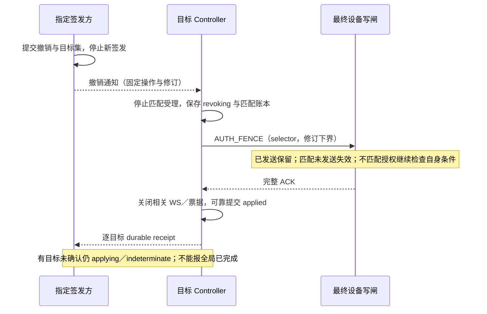
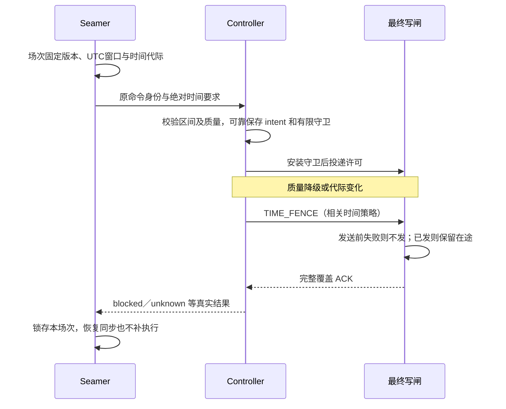
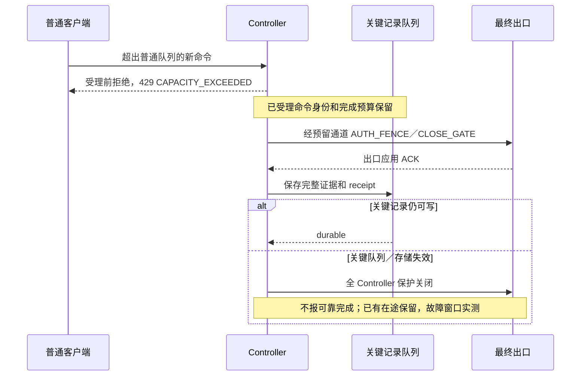

# F04／F05：身份撤销、时间边界与容量保护

> 后续归并：用户已同意本文方案，已进入 [公共 draft.3／IPC 0.2](rebirth-draft3-review.md)。本文候选字段与“待归并”表述保留当轮历史，新版机器规范及整体审阅为当前依据；库选型和运行证据仍未完成。

- 日期：2026-10-17；用户已同意 [F02／F03 方案](rebirth-f02-f03-design.md)，认可设计不等于通过运行验收。
- 后续确认：用户已同意本文 F04／F05 推荐方案；候选模型保留版本，协议归并及真实运行验收仍待完成。本轮继续 [F06／F07 细化](rebirth-f06-f07-design.md)，不启动业务实现。
- 已知项目约束：Q55—Q57 的身份与组织自动化分离、Q23／Q48／Q59／Q60 的时间边界、Q63／Q64 的容量及事件完整性，均以 [主设计](rebirth-design.md) 为准。
- 本文为工程推荐 `f04-f05/0.1.0-draft.1`；样例、预算和算法是待实现方案，未测网络、NTP、身份服务、浏览器或设备。机器资料见 [独立校验入口](contracts/f04-f05/README.md)。

## 1. 与已同意基线的关系

公共协议 `1.0.0-draft.2`、F02 的 `ipc/0.1.0-draft.1` 保持原文件和语义。本轮发现三个**需要后续版本显式归并的工程缺口**，不暗改现有契约：

1. DispatchPermit 的 authorization_revision 不足以表达具体会话、组织服务授权及扩展批准对象。增加执行守卫的身份绑定和精确撤销屏障，不能把人员退出一律映射成整台设备 CLOSE_GATE，导致独立组织自动化被隐式暂停。
2. 业务 NTP 质量降级不能调用无差别 CLOSE_GATE。增加时间代际／绝对时间守卫，仅阻断依赖该时间策略的动作；认证时间失信、关键持久化失败等仍按各自更大保护范围处理。
3. 浏览器 WS 升级不能假定任意 Authorization 请求头可直接由页面设置；提出一次性票据握手。旧 OpenAPI 仅声明 bearer 的 WS 入口未覆盖此流程，正式发布前须修改安全方案、测试 SDK 和浏览器。（浏览器接口依据：[WHATWG WebSockets](https://websockets.spec.whatwg.org/#dom-websocket-websocket)）

建议在统一发布候选时归并公共 `draft.3`、内部 `ipc/0.2.0-draft.1`，确切版本待合并评审；本轮的独立模型不是可以混投旧 IPC 的新字段。新 worker 必须协商 `scoped_authorization_fence`、`execution_guard`、`clock_generation_guard` 特性；不支持则不开放首闭环写入。F02 的唯一出口、完整账本、effective／ready、原终态与未知保护保持不变。

## 2. F04 身份、登录与信任

### 2.1 推荐实现边界

独立 Controller 自行签发本地身份；套件由指定 Controller 充当签发方，Seamer／其他 Controller 显式配对并自行授权。主体主键为 `(issuer_id, issuer_epoch, principal_id)`，不按邮箱或显示名合并。签发方失效不选主、不回退另一个登录来源；本机管理员恢复是独立维护入口，不能绕过接管、资源和关键存储约束。

首期推荐**服务端保存的不透明会话与短期、单 audience 访问令牌**，而非仅验签后长期离线相信令牌内的角色。随机令牌由成熟密码库生成，服务端保存不可逆验证值；密码使用经审阅库的 Argon2id，参数按两平台实际内存／耗时测试固定，不实现自制密码算法。（密码算法依据：[RFC 9106](https://www.rfc-editor.org/rfc/rfc9106)；令牌架构为项目推荐。）

浏览器登录／续期只向指定签发方发起：长会话／刷新凭据通过 Secure、HttpOnly、限制 Path 的 Cookie 保存，不放 localStorage／URL；服务定向访问令牌只保存在 GUI 内存。Cookie 操作同时检查精确 Origin 和会话绑定 CSRF 令牌，SameSite 只作辅助。首期 GUI 与认证入口经同一站点路由；跨源服务只允许显式 GUI 来源，拒绝通配凭据来源。TLS 终止在 Nginx 时后端仅接受受控代理／受保护通道，忽略客户端自填身份头。HTTPS 与证书信任由安装流程处理，本机一次性初始化不变成常驻匿名管理接口。

服务间优先使用配对后的 mTLS 身份和受限服务凭据；TLS 证明服务身份，不代替设备／动作授权。凭据、令牌、票据、密码、NTP 内部地址不进入公开审计或示例。凭据轮换保留有界重叠窗口和 credential_id，撤销旧凭据不创建新批准或扩大 RunGrant。成熟认证库、mTLS 实现及秘密存储具体选型仍须结合运行语言审阅；本文不声称已实现完整 OAuth/OIDC。

初始化令牌仅部署者本机可取、单次消费、有限有效期；首次管理员创建与令牌消费在同一事务，失败不留半个管理员。配对使用 `pairing_id, challenge, issuer_id/epoch, service_id, service_key_fingerprint, requested_scopes, expires_at, expected_revision`，两端核对指纹／范围并持久化后才 active；已消费 challenge 不可复用。增权、配对、凭据管理要求近期重新认证，普通控制不反复弹窗。锁定、暴力尝试限速及恢复流程不得泄露账号是否存在。

### 2.2 API 候选契约

以下路径是候选规范，尚未写入公共 OpenAPI；所有管理写入采用现有 context／idempotency／expected revision 规则。涉及秘密的响应只返回一次，不写入普通事件。对外查询按当前权限过滤，错误不泄露其他租户／主体存在性。

| 接口／权限 | 关键输入 | 关键输出及语义 |
| --- | --- | --- |
| `POST /auth/bootstrap`，部署者一次性能力 | bootstrap_token、管理员登录资料、实例模式 | principal_id、issuer_id/epoch；原子消费，一旦完成永久关闭普通网络初始化 |
| `POST /auth/sessions`、`POST /auth/sessions/refresh` | 登录证明／Cookie、CSRF、origin；不接受自报角色 | session_id、认证时间、会话边界；刷新轮换单次凭据并记录复用异常 |
| `POST /auth/service-tokens`，当前会话 | audience、requested_scopes、extension_instance_id（可选） | 短期 opaque access_token、token_type、expires_in、audience；交集授权，不能指定他人 principal |
| `POST /internal/auth/introspect`，已配对服务 | token 验证材料、audience、challenge_id、required_revision | active 及 AuthorizationSnapshot；只返回该服务所需信息，不公开枚举 |
| `POST /api/v1/auth/revocations`，按目标授权／近期认证 | 身份键、selector、expected_revision、reason | `202`＋RevocationRecord；accepted 仅签发方可靠受理，不能当全服务已撤销 |
| `GET /api/v1/auth/revocations/{id}` | 查询权限 | 固定目标集、逐目标 receipt、未确认项；目标不能为了显示 applied 而删除 |
| `POST /api/v1/ws-tickets`，服务 audience 令牌 | origin、subscription_scope、client_instance_id | 单次 ticket、binding_id、有限期限；签发不是订阅成功 |
| `GET /api/v1/clock-assessment` | 查看时间状态权限 | ClockAssessment＋当前 ClockStatus 投影；内部源地址另受管理权限保护 |
| `GET /api/v1/capacity` | 查看状态权限 | profile_id/revision、压力级别、限额／占用、保护原因；不公开其他主体私有用量 |
| `PUT /api/v1/capacity/profile` | 管理权限、近期认证、expected_revision、已验证 profile 引用 | 应用操作及影响；调低上限保留既有身份／记录，不淘汰未决命令 |

不透明令牌查询参考 RFC 7662 的活动状态与受保护查询边界；本项目增加授权修订和新鲜度，并不把自定义 JSON 接口冒充兼容 RFC 的完整 OAuth 接口。（来源：[RFC 7662](https://www.rfc-editor.org/rfc/rfc7662)）

### 2.3 权威记录与执行守卫

| 模型 | 必须字段与约束 |
| --- | --- |
| AuthorizationSnapshot | snapshot_id、issuer_id/epoch、issuer_revision、audience、principal_kind=`human/service`、principal_id、session_id（service 为 null）、credential_id、subject_revision、session_revision（service 为 null）、policy_revision、permissions[]、scope_digest、challenge_id、validity(not_before/expires_at)、fresh_for_ms、state=`active/revoked/expired`；权威生成，客户端不能填出 active |
| AuthorizationBinding | issuer_id/epoch、audience、principal_kind/id、origin、session_id、credential_id、subject_revision、session_revision、policy_revision、scope_digest、grant_id/revision、arm_generation、extension_instance_id/approval_revision；human 必须有 session 且无组织 grant；automation 必须是 service 并有 grant＋arm，manual 无组织 grant，扩展的两个字段同时有值或同时 null |
| ExecutionGuard | guard_id、permit_id、command_id、device_id、controller_boot_id、worker_boot_id、ipc_session_id、binding、authorization_revision、authorization_deadline_tick_ns、clock_domain_id、clock_generation（即时动作 null）、time_policy_revision（即时 null）、time_required、capacity_reservation_id、guard_digest；随 intent 固定，不能临时改绑定重用旧许可 |
| RevocationSelector | kind=`session/principal/credential/grant/extension/trust`、issuer_id/epoch、target_id、revision_floor；只作用于匹配绑定；提升修订形成单调拒绝下界，不接受较旧“active”覆盖 |
| RevocationRecord | operation_id、selector、issuer_commit_revision、target_service_ids[]、state=`accepted/applying/applied/indeterminate`、receipts[]、reason、audit_id；applied 要求目标集完全覆盖且每项 durable、对应出口／订阅确认 |
| RevocationReceipt | operation_id、target_service_id、service_boot_id、selector、observed_revision、gate_revision、state=`pending/applied/indeterminate`、barrier_id、closed_subscription_ids[]、invalidated_permit_ids[]、in_flight_command_ids[]、unresolved_command_ids[]、durable；匹配原操作，等待超时不是 applied |

Snapshot 的 UTC 有效期按**认证时钟**判断。目标服务发 challenge 前记自身单调时刻 m0；有效缓存截止至多为 `m0 + min(fresh_for_ms, 本地策略上限)`，收到响应时若已过期即拒绝。禁止从响应收到时重置完整 TTL；网络慢会缩短可用时间。发送许可的本地授权截止还需取令牌／会话／grant 的保守到期映射最小值，不超过已有写闸租期。续期只为**新许可**提供新快照，不延长已投递许可的旧授权截止。

组织批准记录须有明确有效窗口；RunGrant 的 validity 必须落在该批准窗口内，布防不能自行延长批准。长运行也有有限绝对上限，不以持续心跳无限续命；凭据轮换和快照刷新不改变 grant 到期日。到期先停止匹配派发并失去布防，新授权／新运行仍按明确批准与布防处理；模拟 profile 只测试现有 validity 字段，生产批准时长须结合实际直播场次冻结，不能暗设无限。

服务维护已见撤销修订下界；较旧响应即使 active 也不能覆盖。恢复时缓存作废，先关闭旧写闸／上下文并重新取可信快照。签发方用事务一致的状态生成响应，不能在已提交撤销后回答旧状态的新 challenge。过期只是本地拒绝新写的后备措施，不证明远端已收到撤销，未获确认的目标仍显示 indeterminate。

revision_floor 的定义是最低可接受新修订：匹配 session／principal／grant／extension 的绑定修订小于下界即禁止；不会因此批准新的更高修订，其仍需完整授权。credential 按精确凭据 ID 永久禁用，trust 按该 issuer/epoch 信任域禁用，不靠提高令牌修订解除。target_service_ids 取所有可能持有相关令牌／授权／订阅的已配对服务；无法证明无影响时纳入，不能仅列当前在线者。后续新配对服务先导入最新拒绝下界才能启用，旧目标离线不能通过删除它让操作变 applied。

ExecutionGuard 的 guard_digest 对除其自身以外的完整对象做 JCS＋SHA-256，固定字面字段和 null；不是签名或权限证明。Seamer／签发方没有设备 worker 时，receipt 的 barrier_id 指自身授权与订阅的串行应用屏障，空设备清单须经登记表确认；不能伪造一份设备 ACK。全局状态只在全部固定目标可靠确认后 applied。通知可按固定操作重传，设备命令不可因此重投；这些传播限制与 RFC 7009 的说明一致。（来源：[RFC 7009 第 2.1 节](https://www.rfc-editor.org/rfc/rfc7009#section-2.1)）

### 2.4 精确撤销与最终出口

候选内部消息（与 F02 一起升版协商后才能使用）：

| 消息 | 字段与应用顺序 |
| --- | --- |
| GUARD_INSTALL／GUARD_ACK | 完整 ExecutionGuard、对应 permit 的内容摘要；先可靠保存 intent，再安装守卫，ACK 绑定 guard_digest／boot／session。只有 ACK 后才投 DISPATCH，旧 permit 无守卫不发；安装消息自身不执行设备动作 |
| AUTH_FENCE | operation_id、barrier_id、selector、target_authorization_revision、issued_cut_revision、ledger_digest、匹配 selector 的 open_intents[]；同设备最终出口串行安装拒绝下界，不改变人工持有人或 control_version |
| AUTH_FENCE_ACK | 回显全部绑定、匹配的 coverage、invalidated permits、在途／未知、applied_authorization_revision；像 F02 一样完整对账，不能以一条 ACK 代替全部设备／worker |
| TIME_FENCE／TIME_FENCE_ACK | time_policy_revision、old/new clock_generation、barrier_id、依赖该策略的完整 intent 清单及 coverage；只使相关绝对时间许可失效，普通即时动作不因这一项停用 |

它们沿用 F02 的鉴权信封、有序去重、最终出口、三类 coverage 与可靠落库规则。AUTH_FENCE 与发送竞态：先发则保留在途，先装拒绝下界则禁止匹配许可；不匹配的独立组织授权不会因人员注销失效。全库失效、恶意／失控模块或无法区分绑定时仍用 F02 CLOSE_GATE 保护更大范围，界面明确显示故障影响，不伪称已完成精确撤销。

AUTH_FENCE 的单调拒绝下界即使数据库故障也可先保护性安装；对外 applied 仍需关键事务可靠保存。错误降低权限不会自动回滚；合法恢复必须新修订、重新认证／批准、明确重新布防与新许可，不能重开被撤销的 command。查询和只读观察仍按当前读取权限处理。

持久化接续 F03：签发方同事务保存主体／会话／grant 状态、拒绝下界、固定目标集及事件 outbox；目标服务先保存匹配命令阻止结果、屏障切点，ACK 后再同事务保存完整证据、应用 receipt 与事件。配对信任、凭据验证值、单次 challenge／ticket 消费、撤销下界和容量 reservation 均是关键记录；验证缓存和单调租期重启作废。保护已安装但事务失败时不发 applied，重启需从权威源核对；不能用旧缓存重开出口，也不能以数据库回滚撤回已发送动作。



| 撤销目标 | 必须停止／保留 |
| --- | --- |
| 人员会话退出／到期 | 阻止该会话新操作、未发手动命令、WS、票据及面板临时权；接管限制保留；独立服务身份／组织 grant 保留 |
| 人员账号停用／收权 | 该人员所有相关会话／绑定更新拒绝下界；列出其创建或批准的组织自动化供明确处理，不能自动把它们当该人员会话撤销 |
| 服务凭据／grant／组织范围撤销 | 匹配自动化停止受理和未发、失去布防；在途继续记事实；不凭换一张新凭据复活旧 grant |
| 面板卸载／撤权 | 扩展实例临时授权、请求、票据及订阅失效；不撤销独立组织运行；宿主核对真实 iframe source、origin 和通道，不信任自报 extension_id |
| 配对／签发信任撤销 | 该信任域的新操作受阻，跨目标逐项确认；签发方更换走维护，不让同名新 issuer 继承旧域 |

### 2.5 浏览器与认证时钟故障

WS 推荐以 HTTPS 请求取得**目标服务签发的单次短票据**，在 Upgrade 的专用子协议项传递，服务端只回显固定业务子协议，不回显秘密票据；URL 不带令牌，代理／应用日志脱敏该请求头。票据绑定当前 session、audience、精确 Origin、scope_digest、client_instance_id、issuer_epoch 和短截止，升级前原子消费并重新鉴权。协议依据中 Origin 是浏览器侧防跨站输入，非浏览器可以伪造，不能代替令牌认证。（来源：[RFC 6455 第 10.2 节](https://www.rfc-editor.org/rfc/rfc6455#section-10.2)）

连接存在不代表永远有权限：每次订阅变更与事件发送前检查本地绑定／范围和截止，撤销先停止排入敏感事件并丢弃未交给传输层的队列，再关闭连接；已经交给客户端的内容不能收回。失联后重连须新票据和当前权限，旧 resume cursor 不授予读取权。第三方面板通过宿主受限消息桥调用，拿不到宿主长凭据／全权限 token。

认证时钟使用部署者信任的系统时间与单调回拨检测，**不加用户配置的业务 NTP offset**。已建立的有限截止不能因墙钟回拨变长；异常前跳导致过期不能回拨复活。认证时间可信度不足时拒绝新的认证／续期／写入，保护锁存并显式恢复；不能因业务 NTP 未同步而禁用 exp/nbf/TLS 时间校验。正常业务 NTP 故障但认证时间可信时，符合其他门控的即时手动操作仍可用。

认证时钟自身也需要发布策略中的可信偏差预算：使用认证时间区间的下界检查 not_before、上界严格检查 expires_at，不额外添加可扩展 exp 的“宽限”。对应单调 deadline 只取更早值。撤销通知先应用和授权到期先发生二者任一都阻止后续匹配 Lsend；不能把快照 2 s 与写闸 500 ms 简单相加作为允许延长窗口。已经进入传输层的字节仍可能晚到，配置时限不等于物理撤回时限。刷新失败或响应丢失不放宽旧凭据；SDK 协调并发刷新，无法确认新凭据时重新登录，不重新发送业务命令。

## 3. F05 业务时间与 NTP 边界

### 3.1 后端与质量来源

官方事实：NTP 定义偏移、网络延迟及误差相关量；收到响应或 stratum 看似正常并不等于 LeafSeamer 已获得可用的执行误差上界。NTS 为 NTP 增加认证保护，也不能证明上游时间绝对正确。（来源：[RFC 5905](https://www.rfc-editor.org/rfc/rfc5905)、[RFC 8915](https://www.rfc-editor.org/rfc/rfc8915)）

推荐统一只读 `ClockProvider`，支持配置指定源及监测实际选源。Linux 优先读取经配置 chrony 的样本与质量；Windows 提供系统时间服务适配，若只能取得源和偏移而无法给出所需年龄／误差，则质量为 unproven，不冒充 synchronized。需要更完整质量时再提供经审阅 NTP 库的应用层 offset 模式，**服务不自行修改宿主系统时间**。部署者显式选择模式和源，不因故障静默改公共 NTP。容器读取宿主支持的时间来源／监测接口，不默认授予改系统时钟权限。（可用接口依据：[chronyc 官方手册](https://chrony-project.org/doc/4.7/chronyc.html)、[Windows Time Service 官方资料](https://learn.microsoft.com/en-us/windows-server/networking/windows-time-service/windows-time-service-tools-and-settings)；支持程度须实测。）

NTP 模块需要校验来源、请求响应绑定、往返／离群样本、未同步标志、源策略、误差可估性和新鲜度，禁止仅解析 transmit timestamp 后宣称同步。指定单源可支持，但其错误与受攻击风险不能靠软件估计彻底排除；是否使用 NTS／多源一致性由发布 profile 明确，严格策略要求无法满足时拒绝依赖它的排期。源配置地址视为管理配置，不直接回显给普通 API 读者。

### 3.2 模型与整数边界

| 模型 | 具体字段 |
| --- | --- |
| ClockSample | sample_id、provider_id/boot_id、host_boot_id、clock_domain_id、clock_generation、policy_revision、source_ref、source_auth=`nts/trusted_network/unverified`、mode=`system_disciplined/application_offset`、sample_tick_ns、estimated_utc_ms、uncertainty_ms（不可估为 null）、drift_bound_ppm、max_sample_age_ms、quality=`synchronized/degraded/unsynchronized` |
| ClockAssessment | sample_id、clock_domain_id、clock_generation、policy_revision、evaluated_tick_ns、sample_age_ms、uncertainty_now_ms、utc_lower_ms/utc_upper_ms、eligible_for_absolute、reason_code；无可信界时上下界为 null，不能拿零误差代替未知 |
| ScheduleGuard | occurrence_id、definition_version、clock_generation、time_policy_revision、not_before、not_after、window_enter_tick_ns、queue_deadline_tick_ns、health_latched、block_reason；原稳定场次身份不因时间回拨变化 |
| EventAgeProof | event_id、provider_boot_id、source_sequence、basis=`trusted_utc/causal_capture/unproven`、capture_sample_id、lower_age_ms/upper_age_ms、challenge_id（按方法）、scope_digest；不能只靠 received_at 给旧事件重置年龄 |

毫秒 UTC 使用安全整数进行内部计算，对外时间仍按 draft.2 UTC 字符串；纳秒 tick 使用十进制字符串，不跨宿主比较。给定当前本地 tick m、样本 tick m0，以向外舍入得到 UTC 区间：

```text
elapsed_ms = (m - m0) / 1_000_000
uncertainty_now_ms = uncertainty_ms + ceil(drift_bound_ppm * elapsed_ms / 1_000_000)
L = floor(estimated_utc_ms + elapsed_ms - uncertainty_now_ms)
U = ceil (estimated_utc_ms + elapsed_ms + uncertainty_now_ms)
```

只有同域／同代、m≥m0、样本年龄严格小于策略上限、误差可估且不超过策略阈值、来源策略合格和 quality=synchronized 才 eligible。读取／采样误差必须已纳入 uncertainty_ms，不能省略；drift_bound_ppm 是待验证的发布假设，不是每台机器的恒定事实。该区间是模型下的保守估计，不是对错误或恶意时间源的绝对保证。

绝对排期窗口定义为 **[not_before, not_after)**，最终开始发送必须同时满足 `L >= not_before` 且 `U < not_after`，以及本地队列截止、授权、写闸、前提等。边界等于 not_after 即拒绝；样本／授权／租期截止也用严格 `<`。首闭环不承诺帧同步或按截止完成设备动作。

质量始终合格时，L 尚未到开始而 U 已跨开始可在原窗口内继续等待，不把正常误差带直接视为断流；但到点或等待期间发生质量失效、时间代际变化、暂停、接管阻止、重启或授权失效，就锁存该场次 blocked／missed。质量恢复后即使仍在窗口也不能自动补发。计划前暂时质量失效可修复并重新预检，不能在已进入执行窗口后利用这一例外复活场次。

窗口开始的故障判定采用“可能已到点”边界：在时间可信时预先计算并保存 U 最早可能到达 not_before 的同域 `window_enter_tick_ns`，不晚于实际安全开始，也必须早于 queue_deadline。质量失效后不能停掉这个本地计时；跨过该边界时仍失效就锁存。只有能证明修复发生在窗口开始前，才可重做预检；源／时钟代际改变导致无法证明、进程重启或映射丢失时保守阻止。该映射不是准许发送的依据，实际发送仍重算 L/U 并检查全部条件。

### 3.3 时钟代际、跨节点事件与回拨

源／策略改变、无法解释的墙钟跳变、宿主重启、无法安全计入的挂起／恢复使 clock_generation 变化或进入 degraded。每个进程的“从零开始计时”不是共享时钟；F02 所需同机共享 clock_domain 的具体 Windows/Linux 实现仍需验证。NTP 常规小幅校准可更新样本，但必须保持经过验证的误差界，不能偷偷重置原命令的 queue deadline。

NTP era 到 UTC 的展开、闰秒及源的 smear 策略必须由后端明确处理，不将原始 NTP 秒数直接当 Unix 毫秒。首闭环实验不验收闰秒／smear 切换窗口跨越；发布 profile 需声明时间尺度、保护窗口和误差处理，未验证窗口阻止新的绝对派发。不能在两个不兼容时间尺度间平均取值后声称误差更小；即时手动仍按其他门控判断。

绝对许可固定其时间代际。新样本不能扩展旧许可的最晚单调截止；当前质量恶化时执行守卫拒绝，TIME_FENCE 在相同最终出口排序。允许已经 Lsend 的动作继续观察；时间同步恢复不产生新的发送意图。认证时钟若同样受系统跳变影响，另走 F04 保护，不能靠业务 offset 修复认证。

跨节点事件有两种可审阅年龄证明：

- **可信 UTC**：来源捕获时刻区间 `[Ls,Us]` 与接收时刻 `[Lr,Ur]`，最大年龄 `max(0, Ur-Ls)`，最小年龄 `max(0,Lr-Us)`；若来源区间全在接收区间之后则拒绝异常。用最大年龄对触发 max_age 检查，持久队列等待继续累加本地单调年龄。
- **因果新采样**：接收端先发不可重放 challenge 并记本地 m0，可信来源必须在收到 challenge 后**重新采样**，响应绑定本次 challenge；年龄上限包含从 m0 至当前的全部时间。此法能支持声明为 sampled 的状态，不会把旧离散边沿事件变成新事件，也不自动证明之前没有丢边沿。

无法给出年龄界的输入仍可用于明确标记的展示，但不能触发依赖新鲜度的自动化。业务 NTP 故障不必一刀切停止同机单调证据或符合因果新采样的相对触发。跨主机单调值不能相减；简单收到包、RTT/2 或来源自报 age=0 都不是单程年龄上界。重传保留 event_id／来源序号／原捕获时间，快照不能补造漏掉的离散事件。



## 4. F05 容量、背压与保护通道

### 4.1 容量契约与分类

`CapacityProfile` 带 profile_id、revision、purpose=`simulation/release_candidate`、validated_environment、各额度及预算；未验证的实验 profile 不能显示为生产推荐。层级为实例→主体／扩展→设备→操作／订阅，只有全部有额度才能受理。输入字节数、解压后大小、深度、节点数、数组／字段数、动态 Schema 编译／验证步数及时间均有界；客户端压缩或合法 Schema 不能绕过计算预算。

`AdmissionDecision` 包含 request_ref、decision=`accepted/rejected`、reason_code、profile_id/revision、limited_dimension、retry_after_ms（可为 null）、reservation_id（仅 accepted）、command_id（仅可靠受理后有值）。预检成功只代表该瞬间检查，不是未来额度预订；真正受理事务同时确认额度和身份。先查已有身份再判断新执行额度：同键重查不占新执行槽，但仍受有界查询预算保护；不能因满额丢掉原幂等摘要。

| 类别 | 有界排队与超限处理 |
| --- | --- |
| P0 保护应用 | AUTH_FENCE、TIME_FENCE、CLOSE_GATE、屏障 ACK 与必需核对；预留独立槽位，不受普通限流饿死；仍鉴权并限制合并／去重键数；已进有序流不重排 |
| P1 关键证据／查询 | 完成结果、在途核对、关键审计与按 ID 查询；按已受理命令预留证据处理预算。证据无法保留视为关键故障，保护新写，不能先丢结果后报成功 |
| P2 普通新命令 | 公平调度，实例／主体／设备额度；超限受理前拒绝，已受理身份及截止不变，不静默丢弃／合并离散命令 |
| P3 展示遥测 | 仅按声明合并“最新状态”；慢 GUI 断开或 resync.required，不阻塞控制。Seamer 的离散触发／必需采样不得混入此可丢队列 |

接管、取消等外部请求有独立的已鉴权控制预算，但**控制请求受理仍需关键持久化**；只有保护性关闸／拒绝下界可以不等待数据库先成功。预留通道不能变成无鉴权 DoS 入口；重复保护请求按 operation／selector 归并，不能漏掉不同目标或重置完成状态。对于单个目标，较高修订覆盖旧拒绝下界，但旧操作的审计／receipt 仍分别核对。

### 4.2 可重复实验 profile

下列数值只用于设计反例和模拟器，**不是实测生产参数或 SLA**。默认不启用发布 profile；正式冻结要有 Windows/Linux 两平台、参考硬件／文件系统、设备组合、最长事务、NTP 源及异常负载证据。

| 参数 | `sim-f04-f05-v1` 推荐实验值 | 选择目的 |
| --- | --- | --- |
| access token／会话绝对时长 | 60 s／8 h；近期认证 5 min；刷新空闲上限 30 min | 快速覆盖过期／退出，活跃不延长会话绝对上限 |
| auth snapshot 新鲜度／刷新周期 | 2 s／500 ms，截止从目标 challenge 发出时算 | 故障窗口可测，不能从响应收到时重置 |
| worker 写闸租期／续约周期 | 500 ms／100 ms | 作为 F02 有限租期的试验值；到期不等于进程已死 |
| 撤销应用告警预算 | 本机 500 ms、跨目标 2 s | 超界标 indeterminate／停止相关续期，不谎称达到全球 SLA |
| WS 票据／配对／bootstrap 时长 | 10 s／60 s／10 min，均单次 | 重放和时限反例；bootstrap 另受本机权限限制 |
| NTP 样本最长年龄／最大误差 | 10 s／50 ms，drift 测试界 100 ppm | 测试新鲜度、误差累积与边界等号；不承诺现实精度 |
| HTTP body／WS 或 IPC frame | 64 KiB／256 KiB，JSON 深度 32 | 与 F02 帧上限衔接；巨大导入走另有界方案，不能靠本接口绕过 |
| 设备／worker 数 | 每 Controller 8 设备／2 worker | 首闭环模拟规模，不限制未来产品拓展 |
| ordinary command queue | 每 Controller 32／每设备 8 | 满额拒绝新命令，保留已受理记录 |
| writer／关键结果／保护队列 | 64／64／16 个记录槽，总预留字节上限 16 MiB | 主写者仍单个；每已受理命令先预留最小完成记录槽 |
| worker IPC 普通／保护槽 | 64／4，沿用 F02；单屏障最多 256 intent | 覆盖不能截断；越限先停止签发并保护 |
| 普通身份请求速率 | 每主体 10/s、burst 20；登录每入口＋账户分别 5/min、burst 5 | token bucket 用单调时钟，多维防单主体占满；异常不能改变身份语义 |
| GUI 增量缓冲 | 每订阅 256 条且最多 1 MiB，二者先到为准 | 慢客户端失步，不静默跳游标 |
| 触发输入队列 | 每来源 256 条且最多 1 MiB | 溢出记 gap，暂停依赖它的运行，不合并离散事件 |
| 数据库／WAL 空间保护 | 剩余空间低于 1 GiB **或** WAL 高于 256 MiB 停新写 | 故障测试阈值；预留不保证磁盘永远可写，关键错误仍立即保护 |
| 清理期限 | context 5 min；终结详情候选 7 d；关键审计候选 30 d | 仅清理无未决／引用且上下文关闭的记录；不可清理项耗满容量则停新受理 |

实际值保存在可校验 [实验配置](contracts/f04-f05/simulation-profile.json)，F02 既有 256 KiB／64＋4／256 约束没有扩大。动态 Schema 计算预算、CPU／内存、每来源频率、事务时延、数据库留存字节上限及 release 数值仍需压测确定，禁止把 null 当无限生产许可。收紧 profile 后占用高于新上限只停止新增，按既有身份完成／终结；不为追赶新上限强行取消在途或清空 unknown。

### 4.3 拥塞故障时序



受理前大小／结构拒绝为 413／422，额度耗尽为 429，关键存储或保护状态为 503；鉴权失败仍为 401／403，修订冲突 409，时效错误按现有命令契约。已返回 202 的命令不能事后变成“从未受理”的 HTTP 拒绝，须保存 blocked／expired／unknown 等真实结果。Retry-After 是准入建议，不授权设备自动重试；网络丢响应仍用原身份查询。

## 5. 故障验收与观察点

以下 **FA01—FA24、TB01—TB24 均未运行**。实际验收需固定产物／profile／时钟源／平台，记录出口发送计数与序列、数据库重开事实、receipt 覆盖集合、WS 抓包和脱敏 GUI 状态；虚拟时钟／模拟器结果不能冒充真实 NTP／浏览器／设备证明。

| 用例 | 注入点 | 必须结果 |
| --- | --- | --- |
| FA01 | 无 Seamer 的独立 Controller 登录及手动控制 | 本地身份完整可用；无匿名控制捷径 |
| FA02 | 套件未配对、同名 issuer、错误指纹或重复配对 challenge | 拒绝信任，不自动合并主体 |
| FA03 | bootstrap 并发消费／提交失败／已初始化再调用 | 至多一个完整管理员，接口关闭，失败无半条状态 |
| FA04 | token 改 audience、主体、权限或过期 | 拒绝；客户端自报角色无效 |
| FA05 | 新鲜度响应延迟超过 2 s，返回仍 active | 从发出 challenge 时算，不能收包后续命 |
| FA06 | 收到撤销新修订后才到旧 active 响应 | 拒绝旧响应，不倒退修订下界 |
| FA07 | AUTH_FENCE 与 Lsend 两种相反顺序 | 未发拒绝／已发保留在途；不伪报取消 |
| FA08 | 漏掉目标 receipt、漏 intent、错 boot／session ACK | 不得全局 applied，完整账本对账失败 |
| FA09 | worker ACK 到达后数据库失效 | 已保护但 receipt 非 durable，不报已可靠完成 |
| FA10 | 一个 Controller 不可达，其余完成撤销 | 显示逐目标状态；未确认项不得从集合删掉 |
| FA11 | 只注销某人员会话，独立组织运行在同设备 | 该会话未发失效；组织 grant 不变且不被无差别停控；接管仍保留 |
| FA12 | 人员停用同时有其批准的组织运行 | 人员立即失权；关联运行列出，批量撤销是另一个明确操作 |
| FA13 | 撤组织 grant 或服务权限、随后轮换凭据 | 相关运行失去布防；新凭据不复活旧授权 |
| FA14 | 卸载面板，仍持有旧 channel／ticket | 面板新请求／订阅失效，独立组织运行不受隐式撤销 |
| FA15 | 伪 iframe source／Origin／extension_id | 拒绝；来源与真实宿主绑定交叉验证 |
| FA16 | WS ticket 重复使用、过期、错 audience／origin | 升级前拒绝，不给快照或敏感事件 |
| FA17 | WS 建连后会话过期／收权，待发事件存在 | 停止未发送敏感数据并关闭；已交传输层数据如实说明不可收回 |
| FA18 | 签发方宕机，有限缓存到期 | 相关新写拒绝；不切换登录源；lease 超时不证明远端撤销已 applied |
| FA19 | 业务 NTP 偏移修改，认证时钟正常 | 不延长身份期限，正常手动可用 |
| FA20 | 认证时钟回拨／前跳／失信 | 截止不延长，不禁用过期检查；恢复不能复活旧请求 |
| FA21 | 服务恢复旧备份或重启，缓存／票据仍在客户端 | 缓存重建；旧世代／单次票据／旧守卫不能复用 |
| FA22 | 新 worker 不支持精确授权／时间守卫特性 | 不开首闭环写闸，不回退到忽略字段 |
| FA23 | Cookie 请求 CSRF、宽泛 CORS、代理伪身份头 | 拒绝；不泄露令牌，服务独立授权 |
| FA24 | 保护操作队列饥饿／CPU 卡顿／同步 I/O 阻塞 | 记录实际传播窗口与超界保护；不能只因配置了 500 ms 就声称达标 |

| 用例 | 注入点 | 必须结果 |
| --- | --- | --- |
| TB01 | 指定源不可达／实际选中未批准源 | 不报合格，不静默切换公共源 |
| TB02 | 缺误差界、过期样本、未同步标志 | 不 eligible；不能以零值代替未知 |
| TB03 | 样本年龄恰好上限、误差恰好上限及超出 | 年龄等号拒绝；误差等号允许、超出拒绝，取整一致 |
| TB04 | UTC 区间跨开始／等于截止 | 合格样本可在原窗等开始；截止等号拒绝 |
| TB05 | 到点时间质量失效，再在窗口内恢复 | 本场次锁存，不补发 |
| TB06 | NTP 回拨／异常前跳／改源、改策略及未验证的闰秒／smear 窗口 | 场次身份不重置，旧代际许可失效，不爆发补播，尺度不能混算 |
| TB07 | IPC 排队延迟、许可续约、共享 tick 域不匹配 | 原 deadline 不增长，错域拒绝 |
| TB08 | 挂起恢复及重启 | 无已验证单调映射则降级；不把睡眠暂停解释为延长许可 |
| TB09 | 普通手动与相对触发作为 NTP 故障对照 | 只不因业务时钟独立受阻；身份、持久化及资源仍检查 |
| TB10 | 伪未来事件、旧事件重传、不同主机 tick | 可信年龄按上界判断，不按接收时间变新，不跨域相减 |
| TB11 | causal challenge 新采样／旧离散边沿伪装采样 | 前者有界年龄；后者拒绝转为新触发 |
| TB12 | 先 Lsend 后 TIME_FENCE／先 TIME_FENCE 后 Lsend | 已发保留，旧绝对许可未发失效；即时许可单独检查 |
| TB13 | 普通队列满仍有保护请求、同键查询 | 新命令拒绝；保护／核对预算可用，不重复占执行槽 |
| TB14 | 关键证据队列满或无法预留完成记录 | 停新受理／保护，不吞掉已受理命令结果 |
| TB15 | 一个 GUI 很慢 | 该订阅失步重同步，不拖住控制；快照不能证明历史无事件 |
| TB16 | Seamer 离散事件队列溢出或来源序列缺口 | 相关运行暂停，其他健康来源不无故停用，不补动作 |
| TB17 | 大 payload、解压放大、深 JSON、复杂 Schema | 预算前置拒绝，关键执行／保护不被耗尽 |
| TB18 | 单主体／扩展突发、多个主体公平性 | 多维限流，限速信息不授权自动补发 |
| TB19 | 配置上限降到当前占用以下 | 保留旧记录／在途，拒绝新增而非逐出 |
| TB20 | WAL／磁盘阈值及关键库写错，对照普通日志错 | 前者保护且含手动；后者降级告警不单独停控 |
| TB21 | 保留期到期但仍有 unknown／引用／有效上下文 | 不清理，容量不足拒新受理；旧键不能变新执行 |
| TB22 | 取消、紧急接管试图借 P0 绕过鉴权／存储 | 拒绝旁路，不在库不可写时报成功接管 |
| TB23 | 存储线程／事件循环／GC 停顿超过预算 | 测量真实最大窗口，未达标禁止发布对应容量 profile |
| TB24 | Windows/Linux、原生/容器、真实 NTP 源负载对照 | 分别记录时钟来源质量、队列、提交及撤销分位数／最大值，不互相借用验收 |

映射：FA01—FA24 对应 C07／C09、A09／A10／A15 及 FC13／FC21；TB01—TB12 对应 C06、A11／A12／FC20；TB13—TB24 对应 C05／C08、A08／A14／A16／FC19，并与 FT15—FT26 联合取证。

## 6. 推荐结论与冻结余项

本轮推荐以“精确身份绑定＋出口拒绝下界＋有限可信快照”落实撤销，以“UTC 不确定区间＋单调截止＋场次锁存”落实时间，以“受理前多维额度＋关键结果预留＋独立保护通道”落实容量。没有改变手动优先、组织授权独立、未知不重放或故障后不补播。

尚未完成：认证／TLS／密码／秘密库固定版本，登录与 WS 浏览器实测，配对和轮换实现审阅；Windows/Linux 时钟接口及 NTP 后端的质量证据、跳变与挂起行为；发布 profile 的真实负载／恢复和撤销窗口测量；新守卫／授权和时间屏障合并进下一版公共／IPC 规范与代码生成测试。F04／F05 不能因本轮 Schema 或计算向量通过就标成运行验收完成。
