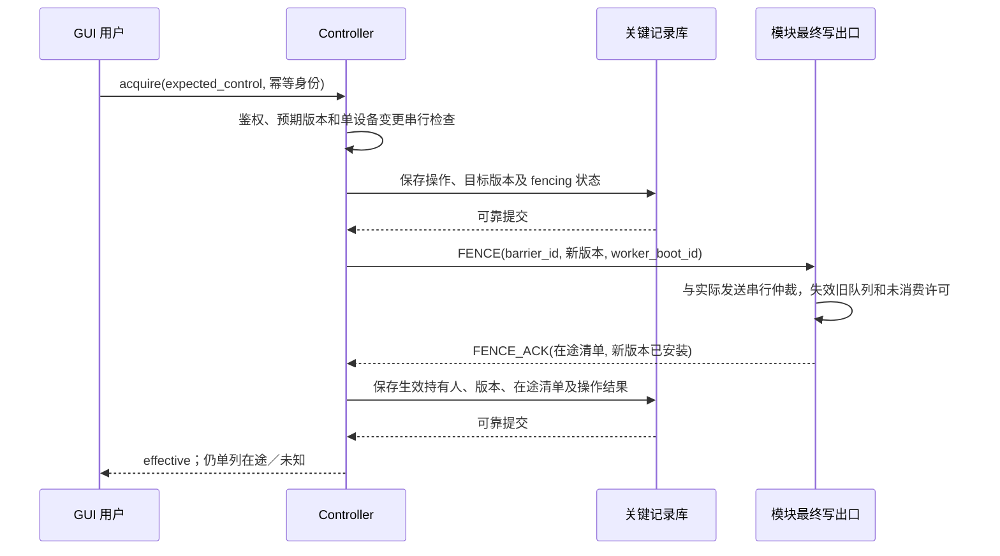

# 首个闭环 SDK/API、命令生命周期与接管契约

> 历史基线说明：本文保留 draft.2 当轮字段。用户已同意后续 F06／F07，当前归并规范为 [公共 draft.3／IPC 0.2](rebirth-draft3-review.md)；涉及新身份、证据、证明及恢复字段时以该版本及机器资料为准，不能混用两个预发布版本。

- 草案版本：`0.1.0-draft.2`，日期：2026-10-17；协议版本 `1.0.0-draft.2`。仅协议资料与离线验证工具，没有业务实现或设备验证。
- 用户已同意 draft.2 基线；[F02／F03 内部设计](rebirth-f02-f03-design.md)细化 IPC、唯一出口及持久化，内部协议独立版本化，本文公共协议不升版。
- 后续方案：用户已同意 F04／F05；[F06／F07 候选设计](rebirth-f06-f07-design.md)补充 OBS 证据顺序／目录身份、权威失败依赖证明及恢复消费字段。这些新增要求等待下一版公共协议归并，不改变本文件 draft.2 的机器基线；OBS 只读资料和离线向量不代表运行支持。
- 已确认依据：[Q1—Q72 设计登记](rebirth-design.md)、[契约包与验收清单](rebirth-readiness.md)。Q72 已确认转换／并行组设备动作全部必需，仅独立的简单顺序规则步骤可以按显式策略在明确失败后继续。
- 用户已同意首闭环推荐方案。本轮将字段、路径和枚举落实为 [可校验的预发布基线](contracts/README.md)，并在 [F01—F07 边界审阅](rebirth-contract-review.md) 登记技术细化与剩余证据。它不是稳定 API 或生产参数承诺；业务实现仍未授权。
- 首闭环范围：SDK 模拟器与隔离 OBS 场景，能力发现→GUI 手动→事件规则／状态机→Controller 派发→新证据核实→状态提交；包含独立 Controller、身份、SQLite、时间质量、接管及重启负向路径。其他模块完整功能继续保留。

## 1. 契约所有权与共用格式

SDK 拥有公共数据模型、错误码、客户端及契约测试设计；Controller 拥有设备与命令的权威记录；Seamer 拥有规则、运行、排期及业务状态；GUI 仅调用公开 API，Suite 固定兼容组合。当前草案暂在 Suite 审阅，冻结后由 SDK 按版本发布规范，避免多仓各自复制修改。

建议 SDK 分为 `contracts`（模型／校验）、`client`（HTTP／订阅）、`controller-module`（工作进程接口）、`seamer-provider`（能力／事件提供者）、`testkit`（模拟器与契约夹具）。这是职责划分，包名、语言工具链及发布作用域尚未选定；不新增中心服务。

| 类型／约定 | 具体定义 |
| --- | --- |
| `Id` | 服务生成的不透明字符串，1—128 个 ASCII 字母、数字、`.`、`_`、`-`；显示名称、IP 和数组下标不能代替身份。示例为合成值 |
| `Revision` | 十进制非负整数字符串，如 `"42"`，避免跨语言整数精度问题；只在所属对象／世代内比较 |
| `Timestamp` | UTC 字符串 `YYYY-MM-DDTHH:mm:ss.SSSZ`；未知发生时间为 `null`，不得拿接收时间伪造；时间质量另附 |
| 时长 | 整数毫秒，字段以 `_ms` 结尾；范围必须有上限。单调时钟值只用于本进程，不在网络上传递作跨机比较 |
| 版本 | `protocol_version: "1.0.0-draft.2"`；路径 `/api/v1` 为拟定主版本槽位，当前不宣称 v1 稳定；组件、能力、产物版本分别记录 |
| JSON | UTF-8，对象未知写字段拒绝；参数按固定 Schema 校验，禁止隐式字符串转数值及自动单位换算；只读扩展按协商忽略不影响既有语义的字段 |
| 空值 | 必填字段不得省略；表中标注可选的字段可省略；`null` 只在明确允许的字段使用。空列表不等于来源故障 |
| 身份 | 请求认证上下文决定 `principal_id`、`session_id`、权限与组织；请求体内自报角色无效。GUI 不持有设备秘密、服务签发私钥 |
| 共用响应 | `request_id`、`service_id`、`service_boot_id`、`protocol_version`、`data`；错误为 `error` 替代 `data`。请求跟踪 ID 不充当幂等键 |

`ClockStatus` 字段：`status`=`synchronized|degraded|unsynchronized`，`source_ref`（配置引用，不公开内部地址）、`sampled_at`、`offset_ms`、`uncertainty_ms`（未能估计则 `null`）、`sample_age_ms`、`policy_revision`。质量阈值由发布配置给出；不合格仅阻断依赖绝对时间的操作。认证有效期按身份契约校验，不复用业务 NTP 偏移。

## 2. 首闭环端点与访问范围

下表为拟定路径，各服务各自提供 `/api/v1`，Suite 反向代理前缀不改变协议。所有写请求均鉴权；“读取”也按目标范围过滤。异步操作的 `202` 只表示可靠受理，不表示设备完成或控制权已经生效。

| 服务 | 方法／路径 | 权限与响应要点 |
| --- | --- | --- |
| 共用 | `GET /api/v1/meta` | 版本、特性、支持能力与公开限额；不返回秘密 |
| 共用 | `GET /api/v1/clock` | `ClockStatus`，需状态读取权限 |
| 共用 | `GET /api/v1/session` | 当前主体、授权版本、有效范围，不能用提交用户 ID 切换身份 |
| 共用 | `POST /api/v1/request-contexts` | 给当前主体签发有界请求世代，供设备命令和控制权操作防重放 |
| Controller | `GET /api/v1/devices`、`GET /api/v1/devices/{device_id}/capabilities` | 授权设备与目录；列表返回 `items,next_cursor`，游标失效要求重取，不混合目录修订 |
| Controller | `GET /api/v1/devices/{device_id}/state` | 最新观测、质量、目录及状态修订；不是动作完成证明 |
| Controller | `POST /api/v1/commands` | `device.command`；新命令 `202`，相同有效身份已有命令 `200`，返回执行记录及查询地址 |
| Controller | `GET /api/v1/commands/{command_id}` | 授权查询生命周期、证据、取消及迟到核对结果 |
| Controller | `POST /api/v1/commands/{command_id}/cancel` | 受权取消；未发可确认取消，已发按能力，返回取消操作受理不能伪报设备停止 |
| Controller | `GET /api/v1/control-operations/{operation_id}` | 控制权操作进度与生效证据 |
| Controller | `GET /api/v1/devices/{device_id}/control` | 当前及待生效控制权、在途和阻止原因 |
| Controller | `POST /api/v1/devices/{device_id}/control/acquire` | 当前用户取得控制；强制接管另需 `control.emergency`；`202` 返回操作 ID |
| Controller | `POST /api/v1/devices/{device_id}/control/transfers` | 持有人创建转交邀请，目标用户和有效期固定；不立即改变控制权 |
| Controller | `POST /api/v1/devices/{device_id}/control/transfers/{transfer_id}/accept` | 仅目标用户接受，复核原控制版本；进入屏障后才可生效 |
| Controller | `POST /api/v1/devices/{device_id}/control/release` | 持有人或专门授权者释放；走新版本及屏障，不恢复旧自动化 |
| Controller | `PUT /api/v1/run-grants/{grant_id}` | 已配对 Seamer 提交批准运行范围／版本，Controller 在自身授权交集内登记，不能自授设备权限 |
| Controller | `POST /api/v1/run-grants/{grant_id}/revoke` | 停止该授权的新派发并失效待发；响应区分受理与最终出口已应用 |
| 共用 | `POST /api/v1/subscriptions`、`GET /api/v1/subscriptions/{subscription_id}/snapshot`、`GET /api/v1/events`（WS） | 建立范围受限的快照与增量；WS 会话鉴权及订阅绑定，禁止在 URL 放长期令牌 |
| Seamer | `PUT /api/v1/providers/{provider_id}/catalog` | 已配对提供者写自己的能力目录；预期修订校验，身份不按自报 ID 信任 |
| Seamer | `POST /api/v1/providers/{provider_id}/events` | 有界关键事件入口；可靠受理后才返回确认，重复事件仅返回既有摄取结果 |
| Seamer | `POST /api/v1/definitions`、`PUT /api/v1/definitions/{definition_id}/draft` | 创建／更新草稿，修改必带 `expected_revision`，不影响运行版本 |
| Seamer | `POST /api/v1/definitions/{definition_id}/publish` | 校验草稿后生成不可变 `definition_version`，包括 Q72 依赖证明 |
| Seamer | `POST /api/v1/runs`、`GET /api/v1/runs/{run_id}` | 固定定义版本创建未布防实例；查询业务、转换和设备观测分别返回 |
| Seamer | `POST /api/v1/runs/{run_id}/preflight`、`.../arm`、`.../pause` | 只读预检、显式布防、暂停及撤销运行授权；各目标 Controller 应用状态可查 |
| Seamer | `POST /api/v1/runs/{run_id}/recovery-preview`、`.../resume` | 只读恢复预览；恢复必须携带当前修订及预览摘要，现状变动重新预览，不重放成功步 |

初始化、配对和登录的具体认证协议仍由 C07 专项冻结，本表定义其输出和业务权限输入，不发明自制密码算法。首闭环不得跳过这些入口的真实鉴权。所有非幂等管理操作也须持久化操作身份；草稿使用修订控制，运行创建、发布、布防／恢复和取消使用第 4 节的请求世代与幂等规则。

## 3. 能力、事件与首个 OBS 映射

### 3.1 能力目录

`CapabilityCatalog` 必填：`provider_id`、`provider_boot_id`、`catalog_revision`、`module_id`、`module_version`、`devices[]`。每台设备有 `device_id`、`device_kind`、`display_name`、`connection_state`、`actions[]`、`triggers[]`、`state_schema`；秘密只存在 Controller 凭据存储，不在目录中。

| `ActionDescriptor` 字段 | 类型／语义 |
| --- | --- |
| `action_id, capability_version` | 稳定动作 ID 及独立契约版本 |
| `parameters_schema, result_schema` | 采用 JSON Schema 2020-12 文档；固定摘要引用，发布目录可内嵌，禁止客户端自动抓取任意远程 Schema |
| `resources[]` | 明确冲突资源，如 `device/obs-test/program`；缺失范围按整台冲突，不能因此变为细粒度接管 |
| `completion.supported[]` | `sent|acknowledged|effect_verified`；只能选模块有证据支持的等级，不代表三者天然等价 |
| `completion.default, completion.evidence_policy_id` | 默认等级及固定证据规则；无反馈的显式降级记入批准定义，不由运行时悄悄降级 |
| `cancel.mode` | `before_dispatch_only|cooperative`，后者附取消确认标准；杀进程不是取消设备效果 |
| `retry.mode` | `never|conditional`；条件模式附错误白名单、安全条件及预算，默认 `never` |
| `preconditions_schema, read_set[], write_set[]` | 动作所需前提和效果影响集合；未知为显式 `unknown`，不能作为无依赖的证明 |
| `evidence_timeout_ms, limits_profile` | 默认观测时限及限额配置引用，批准定义可在允许范围内收紧 |
| `platforms[], dependencies[]` | 实测／未测平台与外部依赖；目录存在不等于目标实例已就绪 |

`TriggerDescriptor` 必填：`trigger_id`、`capability_version`、`payload_schema`、`delivery_semantics`=`discrete|sampled`、`time_requirement`=`relative_age|trusted_utc`、`max_age_ms`、`causation_support`。采样触发声明采样／聚合语义，不能把 GUI 降频数据当完整事件源。

### 3.2 事件与观测

`EventEnvelope` 必填：`event_id, provider_id, provider_boot_id, source_sequence, trigger_id, capability_version, device_id, occurred_at, observed_at, clock, payload`；可选 `causation_command_id`，无证据则省略。`occurred_at` 可为 `null`。`source_sequence` 为当前来源启动世代内的 Revision，重传保持事件身份及序号。Seamer 另记 `ingest_id, received_at, receive_sequence, age_at_admission_ms, validity_basis`，不信任提供者修改服务接收顺序。

`Observation`：`observation_id, device_id, provider_boot_id, device_session_id, state_revision, observed_at, clock, freshness_ms, values, integrity`。`integrity`=`complete|gap|unavailable`。`freshness_ms` 由观测拥有者计算并由接收端追加本地等待时间；跨服务无法证明上游年龄时不伪报新鲜。不同会话旧缓存不得核实本次命令。

相对事件时效使用连接世代、可证明的来源年龄与本地等待；不能在重传时把年龄清零。无法给出上游年龄的安全上界则拒绝相关时敏触发，普通非时敏观测仍可更新。绝对排期使用受信业务 UTC 及质量，两个主机的单调计数不得直接比较。

### 3.3 OBS 首模块示例

官方协议提供 `GetSceneList`、`SetCurrentProgramScene`、`GetCurrentProgramScene` 和 `CurrentProgramSceneChanged`；请求应答可用请求 ID 关联，场景事件不是本项目命令的因果证明。（来源：[OBS WebSocket 官方协议](https://raw.githubusercontent.com/obsproject/obs-websocket/refs/heads/master/docs/generated/protocol.md)，此前设计轮次核查；发布时须固定实际测试版本。）

项目映射草案：`obs.program_scene.set` 的参数为 `scene_ref`（含 `collection_ref, scene_id, catalog_revision`），结果为核实的 `scene_ref`；冲突资源 `device/{device_id}/program`，默认 `effect_verified`、`cancel=before_dispatch_only`、`retry=never`。能力 `obs.program_scene.changed` 提供变更事件；按可用协议 UUID 建立稳定映射，缺失稳定身份或场景集合改变须明确失效，禁止按同名自动改绑。

首闭环采用合成场景 A／B、可观察切换及隔离输出。成功要求请求成功应答加同连接中**请求应答后发起的新查询**确认目标，保存查询身份／观测；事件用于状态更新及触发，不单靠事件猜测请求成功。发送前已经是目标仍须新查询，不用缓存；超时后查询相同场景只证明当前状态，不能在无请求结果时证明先前命令成功。视觉输出另验，不等同场景选择已核实。此选择不表示软件能够阻止 OBS 原生面板的外部变化。

## 4. 命令字段、幂等与错误

### 4.1 请求世代与接收去重

`RequestContext`：`context_id, service_id, principal_id, audience, issued_at, expires_at, ttl_ms, max_unique_requests, context_epoch`。由目标服务签发并持久化，主体／服务／操作范围绑定；客户端只提交引用。服务以自身可靠计时判断存活，普通重启保守关闭旧上下文；同库已受理记录仍可授权查询。备份恢复必须更换 `context_epoch`。

幂等域为 `(service_id, context_epoch, context_id, principal_id, idempotency_key, operation)`；键1—128字符。同域同规范化内容只返回旧执行，同域不同内容返回 `IDEMPOTENCY_CONFLICT`。先鉴权，再查已有身份，再判断新受理资格；已过期上下文已有记录只读返回，记录已清理返回 `REQUEST_EXPIRED`，不能新执行。当前仍可受理的上下文不得清理其去重摘要；达到键数上限拒绝新键，不能逐出旧键。上下文关闭且受理期结束后才可清理防重放摘要；在途、未知及必要审计另有保留规则。

内容规范化采用 RFC 8785 JCS＋SHA-256 的预发布基线：先校验原始 JSON、Schema 和固定版本能力，再补齐已批准默认值并形成内容投影。排除顶层上下文／幂等键及跟踪 ID，保留业务参数、数组顺序和 Unicode 原字符；不隐式转换类型。具体规则和 Python／Node 固定向量见 [契约说明](contracts/README.md)。当前仅验证已列向量，不声称所有语言及数值边界均完成兼容测试。

### 4.2 `CommandRequest`

| 字段 | 必填性／类型／检查 |
| --- | --- |
| `context_id, idempotency_key` | 必填；使用上面的受控请求身份 |
| `device_id, action_id, capability_version` | 必填；匹配目录和当前主体授权 |
| `parameters` | 必填对象；动作 Schema 完整校验 |
| `expected_control` | 必填 `{epoch:Id,version:Revision}`；不是认证凭据，过时拒绝，不自动换为最新重试 |
| `origin` | 必填 `manual|automation`；服务器按身份／授权核实，不能伪装 manual 绕过布防 |
| `run_binding` | automation 必填 `{run_id,definition_version,grant_id,grant_revision,arm_generation,step_id,logical_action_id}`；manual 禁止填写 |
| `required_completion` | 必填能力支持的等级；与批准定义一致，降级必须显式重新批准 |
| `preconditions` | 必填数组，可为空；内容为 Schema 定义的谓词及观测新鲜度要求，不允许任意执行脚本 |
| `dispatch` | 必填 `{mode:"immediate",max_queue_ms}` 或 `{mode:"scheduled",occurrence_id,not_before,not_after,clock_policy_revision,max_queue_ms}`；客户端不能延长批准窗口 |
| `evidence_timeout_ms` | 必填有限时长，在能力及服务允许范围内；不是设备取消超时 |
| `correlation_id` | 可选追踪身份；不充当命令幂等键或授权 |

`principal_id, session_id, authorization_revision, accepted_at, command_id, content_digest, attempt_id, device_session_id` 由服务补齐，不允许请求体覆盖。收到 manual 时验证当前控制权：已有他人持有则拒绝；无人持有时先完成显式接管，再允许该用户写设备；不在 `POST /commands` 中隐式抢占。这是首闭环 GUI 操作步骤草案，兼容已确认的手动优先和独立模式。

```json
{
  "context_id": "ctx-demo-1",
  "idempotency_key": "click-demo-1",
  "device_id": "obs-test",
  "action_id": "obs.program_scene.set",
  "capability_version": "1.0.0-draft.2",
  "parameters": {
    "scene_ref": {"collection_ref": "collection-test", "scene_id": "scene-b", "catalog_revision": "3"}
  },
  "expected_control": {"epoch": "control-demo", "version": "8"},
  "origin": "manual",
  "required_completion": "effect_verified",
  "preconditions": [],
  "dispatch": {"mode": "immediate", "max_queue_ms": 2000},
  "evidence_timeout_ms": 5000
}
```

数值仅是模拟夹具，不是生产性能承诺。上例的控制版本必须来自已生效接管，不能直接复制为实际设备授权。

`max_queue_ms` 从 Controller 受理起按本地单调计时累计，不因重试或资源等待重置；排期长时间等待由 Seamer 管理，不能把远期命令提前塞进 Controller 延长期限。需要取消的旧请求不因改变请求上下文而获得新的时间预算。

### 4.3 `CommandRecord` 与完成证据

记录必填 `command_id, revision, request_identity, content_digest, target, actor, origin, accepted_at, phase, outcome, effect_status, cancellation, completion, attempts[], dispatch, control_binding, automation_continuation, reason_code`。其中：

draft.2 增补必填 `resource_status,resource_evidence_ids,retry_policy`（无条件重试时为 null），automation 记录另需 run_binding。完整类型与条件约束以机器契约为准；失败／未知／取消／过期／阻止须有稳定 reason_code。

- `phase`=`queued|dispatching|awaiting_evidence|finished`；`outcome`=`pending|succeeded|failed|unknown|cancelled|expired|blocked`。
- `effect_status`=`not_sent|possible|acknowledged|verified|partial`，与 outcome 分离；明确失败也可能已有部分副作用。新增 `resource_status=held|clear|unresolved` 与 `resource_evidence_ids[]`；完成不等于资源可再写，非明确未发送的 clear 必须有资源释放证据，unknown 保持 unresolved。
- `attempts[]` 记录 `attempt_id, worker_boot_id, device_session_id, dispatch_intent_id, send_started_at, protocol_request_id, evidence_ids[]`；时间未知为 `null`，不得推断未发送。
- `completion` 含 `required, achieved, evidence_policy_id, evidence_ids[]`；`achieved` 可 `null`，支持的 `sent` 只代表模块确认协议提交，不保证设备收包；HTTP 受理不属于 sent。
- `cancellation` 含 `status:none|requested|confirmed|unsupported|failed`、`operation_id`（无请求时 `null`）、`reason_code`。取消受理不是 outcome=cancelled。
- `automation_continuation`=`eligible|paused_latched`；接管、未知、故障或门控失效后置暂停锁存，迟到证据不得清除。
- `resolution` 可选 `{revision,resolved_outcome,evidence_ids,resolved_at,resolver}`；迟到事实追加此对象及审计，不重写已发给调用方的初始终止结果，不自动复活步骤。

`CompletionEvidence`：`evidence_id, command_id, attempt_id, kind, worker_boot_id, device_session_id, observation_id, protocol_request_id, captured_at, clock, predicate_id, predicate_result, durable`。不适用引用允许 `null`；`kind`=`transport_submission|device_ack|fresh_query|device_event|cancel_ack`。验证器必须核对会话、请求关联、采集先后及证据规则，旧快照和仅相同值不足以证明因果。关键证据落库失败不发布可靠完成，开启 Q52 停写；保留可观测的存储故障，恢复后重新核对。

### 4.4 拒绝和故障响应

错误对象固定 `code, message_key, request_id, details, existing_command_id, retry_advice`，后二者可 `null`；文本本地化不改变 code。`retry_advice` 仅诊断，绝不授权自动设备重发。

| HTTP 候选 | 原因码示例 | 是否新受理设备命令 |
| --- | --- | --- |
| 400／422 | `INVALID_REQUEST`、`UNKNOWN_WRITE_FIELD`、`UNSUPPORTED_COMPLETION`、`INVALID_CONTINUE_POLICY` | 否 |
| 401／403 | `AUTH_REQUIRED`、`PERMISSION_DENIED`、`GRANT_REVOKED` | 否；已受理后撤权则命令记录为 blocked 或在途继续观察 |
| 409 | `REVISION_CONFLICT`、`IDEMPOTENCY_CONFLICT`、`CONTROL_VERSION_MISMATCH`、`CONTROL_NOT_EFFECTIVE`、`DEVICE_IN_FLIGHT` | 否；返回可公开的当前修订，不泄露他人命令详情 |
| 410 | `REQUEST_EXPIRED`、`REQUEST_EPOCH_RETIRED` | 否；不可新键重包装旧执行 |
| 429 | `CAPACITY_EXCEEDED` | 否；保护请求使用独立有界配额 |
| 503 | `CRITICAL_STORAGE_UNAVAILABLE`、`WORKER_NOT_READY`、`CLOCK_UNTRUSTED` | 否；时钟错误只适用需要可信时间的命令 |

网络断开、代理超时及一般 5xx 可能丢失受理响应，客户端必须按原上下文／幂等键查询或重复提交原请求以定位记录，不能换新身份重发。服务已受理后发生的门控失败写入记录并发事件，不能再伪装为从未受理的 HTTP 拒绝。响应 `202` 前，命令、身份摘要和所需审计必须同事务可靠保存；失败不得向工作进程投递。

## 5. 命令状态转换与 Q72

### 5.1 允许的转换

| 当前状态 | 触发与必须满足的条件 | 新状态及副作用 |
| --- | --- | --- |
| 尚未受理 | 鉴权、参数、版本、额度及请求身份通过，关键事务提交 | `queued/pending/not_sent`；返回 202，不代表已发送 |
| `queued` | 主动取消且出口确认未发送 | `finished/cancelled/not_sent` |
| `queued` | 本地排队期限／排期截止已过 | `finished/expired/not_sent` |
| `queued` | 接管版本、授权、布防、前提或维护门控失效 | `finished/blocked/not_sent`，流程暂停；不能按非必需步骤继续 |
| `queued` | 有界资源调度成功、最终发送条件通过、派发意图持久化并绑定单次许可 | `dispatching/pending/possible`；进入崩溃不确定区，不把 IPC 投递当发送 |
| `dispatching` | 出口消费单次许可、核对版本／启动身份／期限并提交一次协议写 | `awaiting_evidence/pending`；记录实际提交事实，尚不证明效果 |
| `dispatching` | 出口可证明尚未发送且许可已失效 | `finished/blocked` 或 `expired` 或 `cancelled`，`not_sent`；原因决定类别 |
| `dispatching` | 崩溃／超时，无法证明是否送出 | `finished/unknown/possible`，暂停锁存，不重新投递同许可 |
| `awaiting_evidence` | 达到批准完成标准，证据可靠落库 | `finished/succeeded`，effect 按实际证据，不自动假定视觉已完成 |
| `awaiting_evidence` | 当前尝试得到明确安全失败，批准的条件重试允许且预算／期限仍有效 | 结束该 attempt 的失败记录，命令保持 pending 回 queued；新 attempt 必须重新过全部门控，不能重用发送许可 |
| `awaiting_evidence` | 得到明确失败证据且无合法剩余重试 | `finished/failed`，保留 possible／partial 等实际副作用信息 |
| `awaiting_evidence` | 观测超时或连接丢失且缺乏确定结果 | `finished/unknown`，暂停锁存，不改成 failed 或 cancelled |
| `awaiting_evidence` | 模块支持取消且确认达成声明的取消标准 | `finished/cancelled`，保留已经发生的效果；若成功先确定，保持 succeeded 并记录取消已来不及 |
| 任意 finished | 重复提交／重复事件 | 返回既有记录，不能回 queued |
| `finished/unknown` 等 | 迟到有效证据或人工核对 | 追加 resolution／审计，保留原结论与暂停锁存；不能自行继续自动化 |

`retry=conditional` 的后续尝试使用同一 command_id／逻辑动作、新 `attempt_id`，前一次明确安全失败、预算尚有余量且全部门控再验证；命令尚未终结，不能把 finished 命令重新打开。`RetryPolicy` 为批准定义与能力的交集：`policy_id, allowed_error_codes[], safety_predicate_id, max_attempts, backoff_ms, total_budget_ms`；服务固定到 command 记录，用户命令体不得临时扩权。初次尝试也计入 max_attempts，等待计入总预算，不延长派发截止。首 OBS 映射没有自动重试；模拟器可验证有明确“设备拒绝且无副作用”证据的例外，不能把“设值通常幂等”当作自动许可。

同资源还有在途或未解决 unknown 时，手动写入也不能默默越过。明确设备停止／覆盖能力属于另一个受权动作；本 OBS 首场景不提供通用强制覆盖按钮。

表中“未发送”描述被停止的当前尝试。条件重试已存在前次尝试时，命令整体 effect_status 必须保留历史事实，不能因当前排队取消或超时把前次设备交互改记为从未发送。finished 后只能追加证据／resolution，不允许重新派发。

### 5.2 Seamer 运行、状态提交与失败继续

`RunRecord` 必填：`run_id, definition_id, definition_version, revision, business_state, transition, lifecycle, execution_summary, arm_generation, grant_bindings[], active_execution_id`；`lifecycle`=`disarmed|armed|running|paused|completed`，`execution_summary`=`pending|succeeded|completed_with_failures|failed|unknown|blocked`。`transition` 包含 `transition_id, from_state, to_state, stage, step_results[]`，stage=`validating|exit|transition|enter|committing|completed|failed|unknown`，无转换时 `null`。

转换先 validating，再 exit→transition→enter；所有必需步骤达到批准证据后，单 Seamer 事务更新业务状态、转换完成及待发布事件。事件发布通过持久待发送记录重试传输，事件 ID 不变；不得重跑设备动作来修复事件发布失败。提交失败暂停并保留真实设备状态，恢复核对，不把设备效果回滚到旧业务状态。

Seamer 在发 HTTP 前持久保存 step 与命令请求身份、内容摘要和发送意图；丢失响应仅以原身份核对 Controller，不换新键重发。Seamer 重启后不自动续发保存的命令意图，先按原身份查询并核对，未发／未知／已成功分别展示；Controller 返回 succeeded 但 Seamer 本地结果尚未写入时也不能再执行一步来补记录。运行提交、恢复预览及其消费用 revision 比较，阻止两个 GUI 同时恢复同一实例。

`StepDefinition`：`step_id, action_ref, parameters, required, on_failure, depends_on[], preconditions, completion, deadlines`。转换及并行组只能 `required=true,on_failure=stop`；发布时拒绝其他组合。简单顺序规则可 `required=false,on_failure=continue_if_independent`，但需固定能力 read/write 集合，失败步骤效果不能影响后继参数、守卫、资源前提或目标要求；未知集合、动态未证明引用、同资源未决影响均拒绝。记录 `independence_proof_revision` 绑定能力目录与定义版本；能力变化使证明失效，不能沿用。

只有 outcome=failed 且可证明后继安全时可继续；blocked／expired／unknown／接管／撤权等不能“转成失败”放行。运行保留每步失败，最终为 `completed_with_failures` 的执行总结，不是全部成功；该总结与 `lifecycle=completed` 分开。人工校正业务状态另立审计操作，不改写旧 step_results。

布防记录：`run_id, definition_version, approval_id, arm_generation, grants[]`。Controller 的 `RunGrant` 含 `grant_id, revision, run_id, definition_version, arm_generation, principal_id, device_actions[], parameter_constraints, validity, state`；state=`active|revoking|revoked|expired`。每个目标显式确认授权后才显示布防完成。暂停先停 Seamer 新触发，再向各 Controller 撤销并取得出口应用确认，显示逐目标 pending／applied；不能承诺跨服务瞬时原子暂停。Controller 在新派发前检查本地已应用的最新授权和有效期，失联超过有效期拒绝写入；撤销传播窗口 F04 必须冻结。

draft.2 的请求使用 `GrantProposal`，提交批准引用及所需范围；不得自填 RunGrant 的 principal_id、revision、state，服务依据已验证身份／批准范围生成。运行级 `GrantBinding` 只含 controller_id、grant_id、grant_revision、arm_generation、application_state，与命令级带 step_id 的 RunBinding 分开。布防成功不得混有未应用目标；Schema能拒绝明显不一致组合，目标集合是否完整仍需运行时核对。

## 6. 接管、转交及释放的时序

### 6.1 数据结构与确认语义

`ControlRecord`：`device_id, revision, control_epoch, effective_version, effective_holder_id, mode, pending_change, gate_state, in_flight_command_ids[], unresolved_command_ids[]`。

- `mode=automatic|manual`，automatic 只代表无人工接管，不代表 Seamer 已布防。
- `gate_state=ready|fencing|protected`；fencing 和 protected 阻止主服务新写命令受理。旧许可是否已发送以最终出口的屏障顺序为准，不能宣称主服务写入 pending 的瞬间远端队列已停。只读和尽力观察在途继续。
- `pending_change` 可为 null，否则包含 `operation_id, target_version, target_holder_id, target_mode, reason, requested_by`。未生效目标不显示为已可操作持有人。
- `ControlOperation`：`operation_id, request_identity, expected_control, state, barrier_id, target, worker_boot_id, in_flight_snapshot, applied_revision, failure_code`；state=`pending|effective|rejected|indeterminate`。indeterminate 不等于回退成功。
- draft.2 细化：操作还必填 `device_id,controller_boot_id,unresolved_snapshot,barrier_ack,effective_record_durable`；effective 要求匹配原操作、设备、两个进程启动身份、控制世代及版本的完整 ACK，且最终事务可靠提交。在途与未知清单均不得遗漏；`indeterminate` 可凭同操作完整证据核对为 effective，但不能复活旧命令。
- 操作输入含 `context_id,idempotency_key,expected_control,reason`；acquire 的 `force` 默认 false；转交另含 `target_principal_id,offer_ttl_ms`，accept 绑定 `transfer_id`；释放无权清除其他人的接管。
- `control_epoch` 在备份恢复时换新，普通重启保留并先核对记录；版本严格增加。pending 变更不可并行覆盖，竞争返回 409。

### 6.2 取得接管的顺序



期间 HTTP 可以先返回 `202 pending`，GUI 必须等待 GET／事件中的 effective。旧命令只有两种归属：出口发送先发生→记为在途；屏障先发生→旧许可不得发送。主服务的 pending 提交不冒充出口已确认；收到屏障前的实际发送仍属于在途。出口 ACK 后至主服务最终持久化失败时保持 fencing／protected，不能开放新持有人写入；不得恢复旧队列。

屏障需要所有该设备写出口确认，模块内部定时器、自主写入、重连初始化、SDK 重试以及异步传输队列均在声明边界内。OBS 首模块禁止自主写及重连恢复预设。普通工作进程仅运行可信模块；本契约不能拦截恶意代码或设备原生客户端。

### 6.3 最终发送许可与进程故障

内部 `DispatchPermit`：`permit_id, command_id, attempt_id, dispatch_intent_id, controller_boot_id, worker_boot_id, device_session_id, control_epoch, control_version, authorization_revision, grant_revision, arm_generation, gate_revision, deadline_policy, content_digest`。仅经已鉴权 IPC 传递，不能由 GUI 创建。许可绑定本次进程与连接、只消费一次；模块出口以本地单调截止和必要 UTC 质量复核，不能把旧许可放入不受屏障控制的二次队列。

主服务先可靠保存 dispatch intent，出口在同设备串行入口安装版本、撤销和单次发送；实际协议提交前复核其当前已应用的门控版本。网络写可能只发送部分字节，任何“可能已交给传输层”的尝试均不能证明未发。接管仅能阻止尚未跨过此出口的动作，不承诺撤回网络／设备缓冲中的字节。

工作进程失联时不得根据超时假定它已停止写入。未收到屏障 ACK 就不报告接管成功；新进程接替前必须证明旧进程及旧写通道终止，无法证明则保持 protected，不启动第二个写入者。进程终止不证明此前设备动作已停止。启动身份变化使许可失效；重启只读连接／采集，已有 dispatch intent 无确定发送证据则进入 unknown 并核对，不复投。

### 6.4 转交、释放及失败分支

转交邀请创建／过期不变控制权；目标用户接受时重验权限、原持有人／版本和邀请有效性，走与接管相同的 pending→屏障→effective 流程。屏障前旧持有人已发送请求仍在途，之后旧版本未发请求失效；新持有人不能绕过相关在途／unknown。紧急接管增加权限与理由，仍走相同时序。

释放也生成新版本并作屏障，使旧持有人待发及旧自动化请求均失效。生效后 `mode=automatic,holder=null`，只解除人工限制，不重新布防、不恢复运行、不补排期。关闭页面、用户退出、会话过期及转交邀请过期都不等于释放。

| 故障点 | 必须表现 |
| --- | --- |
| 初始持久化失败 | 操作未生效，不发屏障；关键记录故障触发停写；原持有人不能因此自动释放 |
| pending 已写、屏障超时／worker 失联 | 返回／查询为 indeterminate，保持保护；不宣称新持有人已可写，按操作 ID核对 |
| ACK 丢失 | 幂等重查／重复同 barrier 只返回当前应用状态，不再执行设备动作 |
| ACK 后最终落库失败 | 仍保护；恢复时核对同 barrier 与控制记录，不回滚版本或复活旧命令 |
| 客户端在有效提交后失去响应 | 同操作身份查询得到同一结果，不新建接管来猜测是否成功 |
| 旧进程迟到结果 | 仅按原 command／attempt／会话追加证据；不能确认新 barrier 或恢复自动化 |

## 7. 快照、增量及服务到服务边界

订阅请求 `scope, event_types[], resume_cursor?`；服务返回 `subscription_id, stream_id, snapshot_id, snapshot_cursor, expires_in_ms`。`stream_id` 是持久事件日志世代，不等于进程启动 ID；恢复旧库后换新。服务在同一受控边界固定关键状态快照和日志水位，并为该订阅缓冲水位后的有界增量。快照分块使用固定 snapshot_id，不能拼接不同时刻片段。

WS 帧：`subscription_id, stream_id, cursor, event_type, entity_id, entity_revision, payload`。客户端从 snapshot_cursor 之后消费；cursor 在订阅内连续或由服务显式给出前驱，不因权限过滤产生假间隙。buffer 超限或游标过期返回 `RESYNC_REQUIRED`，不能假装连续。GUI 显示失步重取；Seamer 丢失依赖完整性则暂停相关运行，快照只更新状态，不重放缺口动作。断线恢复即使重传日志也不恢复已失去执行资格的场次。

Controller→Seamer 先以配对身份发布目录，再输送事件／观测，投递确认只代表 Seamer 已可靠摄取；不代表规则执行成功。Seamer→Controller 只有受权 CommandRequest；模块不能通过自报 trigger 或伪 origin 提权。所有关键结果以 Controller 查询记录为准，WebSocket 是通知，通知丢失可查，不允许 GUI 本地推算成功。

## 8. 首闭环实验配置与待冻结数值

建议先使用名为 `sim-first-loop` 的测试配置：`max_queue_ms=2000`、`evidence_timeout_ms=5000`、`fence_wait_ms=3000`、每设备普通待发上限16、单主体每上下文最多256个新键、上下文 TTL 60秒、JSON 请求上限64 KiB。它们只用于可重复的故障注入，不是生产默认值或吞吐／延迟保证；保护请求独立配额，不能被普通队列耗尽。

生产冻结表必须包含：所有队列／订阅／上下文总量上限、上下文签发限流、控制保护配额、证据与日志保留、工作进程失联检测、授权有效期／撤销传播窗口、NTP 质量阈值及绝对窗口、OBS 查询预算。不能只限制单个请求而允许无限上下文或订阅；容量耗尽在受理前拒绝，保留旧记录。

## 9. 可执行验收用例设计

以下均未执行。测试夹具必须提供可计数的协议写出口、可暂停的 IPC／数据库提交点、虚拟时钟、可伪造迟到回执、按原身份查询的客户端；禁止以“接口返回成功”代替设备发送计数与记录断言。映射上轮 A01—A18，不另行宣称平台验收通过。

| 用例 | 前置与注入操作 | 必须断言 | 映射 |
| --- | --- | --- | --- |
| FC01 | 已接管、有权限；发送场景命令，成功应答后新查询匹配 | 一次设备写；queued→dispatching→awaiting_evidence→finished/succeeded；三类证据及最终事务齐全 | A01、A18 |
| FC02 | 同上下文／键／内容并发提交两次；再改参数提交 | 前两次同 command_id、设备写最多一次；改参数409，无新执行 | A02 |
| FC03 | 关闭／过期上下文并清理可清理详情；重送旧身份，另模拟旧备份世代 | 410或授权查询旧记录，设备写0；绝不按新命令受理；在途／unknown记录不可被清理 | A02、A16 |
| FC04 | 错版本、无权限、未知字段、超限或不支持证据等级 | 受理前明确拒绝，命令及设备写均0；不返回202 | A01、A14 |
| FC05 | 派发意图持久化前磁盘失败；另在完成证据落库时失败 | 前者设备写0；后者不报可靠完成、不重发，手动及自动新写均停，普通日志故障对照组不单独停控 | A16 |
| FC06 | 命令已投IPC，出口发送前暂停；取得接管并释放暂停 | barrier先到则旧设备写0，命令blocked；effective之后旧版本不能发送 | A03 |
| FC07 | 先跨过实际发送出口再接管，设备回执延迟 | 已发送计数1，接管effective仍列在途；新手动冲突写不越过，迟到成功不续跑 | A03、A06 |
| FC08 | pending落库后丢屏障ACK；另ACK后落库失败 | 不报effective，保持protected／fencing；同barrier核对无设备写，不回退版本 | A04 |
| FC09 | dispatch intent提交后杀worker，另在设备写后／结果落库前杀worker | 不能证明未发则unknown；重启发送计数不增加，旧启动身份不能消费许可 | A04 |
| FC10 | 取消尚未发送命令；再取消已发送且不支持取消的OBS命令 | 前者确认cancelled且写0；后者unsupported但命令仍观察，不伪报取消或杀设备效果 | A06 |
| FC11 | 模块应答成功但返回旧缓存；超时后新查询相同值但无原应答 | 缓存不能effect_verified；超时unknown，查询仅显示现状；不重发、不自动恢复 | A06、A18 |
| FC12 | 两用户同时申请／接受转交，旧用户待发命令在队列中 | 单一有效持有人，冲突409；接受生效使旧待发失效；邀请过期和退出不释放 | A03、A10 |
| FC13 | 等待中撤销会话／组织授权；Seamer暂停在一目标延迟应用 | 已应用目标禁止新派发；界面显示未全部应用；不宣称全局暂停；到期拒写、接管不消失 | A10 |
| FC14 | 释放接管后恢复授权／时间；仍有旧排期窗口及旧命令 | 控制版本改变；旧命令写0、旧场次不补；恢复需新预览及明确操作 | A03、A12 |
| FC15 | 状态转换任一退出／转换／进入步骤失败；发布含optional或continue的转换／并行组 | 运行暂停、业务状态未提交；非法定义发布拒绝，失败步骤不能标成功 | A05、A07 |
| FC16 | 简单顺序规则optional步骤确定失败且证明无后继影响；对照未知影响／unknown／blocked | 前者后继可执行、总结completed_with_failures；后三者禁止继续；更换能力版本使旧证明失效 | A05、A06 |
| FC17 | 并行组一成功、一失败、一在途、一未派发 | 未派发和后继写0，在途继续收集，成功不回滚；unknown阻恢复 | A07 |
| FC18 | 业务状态提交后、完成事件发出前崩溃 | 重启状态保持提交结果、同事件身份可重传，设备动作写次数不增加、自动化不自行续跑 | A05、A08 |
| FC19 | 快照边界并发更新，缓冲溢出、重复和旧来源事件；慢GUI对照 | 连续流无丢失窗口；溢出明确失步；Seamer依赖缺口停相关；GUI慢不拖住设备控制 | A08、A14 |
| FC20 | 绝对排期过窗／窗口内失去布防；NTP异常；普通手动对照且身份过期 | 排期写0且恢复不补；正常授权手动不因业务时钟独立受阻，身份过期仍拒绝；不跨机比较单调时钟 | A11、A12 |
| FC21 | 不启动Seamer，仅Controller+GUI；再运行完整套件 | 独立登录→显式接管→手动核实可走通；套件批准版本及受限授权生效，不用匿名捷径 | A09、A18 |
| FC22 | 旧worker失联但仍存活，尝试启动新writer／报告接管成功 | 无屏障或终止证明则保持保护，不双写、不报effective；终止也不把原在途当取消 | A04 |
| FC23 | OBS隔离A/B场景，手动一次，再一次受控模拟事件触发转换 | 协议写次数与运行对应，新的查询和视觉分别取证；场景回流不自激；不连接正式播出、不推流冒烟 | A13、A18 |
| FC24 | 模拟能力明确条件重试：第一次被设备拒绝且证明无副作用，第二次成功；对照未知、预算耗尽及等待中撤权 | 允许例保持同command_id并用新attempt／许可；对照不再写，最终正确终结；OBS默认仍只发一次 | A06 |

每例记录输入JSON、断点位置、提交顺序、实际设备写计数、最终GET与WS记录、业务状态及控制版本、证据文件；不能仅断言最终画面恰好相同。FC01／FC23需要另有明确设备操作授权，其余先以测试夹具实现，当前全部是测试设计。

## 10. 冻结前检查与尚未落实项

| ID | 冻结交付 | 当前状态 |
| --- | --- | --- |
| F01 | 将字段转为完整机器可校验的 Schema／OpenAPI，枚举、必填、null、大小限制、错误响应及正反例一致；幂等规范化跨语言向量 | 已交付可校验预发布基线、正反例及 Python／Node 固定向量并通过离线校验；完整客户端／代码生成及生产预算验证仍待做 |
| F02 | C03 IPC／屏障实现设计，证明唯一写出口、传输缓冲边界、worker失联及单写者接替；FC06—FC09、FC22夹具设计 | 已补13类内部IPC、完整intent账本、effective／ready时序、进程恢复及FT故障用例；真实IPC、进程与传输证明未完成 |
| F03 | C08 SQLite事务／耐久设置、上下文保留／世代轮换、故障恢复和事件待发送记录设计 | 已补WAL＋FULL、T1—T8事务、提交不确定核对、checkpoint与备份恢复设计；驱动／引擎构建及故障实验未完成 |
| F04 | C07身份认证、配对、签发／撤销协议，权限及运行授权时效，Controller到出口的应用确认时限 | [候选设计](rebirth-f04-f05-design.md)已补身份／快照、精确撤销屏障、WS票据与FA验收；候选模型和有限边界向量可校验，完整OpenAPI／IPC归并、库选型及传播实测未完成 |
| F05 | C06指定NTP后端、跨节点事件年龄证明、质量阈值及截止校验策略；生产容量／保留参数 | [候选设计](rebirth-f04-f05-design.md)已补UTC区间、代际锁存、事件年龄、分级容量、实验profile及TB验收；真实NTP、平台时钟与发布容量测量未完成 |
| F06 | OBS固定版本、场景身份映射／目录变化、证据验证器及完整旧能力矩阵 | SceneRef、首动作参数及动态参数二次校验已交付；模块实现、版本固定及软件实测未完成 |
| F07 | C04失败依赖证明规则、运行版本／恢复预览／批准摘要，定义Schema与状态转换负向矩阵 | Q72结构限制及负例已通过，运行级GrantBinding与步骤RunBinding分开；依赖证明和恢复并发尚需运行实现 |

以上余项是实现方需要完成的技术设计，不新增用户产品选择轮次；若验证暴露必须改变已确认行为，再单独呈现具体差异。用户已同意首闭环推荐方案，本轮可校验资料不等于稳定版冻结；文档校验也不等于运行验收，不解除暂不修改业务代码的限制。详细证据与剩余门槛见 [本轮边界审阅](rebirth-contract-review.md)。
